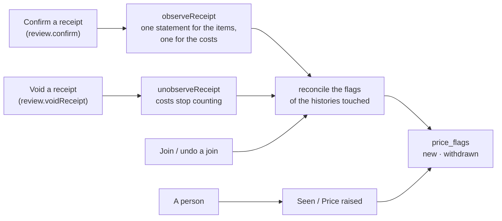

# Costs and price rises

> What each item costs from each supplier, kept from the receipts on the books,
> and a flag when a cost rises, so a manager can decide whether to raise a
> selling price. The app changes no price.

<!-- No screenshot: this screen exists only in the Operations app (ADR-0023), and the
     docs runtime (scripts/docs/runtime.js) runs the Apps Script server, which has no
     cost calls. Nothing in scripts/docs/screens.js can render it. -->

## What it does

Built in card P5-15, in the Operations app only (inside Apps Script the entry
does not exist). **More → Costs**, for admin, manager and payroll admin; an
employee sees nothing of it. One business at a time: the screen opens asking
*Choose a business* and makes no request until one is chosen (there is no
*both*; the two businesses' costs are never in one list).

**Price rises.** Chips for *New*, *Seen*, *Price raised* and *Withdrawn*, each
with its count; *New* is first. Each flag is one sentence:

> **Cola 12-pack** (CK12) from Fictional Wholesale Ltd: $6.00 → $6.72 each, up
> 12.0%, on the receipt of Nov 20

with how it came about (found by joining two items, found again after a void),
who last marked it, and the percentage it was flagged under. An admin or a
manager marks it **Seen** or **Price raised** (an optional note of up to 300
characters), or **Mark new again**; a payroll admin only reads. **History** opens
the item. A flag is for a person to act on at the till: nothing here writes to a
till or changes a receipt.

**Find an item** by supplier and part of its name or code (empty finds the
first 20). Each row shows the latest cost, its date and how many costs count;
*no cost recorded* when none does (never `$0.00`). Tapping an item opens its
**history**: the counted costs, oldest first, each with the date, the cost per
unit, whether it was printed or *worked out from the line total* (with the
total and quantity it came from), the invoice number and the line as that
receipt printed it, and *Up 12.5% on the cost before it* on the one that rose;
then, apart, the costs that are **not counted** (a voided receipt's) with why.
An admin or a manager also sees **This is the same item as…**: pick another of
the same supplier's items, give a reason (3 to 300 characters) and the two read
as one; the items read as one are listed with **Undo**.

**Work out costs for earlier receipts** (admin): receipts confirmed before this
card have no observations. The button observes every confirmed receipt that has
none, up to 200 at a time, and says how many receipts and lines it covered and
whether to run it again. Safe to run twice.

On the Receipts screen, after a **confirm** or a **void**, the result sheet also
says what happened to the cost history: *5 lines added to the cost history; 1
line with no cost (not guessed); 1 price rise flagged.* or *1 cost no longer
counted in the cost history; 1 flag withdrawn.*

## How it works

**What an item is.** A supplier's own line: the business, the supplier (a row of
`ops.suppliers`: a confirmed receipt always has one) and the supplier's printed
code for the line when there is one, otherwise the line's description, in the
repository's normal form (`normalise`: NFKC, lower case, no white space, no
dashes). The key is `c:` and the code, or `d:` and the description, so a code
`cola` and a description `cola` are different items. The item keeps the name and
code as first printed; each observation keeps the line's own words. It is **not**
a product: the app has no product list, never matches a line to one, and
does not compare the same goods across suppliers. See
[ADR-0030](../adr/0030-an-item-is-a-suppliers-own-line.md).

**When a cost is observed.** When a receipt is **confirmed**, one observation per
line that gives a unit cost *exactly*:

| The line | Result |
|---|---|
| a unit price is printed (above zero) | that is the cost, up to four decimals, as stored: *printed* |
| no unit price; a line total and a quantity, both above zero | total ÷ quantity, in integers (`total_cents × 100000 / quantity_thousandths` in ten-thousandths of a dollar), rounded half up to four decimals: *worked out* |
| anything else: no unit price and no total or no quantity; a quantity or total of zero or less (a return, a free item, a discount); a printed price of zero or less; a line with neither a code nor a description to identify it; a cost the column cannot hold | **no observation**: counted as *lines with no cost*, never stored as 0 and never guessed |

Costs are as printed, before tax; the observation also keeps the quantity, the
line total, whether the line was taxed, the receipt, line and date. Worked-out
costs are **not** rounded to cents: 10.00 for 3 is $3.3333, 0.01 for 8 is $0.0013
(half up). Receipts with no lines are observed too (nothing is added, and it
says so).

**The order.** By the receipt's **date**, then the receipt's **confirmation
time**, then its id and line. A receipt confirmed late takes its place: entering
an older receipt can create a flag between its neighbours, change one (the new
previous cost) or withdraw one. Two receipts of one date are ordered by when they
were confirmed.

**The flag rule.** An observation is flagged when its unit cost is **more than N
percent above the counted observation just before it**. N is the setting
`price_rise_flag_percent` (default 5; 0.1 to 500; up to two decimals), kept on
the observation when it is made. The comparison is exact and has no division:
with N in hundredths of a percent, `b` is more than N percent above `a` when

    b > a and (b − a) × 10000 > a × N_hundredths

in integers (BigInt). A fall raises nothing; an equal cost raises nothing; exactly
N percent is not more than N. The rise shown is `(b − a) × 1000 / a` tenths of a
percent, rounded half up, written to one decimal.

*Worked example.* The default is 5%. Receipts of Sep 20 and Oct 20 print Cola at
$6.00; the receipt of Nov 20 prints $6.72. Costs in ten-thousandths are 60000,
60000, 67200. Oct against Sep: `0 × 10000 > 60000 × 500` is false, no flag. Nov
against Oct: `7200 × 10000 = 72,000,000 > 60000 × 500 = 30,000,000`, so a **new**
flag: $6.00 → $6.72, up `7200 × 1000 / 60000 = 120` tenths = **12.0%**. A manager
marks it *Price raised* with a note. A fourth receipt at $6.72 compares 67200
against 67200: nothing. Had Nov printed $6.30 (5.0% exactly, `3000 × 10000 =
30,000,000`, not more than `30,000,000`), there is no flag; $6.31 is flagged.

**Flags are worked out from the history**, and reconciled with what is stored: a
flag that still holds (the same two observations) is left as it is with its
state; one that no longer holds is **withdrawn** (marked with why and when, and
kept, with who had marked it); a new one is written as *new*. Changing the
setting does not rewrite old flags: each observation keeps the percentage it was
made under, and reconciliation uses that.

**Joining.** An admin or a manager says two items of the **same business and
supplier** are the same: `rpcJoinItems { itemId, intoItemId, reason }`. The joined
item points at the one it was joined into; nothing moves and nothing is erased.
No chains: joining into an item that is itself joined, or joining an item that
others are joined into, is refused (and the database refuses it too). Their
histories read as one from then on, in order, so a flag can appear across the
join; flags are worked out again for the joined history and the answer says how
many were raised and withdrawn. `intoItemId: null` undoes it, with a reason;
the flags are worked out again for each side and the flags that rested on the
join are withdrawn (*unjoined*). Joins and un-joins are audited.

**Voiding.** `review.voidReceipt` calls `unobserveReceipt` inside its
transaction: the receipt's observations are marked not counted (*receipt voided*,
with the time), never removed; flags that rested on them are withdrawn; the
neighbours' flags are worked out again (so an older cost and a newer one may now
be compared). The redo is confirmed as a new receipt and observed afresh. If
observing or un-counting throws, the confirm or the void fails with it and
nothing is half done.

**Who.** Admin and manager read and act (mark flags, join and un-join); payroll
admin reads; an employee is refused every call (`FORBIDDEN`) and nobody without a
session gets anything (`NOT_LOGGED_IN`). **Work out costs for earlier receipts**
is for an admin only. Identity and role come from the session only: a planted
`role`, `actorId` or `business` changes nothing. Every call that reads takes a
business and refuses one that is not `cstore` or `vape`.

## Data

| Table | Reads | Writes |
|---|:-:|:-:|
| `ops.supplier_items` | ✓ | ✓ (add; the join columns only) |
| `ops.item_costs` | ✓ | ✓ (add; *counted*, why and when only) |
| `ops.receipt_observations` | ✓ | ✓ (add; when it was un-counted only) |
| `ops.price_flags` | ✓ | ✓ (add; the state, who, when, note, and withdrawn reason and time only) |
| `ops.purchase_receipts`, `ops.purchase_receipt_lines`, `ops.suppliers` | ✓ | |
| `ops.audit_log` | | ✓ |
| `ops.config` | `price_rise_flag_percent` | |

The four tables come from `ops/migrations/0016_cost_history.sql`; they are the
Operations app's own (no Sheet tab feeds them), are in `LATER_OPS_TABLES` in
`ops/src/cutover/compare.ts` (the cutover tools neither load nor compare them),
and are copied by the nightly copy like every table. The app's database role has
no right to remove a row from any of them or to change a figure on one. A
withdrawn flag cannot change (trigger `price_flags_final`); a chain of joins is
refused (trigger `supplier_items_no_chain`); a join stays within one business
and supplier (a composite foreign key). No migration writes data: the catch-up
is the page's button.

`receipt_observations` is the one small table beyond the three the card named:
one row per observed receipt (a receipt with no lines or with only no-cost lines
has no cost row, so without it the catch-up could not tell it had been done).

## Rules it must not break

- **A cost that cannot be known exactly is absent**
  ([ADR-0004](../adr/0004-blank-is-not-zero.md), hard rule 1): never 0, never
  guessed, never shown as `$0.00`; `unit_cost > 0` is a check on the table.
- **The comparison is exact**: integers, no floats, no division
  ([ADR-0030](../adr/0030-an-item-is-a-suppliers-own-line.md)). Money rounding is
  half up and happens once, at the cost.
- **Nothing is deleted** (hard rule 9): observations stop counting, flags are
  withdrawn, joins are undone; nothing in `costs.ts` removes a row and the role
  cannot.
- **The two businesses are never mixed**: an item belongs to one business and
  supplier; every list is for one business, asked for with one.
- **The order is by receipt date**, not by when a receipt was confirmed.
- **Nothing here changes a price, a receipt or sends a message.**
- **Roles and the person from the session only** (hard rule 5).
- **No statement per line**: one for the items and one for the costs of a
  receipt, so the cost of a confirm does not grow with its lines.
- **A failure to observe fails the confirm** (and a failure to un-count fails the
  void) as a whole.

## Code map

| What | Where |
|---|---|
| The pure parts | `ops/src/receipts/costs.ts`: `itemKey`, `unitCostOf`, `isMoreThanPercentAbove`, `riseTenths`, `flagsOfHistory`, `thresholdHundredths`, `costText`, `tenthsText` |
| Writing | `ops/src/receipts/costs.ts`: `observeReceipt`, `unobserveReceipt` (called by `confirm` and `voidReceipt` in `review.ts`), `observeEarlierReceipts`, `setFlagState`, `joinItems`, and the private `reconcile` |
| Reading | `ops/src/receipts/costs.ts`: `getPriceFlags`, `findItems`, `getItemCosts` |
| RPCs | `ops/src/rpc/handlers/receipts.ts`: `rpcGetPriceFlags`, `rpcSetPriceFlag`, `rpcGetItemCosts`, `rpcFindItems`, `rpcJoinItems`, `rpcObserveEarlierReceipts`; listed in `ops/contracts/rpc-ops.json`; `rpcConfirmReceipt` and `rpcVoidReceipt` answer a `costs` summary |
| Tables | `ops/migrations/0016_cost_history.sql` |
| Setting | `price_rise_flag_percent` in `ops/src/lib/config-keys.ts` (`OPS_ONLY_KEYS`) and `ops/src/modules/settings.ts` (group *Other*) |
| UI | `src/Index.html`: `loadCostsTab`, `loadCostFlags_`, `drawCostFlags_`, `costFlagSentence_`, `openCostRaisedSheet_`, `drawCostFind_`, `loadCostItems_`, `openCostItem_`, `drawCostItem_`, `drawCostJoinPicker_`, `askCostReason_`; the `costs` entry of `MORE_ITEMS` (`opsOnly`); the two result lines in the confirm and void sheets |

## Tests

| Suite | Holds down |
|---|---|
| `ops/test/costs.test.ts` | the pure parts as tables (the item key: code over description, spacing and case, a blank code, dashes; the unit cost: printed, worked out with rounding at the half, quantity 0, negative, blank, a total beyond 2^53, a 3-decimal quantity, a 4-decimal price; "more than N percent" at exactly N, a hair over and under for N of 0.1, 5, 12.5 and 500, on costs where the two usual float forms are wrong; the flags of a history: rise, fall, a rise after a fall, three in a row, equal, one); the owner's story end to end (three receipts, a 12% rise on one line, a manager marks it *price raised* with a note, a fourth at the same cost raises nothing); order by receipt date (an older receipt creating, changing and withdrawing a flag; two receipts of one date); void (costs stop counting, the flag withdrawn, the neighbours' worked out again, the redo observed afresh, no row count ever falling); lines that give no cost (counted, never 0, a worked-out cost shown as such, a receipt with no lines); joining (one history in order, a flag across the join, undo, every refusal, the database's own refusal of a chain); the setting (under the threshold, a change not rewriting old flags, 0.1 to 500); the two businesses never mixed (a model over a mixed set; a call with no business refused); an injected failure making the confirm and the void fail as a whole; the catch-up (idempotent, counts, batches, admin only); who may, per role and without a token, planted fields; the audit rows; the same number of statements for 3 and 60 lines; no other table moving; the role unable to remove or rewrite; a nightly copy and restore round trip |
| `tests/suites/ui-costs.js` | the drawer entry `opsOnly` for admin, manager and payroll admin; a flag as one sentence; a worked-out cost says so; a cost that is not there never `$0.00`; a unit cost keeps its decimals; the screen cannot be asked for without a business; hostile text escaped; admin and manager act and payroll admin reads; the catch-up for an admin only; the confirm and void sheets repeat the summary; the built page contains the screen and Apps Script hides it |
| `ops/test/db-migrate.test.ts`, `ops/test/cutover-compare.test.ts`, `ops/test/backup-copy.test.ts` | the four tables present, skipped by the cutover tools, copied by the nightly copy |
| `ops/test/receipt-review.test.ts`, `receipt-drafts.test.ts`, `mcp-receipts.test.ts` | their set-up removes the cost tables before the receipts they reference; the audit list of a confirm and a void now holds `costs.observe` and `costs.unobserve` |

## History

- **Nov 2026 (card P5-15):** cost history from receipt lines and price-rise
  flags for a manager: items as a supplier's own lines, a cost observed when a
  receipt is confirmed (printed or worked out, never guessed), the history in
  receipt-date order, flags above `price_rise_flag_percent`, joins, voiding, the
  catch-up for earlier receipts, the **Costs** screen, six RPCs and four
  tables (migration 0016)
  ([ADR-0030](../adr/0030-an-item-is-a-suppliers-own-line.md)).
