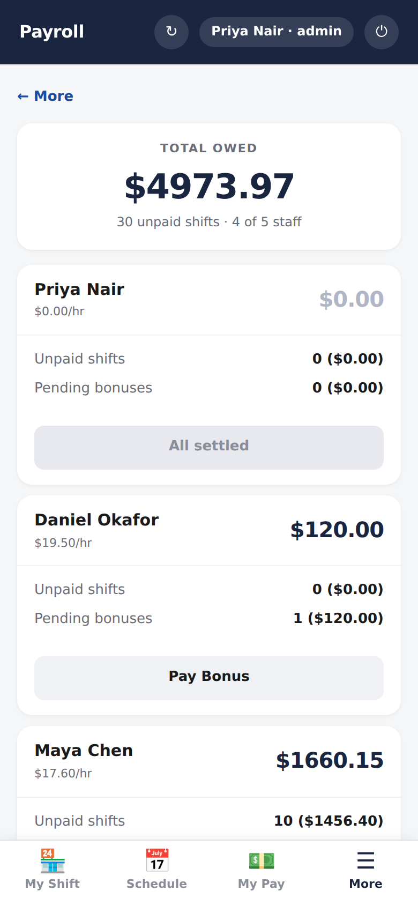
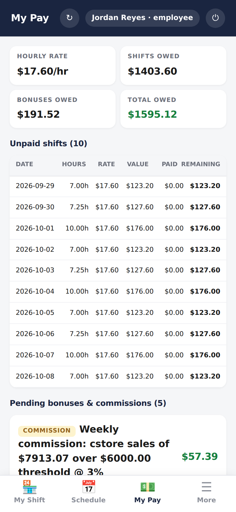
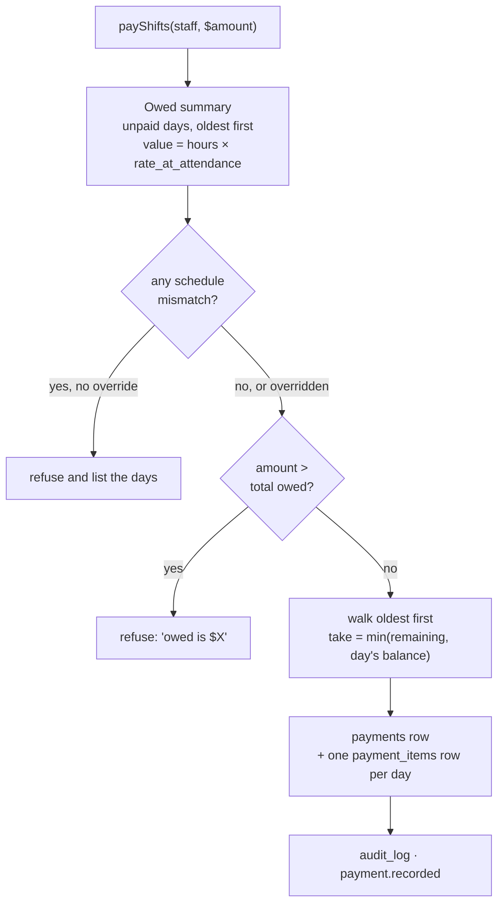

# Payroll

> Pay people for the days they worked, oldest first, and let each person check
> the arithmetic for themselves.

| Payroll (admin) | My Pay (everyone) |
|---|---|
|  |  |

## What it does

**My Pay** is available to everyone and shows only your own pay: hourly rate,
every unpaid shift with *hours × rate = value*, how much of it has been paid,
and pending bonuses and commissions. Anyone can check their pay against their
own memory of the week.

**Payroll** (admin and payroll admin) lists what each person is owed and records
payments in one of two ways:

- **Pay shifts:** enter an amount. It is applied to that person's **oldest
  unpaid day first**, filling each day before the next; the last day may be
  part-paid. Paying more than is owed is refused, and the error states the
  amount owed.
- **Pay a bonus:** pay one specific bonus, commission or fee, in full or in
  part.

If any unpaid day has **scheduled hours that differ from actual hours**, paying
shifts stops and shows the days. The admin either fixes the hours on the
[schedule](schedule-and-attendance.md) or overrides with a reason. A payment
can be **undone**; its items are removed and the days become unpaid again.

## How it works

A day is paid when its `payment_items` (type `shift`) add up to
`hours_worked × rate_at_attendance`. A bonus is paid when its items add up to
its amount, and its status moves `pending → paid`.

## Data

| Tab | Reads | Writes |
|---|:-:|:-:|
| `attendance` | ✓ | |
| `bonuses` | ✓ | ✓ (status) |
| `payments` | ✓ | ✓ |
| `payment_items` | ✓ | ✓ |

## Rules it must not break

- **Oldest first**, so "which days are unpaid" always has one answer.
- **No overpayment**, of shifts or of a bonus.
- **Rates are snapshotted** on the attendance row, so a payment always prices
  a day at the rate it was worked.
  One exception, in the Operations app: when an admin changes a rate on the
  [Staff](staff-admin.md) screen they may give a date, and every worked day
  from it with **nothing paid** against it takes the new rate (days with any
  payment are left as they are). Owed moves by exactly the difference.
- **A day worked with no rate is "no rate set", not $0** (Operations app only;
  [ADR-0031](../adr/0031-a-day-with-no-rate-is-not-a-day-at-zero.md)). When a
  person's hourly rate is blank, their day is stored with a blank rate (the
  Apps Script app stores 0). Such a day is unpaid work that cannot be valued
  yet:
  - **Payroll** (admin, payroll admin): the person's card says *"N days worked
    with no rate set"* with each date and its hours, that nothing can be paid
    for them until a rate is set, and *"Set <name>'s rate on the Staff screen,
    with 'also apply to unpaid days from' <the first of these days>"*. The
    totals owed leave them out and say so (*not counted: N days with no rate*).
    A person with only such days has no *Pay Shifts* button and reads *Rate
    needed*, not *All settled*.
  - **My Pay**: *Hourly Rate: no rate set* (never $0.00/hr for a blank; a real
    0 still reads $0.00/hr), and the days listed with their hours and *no rate
    set* where the rate and the value would be.
  - **Paying shifts** never pays such a day and never treats it as $0: it is
    skipped and named in the answer (`skippedNoRate`) and in the audit row; a
    payment when such days are all that is left is refused (*"<name> has no pay
    rate set: set it on the Staff screen first."*); an overpayment refusal adds
    *"Not counted: N days worked with no rate set."*
  - **Rows already holding 0 are left alone.** A 0 written by the Apps Script
    app, or by the Operations app before card P4-11b, cannot be told from a real
    0, so nothing is rewritten and those days still read $0.00 and are owed
    nothing. An admin fixes them on the [Staff](staff-admin.md) screen: set the
    rate with *also apply to unpaid days from* the first such day.
  - Inside Apps Script every pay screen is exactly as it was: the old app never
    sends a blank rate or the added fields.
- **Bonuses are never paid with shifts.** They are separate flows, so a shift
  payment can't quietly settle a commission.
- **Only `pending` bonuses are payable.** A `proposed` one is refused with
  "Approve it first", so nothing the [commission engine](commissions.md)
  computes is paid until a person approves it.

## Code map

| What | Where |
|---|---|
| Server | `src/Payments.gs`: `getOwedSummary_`, `payShifts_`, `payBonus`, `undo` · `src/Bonuses.gs` |
| RPC | `src/WebApp.gs`: `rpcGetPayrollOverview`, `rpcGetOwedSummary`, `rpcPayShifts`, `rpcPayBonus`, `rpcUndoPayment`, `rpcGetMyOwedSummary`, `rpcGetPaymentHistory` |
| UI | `src/Index.html`: `renderPayrollTab`, `renderPayShiftsForm`, `renderPayMismatch_`, `openPayBonusList`, `renderMyPayTab`, `renderHistoryTab`; no rate set: `noRateSet_`, `payRateText_`, `noRateDaysOf_`, `payrollNoRateHTML_` |
| Operations app | `ops/src/modules/payments.ts` (`workedFor`, `getOwedSummary`, `payShifts`), `ops/src/rpc/handlers/payments.ts`, `ops/src/modules/staff.ts` `hourlyRatesOf` |

## Tests

The Apps Script side has no dedicated suite yet. The allocation walk is the one
`cash-handling` tests for handovers, and `rpc-guards` covers who can call
the payroll RPCs. A payroll suite (oldest-first, overpayment, mismatch guard,
undo) is on the [backlog](../guides/docs-process.md#known-gaps).

| Suite | Holds |
|---|---|
| `ops/test/payments.test.ts` | the Operations app's port of the seven calls, compared with the old arithmetic |
| `ops/test/no-rate.test.ts` | a day with no rate (card P4-11b), through the real router: a blank rate stored NULL at the close, a real 0 kept, every other column as before; the owner's story (a manager adds someone with no rate, two days, Payroll and My Pay say *no rate set*, paying refused with words, the admin re-rates from the first day, the days owed and paid, the audit rows); rated and no-rate days together (paid and skipped, totals with the count left out); old 0 rows untouched by every call; every answer and row for people with a rate pinned against the pre-change code; who may call unchanged; the comparison fixture has no blank-rate worker |
| `tests/suites/ui-no-rate.js` | My Pay, Payroll, the pay form and the Schedule cell sheet inside Apps Script byte-identical to a frozen copy for every role and answer; in the Operations app null reads *no rate set* and 0 reads $0.00; the lists, the fix sentence and *not counted*; hostile text escaped |

## History

- **Nov 2026 (card P4-11b):** in the Operations app a day worked with no rate is
  stored blank and shown as *no rate set* on Payroll and My Pay, never paid and
  never $0 ([ADR-0031](../adr/0031-a-day-with-no-rate-is-not-a-day-at-zero.md)).

- **Nov 2026 (card P4-11):** in the Operations app, a rate change may re-rate
  unpaid days from a date ([Staff](staff-admin.md)).
- **Oct 2026:** My Pay fits a phone: tiles two-by-two, and the shift table stays
  on one line.
- **Batch 4:** payroll and My Pay screens.
- **Batch 3:** payments with oldest-first allocation; bonuses.
