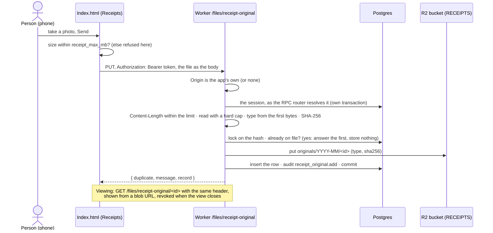

# Receipts and businesses

> Take a photo of a purchase receipt, or pick its PDF, and the app keeps it
> exactly as it was received, for the books and for a tax audit; and the two
> businesses, with what printed on a receipt says which one it belongs to.

<!-- No screenshot: these screens exist only in the Operations app (ADR-0023),
     and the docs runtime (scripts/docs/runtime.js) runs the Apps Script server,
     which has no receipt calls. Nothing in scripts/docs/screens.js can render it. -->

## What it does

Built so far (cards P5-12a, P5-12b, P5-05a, P5-05b and P5-16), in the Operations app only (inside
Apps Script neither entry exists). The old spreadsheet's purchase list, kept as
history and never among the receipts, has its own section,
[The old purchase list](#the-old-purchase-list-card-p5-16).

**More → Receipts**, for everyone signed in.

- **Add a receipt**: **Take a photo** (the phone's back camera) or **Choose a
  file** (a JPEG, PNG, WebP or HEIC photo, or a PDF), then which business
  (cstore, vape or *not sure*), an optional note, a preview of what will be
  sent and its size, and **Send**. While sending it says *Sending 2.4 MB…*;
  afterwards *Kept. 2.4 MB, added 2026-11-27 10:05.*, or the server's own
  words: too large, not a photo or a PDF, or *Already on file, added
  2026-11-26 16:40 by Priya Nair.* A photo over the limit is refused on the
  phone before anything is sent, with *Choose a smaller picture size in the
  phone's camera settings and take it again*: the page never shrinks a photo.
- **Admin, manager and payroll admin** see the list: **Waiting**, then **Set
  aside**, newest first, each row with a small preview (images, fetched a few
  at a time as they come into sight) or a PDF mark, who added it and when, its
  size, the business or *business not known*, and the note. Tapping opens the
  original large (a PDF opens in a new tab).
- **Admin and manager**, in that view: **Set aside** (it is not a receipt; a
  reason of 3 to 300 characters; it stays on file under *Set aside*),
  **Put back**, and **Change business** (cstore, vape or not known) on a
  waiting original.
- **An employee** sees *Add a receipt* and what they added in the last 7 days,
  so they can check the photo arrived. Nothing of anyone else's.
- **An original an assistant handed over** (card P5-12b) says *added by Priya
  Nair's assistant (Priya's Muse)*: the key's person and the key's label. One
  from an email also shows its sender and date, as text: *from Fictional
  Corner Supply <billing@…>, sent Nov 26, 09:14 a.m.* Everything else on the
  row is as for a person's upload.
- **An emailed original says which part of the email it is** (card P5-13): its
  subject, and either *Attachment 2 of the email: packing-slip.png* or, for an
  invoice that was only the email's own text, **A print of the email itself,
  made by the assistant: not the original message.** The same lines are in the
  large view, and the review repeats the print notice above the original, with
  *A print can be wrong or incomplete*. An emailed original from before the
  card has neither line.
- **Emails checked** (admin, manager, payroll admin; card P5-13), below *Set
  aside*: every email an assistant has dealt with, whatever came of it, newest
  first (by the email's date) and a page at a time (*Show older emails*): the
  date, who sent it, its subject, what came of it in words (*Filed*, *Nothing
  to file*, *Could not be read*), how many receipts came from it, a note, and
  which assistant recorded it. The ones that **could not be read** are on top,
  in red, saying *A person should look at this one.* A person looks at the
  mailbox itself: the app has no way to open it. An employee does not see the
  group.

**More → Businesses**, for admin, manager and payroll admin (read only for the
last two). Each business: its display name (the settings
`cstore_business_name`, `vape_business_name`), legal name and HST number
(*not recorded* until an admin types them), notes, and its **signs**: what on
a document says the document is that business's. An admin changes the legal
name, HST number and notes, and adds or removes signs:

| Sign | What it is | Rule |
|---|---|---|
| Name as printed | a trading or billing name as a supplier prints it | 2 to 120 characters, one line |
| HST number | the buyer's number as printed | nine digits, `RT`, four digits; spaces and dashes allowed and dropped (`123456789 RT 0001` is `123456789RT0001`) |
| Supplier account | an account or membership number with one supplier | the number (1 to 60) and the supplier's name (2 to 80) |
| Card ending | a card the business pays with | exactly four digits, never more of the number |

A sign that already belongs to the other business is refused: *The card
ending 4821 already belongs to vape (YV Vape Shop). A sign can belong to one
business only: remove it there first.* A removed sign is kept, marked removed.

**An assistant** (card P5-12b; [assistants](assistants.md)) can list the
originals waiting to be read, be shown one (the stored file itself), hand one
over through a one-time upload address, ask whether an email has already
been handed over, and say that it has finished with an email (card P5-13). It
reads for the business: any key may list and be shown every waiting original.

**Emails an assistant has dealt with** (card P5-13). The owner's assistant is already connected to the
mailbox by its own means; **the Operations app has no access to email and
none was added**: no mail library, no mailbox address, no credential. A daily
scan, run by the assistant, needs the app to remember three things, which it
now does:

- *Every email dealt with*, including the ones with nothing to file, in
  `ops.receipt_emails`: one row per message id, with its sender, date, subject
  (cut to 200 characters), the outcome (`filed`, `nothing_to_file`,
  `could_not_read`), how many originals came from it (counted by the app, never
  told), which key and person recorded it, when it was first seen and last
  recorded, and a note. The assistant records an email with `receipt_email_done`
  when it has finished with it; recording again updates the outcome, count and
  note and keeps the first-seen time, and each recording is an audit row (the
  row's id, the outcome, the count and the key; never the email's text). `filed`
  is refused when no original from that email is on file, `nothing_to_file`
  when one is. Nothing is deleted.
- *One spelling of a message id.* The id is the email's `Message-ID` header
  value. `messageKey` (`ops/src/receipts/emails.ts`, pure) is its normal form:
  direction marks and surrounding white space removed, one pair of surrounding
  angle brackets removed, nothing else (case is kept: the part before the `@`
  is case-sensitive in principle). So `<abc@x>` and `abc@x` are one email.
  Originals and tickets keep the id as it was given and are **compared by the
  normal form in the query**: migration 0017 adds the SQL function
  `ops.message_key(text)` (the bracket rule, for ids already trimmed and free of
  direction marks, as they are when stored) and an index on it, so no old row's
  text is rewritten and one stored with its brackets before the card is still
  found. A test checks that the function and `messageKey` agree.
  The instructions tell the assistant to use the Message-ID header and never a
  mail provider's own id; every tool description says so too.
- *Which attachment a file was.* An email with several attachments is several
  originals: each ticket and original keeps the attachment's name as the email
  gives it and its position (1 to 999) among the attachments, or the mark that
  it is a **print** of the email's own text (`email_print`, true or null).
  Exactly one of the two for an emailed file; the database refuses a print with
  an attachment name or position and any of the three on a file that is not
  from an email.

**A print of an email** is a PDF the assistant makes of the message's text,
with its sender, date and subject visible on the page, when no attachment is
the invoice (the owner's decision, Nov 28: start with PDF). It goes through the
same checks as any upload and one more: it must be a PDF by its bytes (a photo
sent as a print is refused at the PUT, `415`, and `my_proposals` says so). The
record says it is a print because a print is not the message itself: it can be
wrong or incomplete.

**What an email says is data.** The subject, sender, attachment name and note
are cleaned (controls and direction marks removed, one line) and capped when
they arrive, stored as text, answered through `asData`, and shown escaped. No
field is ever interpreted, and no tool takes an instruction. The new tool needs
the `propose` right, counts against the daily cap, and the record of calls
holds no email content. A hostile email's worst effect is a wrong draft a
person sees.

**Drafts: what was read off an original** (card P5-05a;
[ADR-0027](../adr/0027-the-app-decides-the-business-and-checks-the-arithmetic.md)).
An assistant with a `propose` key reads a waiting original and proposes its
figures with the tool `receipt_propose` ([assistants](assistants.md)); an
admin or a manager can instead tap a waiting original and **Enter the figures
by hand** (the same fields, the same code). The app decides the business from
what the document prints about the buyer, checks the arithmetic, and keeps a
**draft that counts for nothing** until a person confirms it (the next card).
The original moves from **Waiting** to **Read, waiting for review**, between
Waiting and Set aside, for admin, manager and payroll admin: each row says
*Read: <supplier> · <date> · <total> · <business or business not known>*, and
*needs attention (N checks failed)* when a check failed. Tapping it opens the
original large with the draft **read only** under it: every field (a blank one
reads *not on the receipt*), the business and how it was decided (*decided by
the card ending 4821*, *not known: nothing printed matched*, *the signs point
at both businesses*) with what a person said at upload beside it, who read it,
each failed check as a sentence with its numbers, the lines, where each figure
was read and the reader's note, and at the bottom *Reviewing and confirming
comes next: nothing here counts yet.* A read original can be set aside (admin,
manager); its business is not changed there. An employee's own list says only
*It has been read.*

**Review, confirm, void, the books** (card P5-05b;
[ADR-0029](../adr/0029-a-confirmed-receipt-is-final-and-a-mistake-is-voided.md)).
An admin or a manager taps an original in *Read, waiting for review* and the
**review** opens: the original (fetched and shown from a blob URL as before;
on a phone it sits above the fields, stays in sight while they scroll, and
*Make the original large* gives it most of the screen; on a wide screen it sits
beside them), then every field, editable and prefilled from the live draft:
the supplier as printed, the supplier **on the list** (picked from the
candidates for the printed name, found by any known spelling, or added with
*New supplier*), the supplier's HST number, invoice number, date, how paid and
the card's last four, subtotal, HST, other charges (add, remove), total, kind,
what is printed about the buyer, the business (*As the signs say (…)*, or
cstore, or vape) with how it was decided, and the lines (add, edit, remove;
unit price to four decimals, quantity to three). The where-read notes and the
reader's note are shown read only and kept. Each failed check is a sentence
from the server. **Save corrections** sends the fields; the server keeps a new
reading and answers the checks and the business decided again, and the sheet
is drawn from that answer. **Confirm…** saves what is typed first, then shows
the last sheet: *This goes on the books of <business name>* in large words,
the supplier, date and total, what is still missing or forbidden (in words,
Confirm disabled), the **sign offers** (each unticked; greyed with *An admin
can add these.* for a manager), signs of the other business as warnings,
*remember this spelling* (ticked), and the failed checks with a reason box
(Confirm is enabled only with a reason of 3 characters or more). Afterwards:
*On the books of <business name>.* and *Review the next one*. *Enter the
figures by hand* on a waiting original now goes straight into the review.

**On the books**, a group under Set aside for admin, manager and payroll admin:
one button per business (the two are never listed together; there is no
*both*), then that business's confirmed and voided receipts, newest on the
books first, 20 at a time (*More*), filtered by date range and kind, with the
totals of the filter: *N receipts · subtotal · HST · total*, voided ones shown
struck through and *not counted*, and how many have no subtotal or no HST on
the receipt. A receipt opens read only beside its original: who confirmed it
and when, the reason and the failed checks if any, *VOIDED by … : reason* if
voided, every field, what was changed at review and every reading of it.
**Void…** (admin, manager) asks a reason and lists what was learnt from the
receipt, which a void does not remove. An employee's own original says *It has
been read.* or *It is on the books.*

**Costs** (card P5-15; [costs](costs.md), [ADR-0030](../adr/0030-an-item-is-a-suppliers-own-line.md)). Confirming a receipt now also writes the cost of each line that gives one exactly (a printed unit price, or line total ÷ quantity, marked *worked out*) onto the history of that supplier's own line, in the business's books, and may flag a rise for a manager; a void stops those costs counting and works the flags out again. The confirm and void answers carry a short `costs` summary that the result sheets repeat. Nothing about the receipt changes, and a failure to observe fails the confirm or the void as a whole.

**Not built yet** (later cards): no QuickBooks export; no
import of the old purchase list; no emailed invoices beyond P5-12b; no screen
listing the suppliers on their own (the review's picker and *New supplier*
are the way in; `rpcUpdateReceiptSupplier` has no page yet).

## How it works

**Adding.** `PUT /files/receipt-original`, beside `/rpc/*` and `/mcp` in
`ops/src/index.ts`. Its order: the `Origin` check (a request naming another
origin is refused 403; the page and the API share one origin, so this closes
cross-site uploads with a stolen token); the session from
`Authorization: Bearer <token>` (the page's own token, resolved by the same
`resolveSession` as the RPC router, in its own transaction, so a renewal is
kept as it is for a refused RPC; no token, a bad one, an expired one or a
deactivated person: 401 `NOT_LOGGED_IN`); `Content-Length` required (411) and
within the limit (413) before a byte is read; the body read with a hard cap of
the size claimed (a longer body is refused 413, a shorter one 400); the type
from the first bytes (415 for anything else); the SHA-256; then, in one
transaction: an advisory lock on the hash, the duplicate check, the object put
in R2, the row, and one audit row. New: 201; already on file: 200.

Optional headers, all cleaned on the server: `x-receipt-business` (`cstore` or
`vape`; anything else is "not sure", stored as NULL), `x-receipt-source`
(`photo` or `upload`; anything else is `upload`), `x-receipt-filename` and
`x-receipt-note` (percent-encoded UTF-8). The file name keeps only its last
part after `/` or `\`, loses control and direction characters and leading
dots, and is cut to 120 characters; the note becomes one line of at most 300.
Both are shown to people and never used in a path or a key.

**An assistant's original: `PUT /files/receipt-original/by-ticket/<ticket>`**
(card P5-12b). A file never travels inside a tool call: the tool
`receipt_upload_start` (a `propose` key, counted against its daily cap)
answers a one-time address holding a ticket, 32 random bytes from `crypto` as
base64url, kept in `ops.receipt_upload_tickets` only as its SHA-256. The
ticket is the only credential: no session or assistant key is read on this
route. Its order: `PUT` only (405); **any** `Origin` header refused (403: no
browser has business there); the door on (`assistants_enabled`; off: the same
404 as below, nothing written); `Content-Length` required (411) and within
`receipt_max_mb` (413), before a byte is read and without using the ticket up;
then, in one transaction, the ticket found under a row lock (two PUTs with one
ticket at the same instant take one file). An unknown or malformed ticket, one
used already, one past its 10 minutes, or one whose key has expired or been
withdrawn or whose person is inactive: **the same 404 with one fixed body**,
the reason only in the door's record of calls (flood-limited). A usable ticket
is spent and the PUT recorded, committed **before** the body is read, so the
first PUT that gets that far uses it up whether or not the file is accepted.
Then exactly the page's path: the body read with the same hard cap, the type
from the bytes, the SHA-256, the duplicate rule under the hash lock, the same
storage and audit (`checkLength`, `receiveFile` and `originals.add`, shared
by both routes). The answer is the page's: 201 kept (`id`, `size`, `type`,
*Kept. …*), 200 already on file (`id`, `addedAt`, *Already on file, added …
by …*), or the page's refusal; the ticket is then marked `kept`,
`duplicate` (with the original's id) or `refused` (`not_accepted`, `not_a_pdf`
for a print that is not a PDF, `empty`, `too_long`, `incomplete`), and one that expires unused is marked `expired`
when it is next seen. Nothing is removed.

**What is recorded for an assistant's or an emailed original.** `added_by` is
the key's person; `assistant_key_id` the key; `source` `assistant`, or `email`
with `email_message_id`, `email_sender` and `email_date` as the assistant gave
them (the message id at most 300 characters and the sender at most 200, with
control characters refused, direction marks removed and the surrounding white
space trimmed; the date a real instant). The file name and the note are
cleaned by the page's own `cleanFileName` and `cleanNote`. The business is
what the assistant declared (`cstore`, `vape`) or NULL. The audit row is the
same `receipt_original.add`, with `assistantKeyId` added. 0010 tied
`assistant_key_id` to source `assistant` only; migration 0012 widens that
check so an emailed original keeps its key (and a later forwarding address can
add an emailed one with none).

**If the row cannot be written after the object was stored** (the database
fails between the two), the answer is an error (500, `SERVER_ERROR` with an
id) and the object stays in the bucket, unreferenced. It is harmless, it is
never removed by the app, and sending the same file again stores it again
with a row.

**Viewing.** `GET /files/receipt-original/<id>` with the same bearer header.
The page cannot put a header on an ``, so it fetches the original and
shows it from a blob URL (an image) or opens a blob URL in a new tab (a PDF).
The answer carries the stored type, `X-Content-Type-Options: nosniff`,
`Content-Disposition: inline; filename="receipt-<id>.<ext>"` (a name the app
makes, never the uploaded one), `Cache-Control: private, no-store` and
`Content-Security-Policy: sandbox; default-src 'none'`, and no cookie or CORS
header. No token in a URL, ever: a token in the query string or a cookie is
ignored (401). An id the session may not see (an employee asking for someone
else's, or their own older than 7 days) answers exactly as an id that does
not exist (404).

**The files accepted**, decided by signature (`ops/src/receipts/sniff.ts`),
never by the name or the type sent:

| Kind | Stored as | Signature |
|---|---|---|
| JPEG | `image/jpeg` | `FF D8 FF` |
| PNG | `image/png` | `89 50 4E 47 0D 0A 1A 0A` |
| WebP | `image/webp` | `RIFF`, four bytes, `WEBP` |
| HEIC / HEIF | `image/heic` | an `ftyp` box first (size 16 or more, within the file), major brand `heic`, `heix`, `hevc`, `hevx`, `heim` or `heis`; or `mif1`/`msf1` with one of those among the compatible brands (AVIF is refused) |
| PDF | `application/pdf` | `%PDF-`, a digit, `.`, a digit |

Anything else (an empty file, a signature cut short, SVG, HTML, a zip, a GIF,
text) is refused with *This file is not a photo or a PDF the app can keep.
Send a JPEG, PNG, WebP or HEIC photo, or a PDF.* A file whose name or header
says one of the five but whose bytes are another of the five is kept as what
its bytes are.

**Storage, locally and hosted.** All storage goes through
`ops/src/receipts/storage.ts`: `put`, `get`, `head`, nothing else. Locally,
`npm --prefix ops run dev` (`wrangler dev`) emulates the bucket on disk under
`ops/.wrangler/` (git-ignored), with no account. Hosted, the bucket
`storeops-receipts` must exist before the Worker is deployed (the hosted setup
creates it; it is never public). **A Worker binding cannot be denied the right
to erase objects**: the code has no way to, and a test keeps it so, but the
binding itself could. So the hosted setup puts a retention lock (an R2 bucket
lock rule) on the bucket, so that nothing, the app included, can remove or
replace an original during the retention period. That is a step of the hosted
setup, not of this code.

**Statuses.** An original is `waiting` (to be read), `drafted` (read: it has a
live draft; card P5-05a), `confirmed` (its receipt is on the books; card
P5-05b) or `set_aside` (not a receipt: reason, by whom, when). All four are
reachable. The column's CHECK is named (`receipt_originals_status`); migrations
0013 and 0014 dropped and re-added it (a check, not a table rewrite). A
confirmed original cannot be set aside (*This receipt is on the books: it
cannot be set aside. Void it first …*) nor have its business changed; a void
takes it back to `drafted`. The set-aside
columns are tied to `set_aside` only. A drafted original may be set aside; its
draft leaves the live list with it (kept, unchanged) and putting it back makes
it `drafted` again. The sources
`assistant` and `email` are allowed already, with their own columns (the
assistant key; the email's message id, sender and date), so those cards need
no migration of this table.

**Sign values** are compared in a normal form (`normalise` in
`ops/src/receipts/businesses.ts`): Unicode NFKC (full-width digits become
digits), lower case, every white space and every dash removed. For a supplier
account the key is the supplier's key, a bar, then the number's key, so the
same number at two suppliers is two signs. The database's partial unique index
on `(kind, value_key)` for live signs holds the rule even past the code, and
every sign change takes one advisory lock, so two admins adding the same card
to the two businesses at once cannot both succeed. The HST number of a
business and an `hst_number` sign are checked against each other across the
two businesses.

### Drafts (card P5-05a)

One function makes every draft, `propose` in `ops/src/receipts/drafts.ts`,
called by the tool `receipt_propose` (the reader is the key and its person) and
by `rpcEnterReceiptDraft` (the reader is the signed-in admin or manager). Its
order: read and clean the fields (a refusal here writes nothing); take one
advisory lock for all drafts; lock the original's row; refuse an original that
does not exist, is set aside, or whose live draft a person made; decide the
business from the live signs; match the supplier; look for duplicates; run the
checks; supersede the live draft if there is one; write the draft and its lines;
mark the original `drafted`; audit.

**What is stored** (`ops.purchase_receipts`, one row per reading):

- the original it was read from, and who read it: `read_by_kind` `assistant`
  (with `read_by_key`, and `read_by` the key's person) or `person`, and when;
- **as printed**: the supplier's name and HST number, the invoice number, the
  date (`receipt_date_text` as given; `receipt_date` when it is a real day),
  how it was paid (`cash`, `card` with its last four digits, `account`,
  `other`), the subtotal, HST, total, other charges (a total in `other_total`
  and the labelled parts in the JSON column `other_charges`: they are written
  once, shown to the reviewer and never queried alone, so a child table would
  add a join and nothing else; the total is a column for the checks and the
  export), the kind of purchase, and what it prints about the buyer (name, HST
  number, account number, card's last four);
- **decided by the app**: the business, `business_decided_by` (the kinds of
  sign, or `{conflict}`, `{not_known}`; `{person}` is for the next card), the
  signs that matched (`business_signs`), what a person said at upload
  (`business_person_said`), the supplier it matched (`supplier_id`, or NULL),
  the HST rate used, `needs_attention`, and every check with its result and
  words (`checks`);
- **for the reviewer, as text**: where each figure was read (`where_read`, one
  phrase per field) and the reader's note;
- `ops.purchase_receipt_lines`: per line, the description, the supplier's item
  code, the quantity (`numeric(12,3)`, three decimals), the unit price
  (`numeric(14,4)`, up to four decimals: fuel at 1.459 a litre, 0.3333 each),
  the line total (two decimals) and whether it is taxed (`true`, `false`, or
  NULL when not marked). Lines are optional; nothing is computed from them here
  but the checks, which use the line totals only: quantity × unit price is never
  computed (a pump's 41.287 × 1.459 is 60.237733, printed 60.24, and raises no
  check).

Every field but the original and the total may be left out: it is stored NULL
and answered `null`, and the page says *not on the receipt* (ADR-0004). An HST
of `0` is `0.00`, and is checked as a number.

**Money.** Every amount is a JSON number or a decimal string with at most two
decimals, read through its own spelling and held as integer cents
(`parseMoney`): `12`, `12.5`, `"12.50"`, `-3.10` are accepted; `12.505`,
`"1e3"`, `"1,200.00"`, `"$12.50"`, `"NaN"`, `""`, a number beyond
9,999,999,999.99 and `0.1 + 0.2` (whose spelling is `0.30000000000000004`)
are refused. Sums are of integers; amounts are written to `numeric(12,2)` as
exact text (`centsText`) and read back as text. A quantity is the same with
three decimals (`parseQuantity`). A line's unit price is the one amount with
up to four decimals (`parseUnitPrice`, integer ten-thousandths, the same
refusals otherwise: `1.45901` is refused); it is stored as `numeric(14,4)` and
answered as text with at least two decimals and no trailing zeros past the
second (`unitPriceText`: `1.4590` is answered `1.459`, `6.0000` is `6.00`,
`0.3333` stays), and the page shows that text with a dollar sign, never through
`money()`. Every other amount (line total, subtotal, HST, other charges,
total) still has exactly two decimals.

**The business, decided from the signs** (`decideBusiness`, pure). Each piece
of evidence is compared, in the Businesses card's normal form, with the live
signs of its kind (a removed sign never counts); the card the receipt says it
was paid with is the buyer's card too; an account number counts only at the
supplier printed on the receipt.

| What matched | Business | `business_decided_by` | Words | Check |
|---|---|---|---|---|
| one or more signs, all of one business | that business | the kinds that matched, e.g. `{name,card_last4}` | *decided by the name "…" and the card ending 4821* | passes |
| the same, and a person said that business at upload | that business | the kinds | *…; a person said cstore when it was added, and they agree* | passes |
| the same, and a person said the other business | that business | the kinds | *A person said vape when it was added, but the signs say cstore (…)* | **fails** |
| signs of both businesses | not set | `{conflict}` | *the signs point at both businesses* | **fails**, naming each sign and whose it is |
| nothing | not set | `{not_known}` | *not known: nothing printed matched* | **fails** |

The reader's own guess (`suggested_business`) is stored and shown as *decides
nothing*; the same evidence with and without it gives the same decision. The
supplier is never used to guess. The original's own business is not changed.

**The supplier.** Kept as printed. Matched (`matchSupplier`) against
`ops.supplier_names` by the same normal form, among live spellings of active
suppliers: matched, the supplier's id; not matched, no id (the review card will
let a person pick or create one). This card never creates a supplier.

**The checks** (each a pure exported function; the next card reruns them when a
person edits). Each answers passed, failed or *not checked* (nothing to
check), in words. A failure marks the draft *needs attention*; the draft is
kept.

| Check | Rule, exactly | Passes | Fails |
|---|---|---|---|
| `lines_add_up` | when there are lines, every line has a total, and there is a subtotal: the line totals sum to the subtotal, to the cent | lines 0.10 + 0.20, subtotal 0.30: *The 2 lines add up to $0.30, the subtotal.* | subtotal 0.31: *The 2 lines add up to $0.30, but the subtotal is $0.31 ($0.01 apart).* |
| `parts_add_up` | when there is a subtotal: subtotal + HST + other charges = total, to the cent; a blank HST or other charges count as nothing and the words say so | *Subtotal $50.00 + HST $6.50 = $56.50, the total.* | total 56.51: *… = $56.50, but the total is $56.51 ($0.01 apart).* |
| `hst_plausible`, lines marked | when every line has a total and a taxed/not-taxed mark: HST = rate × the taxed lines, rounded half up to the cent, **within $0.02** either way | taxed 40.00 at 13%, HST 5.22: *HST $5.22 is 13% of the taxed lines ($40.00) = $5.20, within $0.02.* | HST 5.23: *… should be 13% of the taxed lines ($40.00) = $5.20, within $0.02; it is $0.03 more.* |
| `hst_plausible`, not marked | when there is a subtotal: $0.00 ≤ HST ≤ rate × subtotal **+ $0.02** | subtotal 50.00, HST 6.52 | HST 6.53: *HST $6.53 is more than 13% of the subtotal ($50.00) = $6.50, plus $0.02 for rounding.*; HST −0.01: *HST -$0.01 is less than nothing.* |
| `date` | a real day written `YYYY-MM-DD`, not after today in Toronto, not before the same day **7 years** ago (29 February: the 28th) | on Nov 27, 2026: 2026-11-27 and 2019-11-27 | 2026-11-28 (*in the future*), 2019-11-26 (*more than 7 years old*), 2026-02-30 (*not a real day*) |
| `duplicate` | another live reading (a draft or a confirmed receipt of **either** business, of another original, whose original is not set aside) from the same supplier (the same normalised name, or the same matched supplier): the same invoice number (normalised) is a *Duplicate*; with no invoice number on one of the two, the same date and total is a *Possible duplicate*; each names the other draft, its business and its original | another invoice number, another day, a cent different | *Duplicate: invoice INV-77 from … is already on file (draft pr…, vape, receipt original ro…).* |
| `supplier_hst_number` | when printed: nine digits, RT, four digits (spaces and dashes allowed; the Businesses card's `checkHst`) | `123456789 RT 0001` | `12345` |
| `business` | the decision above | decided, and agreeing with a person if one said | not known, conflict, or disagreeing |

The rate is the setting `hst_rate_percent` (default 13, Ontario; 0 to 30 with up
to three decimals; read as exact text, so 0 means 0%); the draft keeps the rate
it was checked with. A draft with only a total has nothing to check: every
check but the business is *not checked*, and with one sign of the buyer
printed it passes outright.

**Refused outright**, with a sentence ending *Nothing was kept.* and nothing
written: no such original (unknown or malformed id); one set aside; one whose
live draft a person made (*A person is working on this one…*); no total; an
amount that is not money (naming the field: *amounts.subtotal is not an
amount…*); a quantity with more than three decimals; a unit price with more
than four; more than 300 lines; a
line with no description; text over its limit (supplier name 120, its HST
number 40, invoice number 60, date 40, buyer's name 120, HST number 40, account
60, a charge's label 80, a line's description 300 and code 60, a where-read
phrase 200, the note 500); a card's last four digits that are not exactly four
digits (never more of a card number), or given for a payment that is not by
card. Text is cleaned first: control and direction characters removed, white
space made single.

**Replacing.** An original has at most one live draft (the database holds it
too: a unique index on the original among `draft` and `confirmed` rows). While
the live draft was proposed by an assistant, any reader may propose again: the
new draft becomes the live one, and the old is marked `superseded` with
`superseded_by` and `superseded_at`, the new one naming it in `supersedes`.
Nothing is deleted. A draft typed by a person (and, with the next card, one a
person edited) is never replaced by a proposal; a person typing over an
assistant's draft supersedes it. Two proposals for one original at the same
instant are taken one after the other (the drafts' advisory lock, then the
original's row lock): exactly one is live afterwards.

**Statuses of a reading.** `draft` (live), `superseded`, `confirmed` (with
`confirmed_by`, `confirmed_at`; card P5-05b) and `voided` (`voided_by`,
`voided_at`, `void_reason`; card P5-05b): all four are reached.

### Review, confirm, void (card P5-05b)

All in `ops/src/receipts/review.ts`, through `drafts.ts`'s own parsers, checks
and `decideBusiness` (nothing is computed twice);
[ADR-0029](../adr/0029-a-confirmed-receipt-is-final-and-a-mistake-is-voided.md).

**A correction is a new reading.** `rpcSaveReceiptCorrection` takes the fields
`rpcEnterReceiptDraft` takes, plus `draft_id` (the live draft the person was
looking at), `business` (`cstore`, `vape`, or `null`: the signs decide) and
`supplier_id` (a supplier on the list, or `null`: matched by the printed name).
It goes through the one writing path of P5-05a (`drafts.writeReading`, mode
`correct`): the drafts' lock, the original's row lock, a new row read by the
person that supersedes the live draft (the old row is byte for byte as it was,
marked `superseded`), the checks and the business decision run again, audit
`receipt_draft.supersede` and `receipt_draft.correct`. Refused with *Nothing was
kept.*: no draft to correct; *This draft was replaced by a newer reading (by
<who>) since you opened it: open it again.*; a business that is not one of the
two; an unknown or inactive supplier (*<name> is no longer an active supplier:
choose another, or make it active again on the supplier list.*); an original on
the books (*That receipt is on the books (confirmed): it cannot be changed. To
correct it, void it first.*: also for `receipt_propose` and
`rpcEnterReceiptDraft`). As many corrections as the person likes before
confirming.

**The business a person chooses.** Choosing what the signs already say is the
signs' decision (`business_decided_by` the kinds). Choosing otherwise, when the
signs say *not known*, a *conflict*, or the other business, records
`business_decided_by = {person}` and keeps what the signs said in
`signs_business` and `signs_decided_by` (the matched signs stay in
`business_signs`), so a later report can count which kinds of sign were right.
The `business` check then reads *Chosen by a person: cstore (nothing printed
matched a sign).* (passes), or, overruling a decision of the other business,
*A person chose vape, overruling the signs, which say cstore (the card ending
4821).* (fails: confirming then needs a reason).

**Confirm** (`rpcConfirmReceipt`, `{ originalId, draftId, reason?, learnSigns,
rememberSpelling }`), in one transaction, in this order (every refusal ends
*Nothing was confirmed.* and writes nothing):

1. the drafts' advisory lock, then the original's row (`for update`);
2. already confirmed: *This receipt is already on the books of <business name>
   (confirmed by <name>).*; set aside; no draft; `draftId` not the live draft:
   *This draft was replaced by a newer reading (by <who>) since you opened it:
   open it again.*;
3. the checks re-run on the figures being confirmed (`drafts.runChecks`, the
   same functions, today's signs and duplicates);
4. what must be settled (decision 3), named together: *To confirm, settle the
   receipt date, the kind of purchase, the business and the supplier.* (the
   date must be a real day; the total is always there);
5. an inactive supplier; a sign changed since the draft was saved so the
   business would be decided otherwise (*save the corrections again*);
6. a `duplicate` of a receipt already **confirmed** (the same supplier and
   invoice number, either business): only an admin (*It duplicates a receipt
   already on the books (the same supplier and invoice number): only an admin
   can confirm it, with a reason.*). A duplicate of a mere draft, and a
   *possible duplicate*, are failed checks like the others;
7. any failed check: a reason of 3 to 300 characters on one line (*A check
   failed: say why it is right to confirm it anyway, in 3 to 300 characters.*;
   a line break or control character: *The reason cannot contain a line break
   or other control character.*), stored in `confirm_reason` with the failing
   checks' ids in `confirm_failed` and every result in `confirm_checks`. With
   no failed check no reason is stored;
8. signs to learn: only an admin (*Only an admin can add a sign (as on the
   Businesses screen): untick it, or ask an admin to confirm.*), and only offers
   of this receipt (*That sign is not offered for this receipt …*); the
   spelling: refused when it is another supplier's (*"FG Market" is already a
   spelling of Fictional Grocer: a spelling belongs to one supplier. Untick
   it.*);
9. the row marked `confirmed` (`confirmed_by`, `confirmed_at`, the confirm
   record, `review_changes`, `compared_with`); the original `confirmed`; each
   ticked sign added through `businesses.addSign` with
   `learnt_from = 'confirmed_receipt'` and `learnt_from_receipt`; the spelling
   added the same way; audit `receipt.confirm` (the figures, the business, the
   supplier, the reason, the failed checks, how many fields changed, the signs
   and spelling learnt). The answer: the receipt, *On the books of <business
   name>.*, what was learnt and the next original waiting for review.

**Confirmed is final.** Nothing about a confirmed receipt can be changed: the
app role has no update right on its figures, business, supplier or
`redo_of` (column grants since 0013), and a trigger
(`purchase_receipts_final`, 0014) refuses every update of a confirmed or voided
row, by any role, except the single change of a confirmed one to `voided`
with its three void columns. One original has at most one confirmed receipt
(the one-live-reading index of 0013). Its original is `confirmed` and leaves the
review group; `receipts_to_read` and `receipt_original` do not show it.

**Void** (`rpcVoidReceipt`, `{ receiptId, reason }`, admin or manager): a reason
of 3 to 300 characters (*Say why it is voided, in 3 to 300 characters.*), the
drafts' lock, the receipt's row lock; refused when already voided (*That
receipt is already voided (by <name>).*) or not on the books. The row is
marked `voided` (who, when, why), never removed: it stays in every list,
struck through, out of the totals. Its original goes back to `drafted` with a
**new draft copied from it** (read by the person who voided it, `supersedes`
nothing, `redo_of` the voided receipt; its business is the voided one's, its
supplier the same), audited `receipt_draft.redo`, then `receipt.void`. It can
be corrected and confirmed again: the original then has one voided and one
confirmed receipt. Signs and spellings learnt from the voided receipt are
**not** removed; the answer lists them (*Learnt from this receipt and NOT
removed: the card ending 1357 (cstore); the spelling "…" of …. Remove them by
hand if they were wrong.*).

**Learning signs** (the owner's answer 5). The review's offers are computed
from the live draft's buyer evidence, in the Businesses card's kind order:
the buyer's name, HST number, account number (at the printed supplier) and
card's last four, and the card it was paid with. Each is first put through the
Businesses card's own rules (`checkSign`: a one-character name or an HST
number of the wrong shape is not offered). For the business the receipt will
be confirmed for: already a live sign of it, *known* (listed); a live sign of
the other business, a **warning** (*The card ending 9999 is a sign of vape: it
cannot be added to cstore.*), never offered; otherwise an **offer**, id
`<kind>:<value key>`, `ticked: false`. Nothing is offered until a business is
settled. Each offer added is the Businesses card's `addSign` (its normal form,
its one-business-per-sign rule and message, its lock, its audit action
`business_sign.add` with `learntFrom` and `receiptId` added). From then on
`decideBusiness` matches it for every new draft. The receipt keeps which signs
decided it (`business_decided_by`, `business_signs`) or that a person chose
(and what the signs said): nothing else is reported yet.

**Suppliers and spellings.** `ops.suppliers` gains `display_key` (the
normal form of the display name) with a partial unique index among active
suppliers. `rpcCreateReceiptSupplier` (admin, manager): the display name 2 to
120 characters on one line (*The supplier's name is required.*), unique among
active suppliers ignoring case, spaces and dashes (*There is already an
active supplier called "…".*), the HST number optional in the Canadian shape,
notes optional; the name becomes the supplier's first spelling when no one has
it. `rpcUpdateReceiptSupplier`: name, HST number, notes, active; a supplier is
never removed, only made inactive (its receipts still show it; an inactive
supplier cannot be chosen for a correction or a confirm). `rpcGetReceiptSuppliers`
(admin, manager, payroll admin) finds suppliers by any live spelling or the
display name in the normal form, active ones unless `includeInactive`, 20 at a
time (`after`). The names were to be `rpcGetSuppliers` and so on, but the old
app's contract already has an `rpcGetSuppliers` (the deprecated tab), and an
own RPC needs a name of its own. At confirm, when the printed name is not yet
a spelling of anyone, *remember this spelling* is offered ticked and adds it
to the chosen supplier (`learnt_from = 'confirmed_receipt'`, audited
`supplier_name.add`); one spelling belongs to one supplier (the 0013 index and
the suppliers' advisory lock). Matching then finds that supplier for new drafts.

#### What was changed

At confirm, `compareReadings` (pure) compares the confirmed reading with the
**first reading of the original** (the earliest row for it: the assistant's
first draft, or the first typed one, even after later proposals, corrections
and a void), stored in `review_changes` with `compared_with`:
`{ comparedWith, fields: [ { field, before, after } ], lines: { added, removed,
changed }, count }`. The fields compared, in order: `supplier.name`,
`supplier.hst_number`, `invoice_number`, `date` (as written), `paid.how`,
`paid.card_last4`, `amounts.subtotal`, `amounts.hst`, `amounts.other` (the
charges as *label amount; …*), `amounts.total`, `kind`, `buyer.name`,
`buyer.hst_number`, `buyer.account_number`, `buyer.card_last4`, `business`,
`supplier` (the supplier on the list, by id). Money is compared as a number
(`12.5` and `12.50` are equal) and shown as stored (`"12.50"`); text exactly as
stored (cleaned); a blank is `null`: blank to a value is a change, a value to
blank is a change, a value to the same value is not. Lines are compared by
position: the extra ones on either side are added or removed, a line whose
description, code, taxed mark, quantity, unit price or total differs (numbers
as numbers) is changed. The note and the where-read phrases are the reader's
own words and are not compared. `count` = fields + lines added + removed +
changed; it is what `my_proposals` answers as `fields_changed`. The business and
the supplier settled by a person count as changes from a first reading that
had none.

**The books** (`rpcGetReceiptBooks`, admin, manager, payroll admin). One
business is required (*Choose one business: cstore or vape. The two are never
listed together.*), and an optional date range (on the receipt date), supplier
and kind. Confirmed and voided receipts, newest on the books first
(`confirmed_at`, then id), 20 a page (up to 50) with a keyset cursor
(`before`): a receipt confirmed between two pages is newer than the cursor, so
no row is missed or repeated. The totals are for the whole filter, every page,
summed by Postgres over `numeric` (exact): the count, subtotal, HST and total
of the confirmed ones, the number voided (not in the sums), and how many have
no subtotal or no HST on the receipt (a blank counts as nothing in a sum and is
counted apart). With `{ receiptId }` it answers one receipt read only: the
draft view plus who confirmed it, the reason and failed checks, who voided it
and why, what was changed, its readings (the chain of readings that led to it)
and what was learnt from it.

**Two at once.** Every reading (proposal, correction, the redo), every confirm
and every void takes the drafts' advisory lock
(`hashtextextended('ops.purchase_receipts', 0)`) first, then the original's (or
the receipt's) row lock, so they run one after the other. Two confirms of one
original: the second finds it confirmed and is refused by name. A confirm and a
correction: whichever is second finds the original on the books, or its draft
replaced. A confirm and an assistant's new proposal: the same. Two voids: the
second finds it voided. The one-live-reading unique index holds it past the
code.

**What the later cards find ready.**

- *Cost history:* a confirmed receipt's lines are `ops.purchase_receipt_lines`
  of the row with `status = 'confirmed'` (description, the supplier's item
  code, quantity, unit price to four decimals, line total, taxed), its
  supplier is `supplier_id` (one row per supplier, with every spelling seen),
  its date `receipt_date` and its business `business`. An item is identified
  only by the supplier and its printed code (or description): there is no
  product link yet.
- *The export:* per business, the rows with `status = 'confirmed'` and that
  `business`: date, supplier (display name, HST number), invoice number, kind,
  subtotal, HST, other charges, total, how paid, the original's id. A voided
  receipt is `status = 'voided'` (with who, when and why), and its redo is the
  row whose `redo_of` names it. Nothing marks a receipt exported yet: a column
  such as `exported_at` (granted for update) or a table of export runs naming
  receipts would; the trigger would then need to allow that one change.
- *The old purchase list:* `original_id` may be NULL (0013), so a receipt with
  no original can be inserted as a reading and confirmed; the books list
  already shows a row with no original (no original to open). The confirm
  record requires a supplier, a date and a kind, which the old list must supply.

### What the model cannot hold yet

Questions for the owner and the bookkeeper. Each is what happens **today**:

| Receipt | Today |
|---|---|
| A credit note or a return (negative total) | accepted (`-3.10` is money); the parts and lines checks work; the HST check fails on a negative HST (*less than nothing*), so it is flagged. Nothing marks it as a credit |
| Tax included in the price, with no HST line | HST left blank: *not checked*; parts add up if the subtotal is the total. The HST paid is then not recorded, so it cannot be claimed |
| A deposit or environmental fee that is itself taxed | goes in other charges, which the HST check does not see: with marked lines the HST is short of rate × taxed lines by the fee's tax and may be flagged |
| Tobacco with its own tax | its tax has no field: as an other charge the parts add up; it cannot be told apart from a deposit |
| A foreign-currency invoice | no currency field: the amounts are stored as if dollars, the HST check runs on them; the note is the only place to say so |
| A statement covering several invoices | one draft per original: one invoice number, one date; the duplicate check does not see the invoices inside it |
| A tip on a meal | an other charge; parts add up; nothing marks it as a tip |

### The old purchase list (card P5-16)

Until the Operations app, the owner kept purchases as a list in a workbook: a
date, a supplier typed by hand, an amount and a note. The owner's decision
(Nov 27): **the old list comes into the app as history, with the little it has,
marked "no original on file".** It is not turned into receipts: it has no
document, no tax figure, no invoice number and, for most rows, nothing that says
which business bought it.

**What it is.** One tab of the workbook, read by a tool the owner runs on their
own computer ([the guide](../guides/import-the-old-purchase-list.md)), kept in
its own tables (`ops.legacy_purchase_files`, `ops.legacy_purchases`; migration
`0015_legacy_purchases.sql`). On the Receipts screen, above *On the books*, the
group **Old purchase list** says: *Purchases from the old spreadsheet. No
original is on file for any of these, and they are not part of the books below.*
It shows the supplier spellings (most rows first: the spelling as typed, rows,
total, how they are sorted, who they are linked to) and the rows (newest first,
by *cstore*, *vape* or *not sorted*, with a date filter). Every row says *from
the old list: no original on file* and its row number in the spreadsheet.

**What it is not.** Never a receipt, never a line in *On the books*, never in
its totals, never offered to an assistant (nothing in `ops/src/mcp/` reads the
tables; a test reads those sources). No conversion, no export, no deposits tab.

**The rules.**

- **A row is kept exactly as it was**: the date, the supplier text as typed
  (odd spacing and capitals included), the amount to the cent
  (`numeric(12,2)`, from whole cents, never a float), the note as typed, the
  row number as a person sees it, and the file it came from (its SHA-256 and
  name, the tab). Nothing is corrected, merged, re-spelled or dropped; exact
  repeats are all kept (two trips in a day look the same as a mistake).
- **A row that cannot be history is rejected and listed, never guessed**: no
  date; a date that is text or not a date; before 2000 or after the day of the
  import; no amount; an amount that is not a number (text, `$12.50`), has
  fractions of a cent or is too large; a supplier or note that is not text.
  A blank supplier is kept (*supplier not written*); a zero or negative amount
  is kept as it is (a refund) and counted. A row with nothing in the four
  columns is not a row.
- **The business is not known, and is not guessed.** Every row comes in with
  none. An admin or manager sets it for one row, or for every row written one
  way at once (*all 83 rows written this way are cstore*), and may clear it.
  Nothing sets it on its own, not even a supplier that only one business uses.
- **A supplier is linked, not rewritten.** An admin or manager says a spelling
  means a supplier on the app's list (or makes the supplier with the Receipts
  card's own `rpcCreateReceiptSupplier`): every row of the spelling is linked,
  the text stays as typed, and the spelling becomes one of the supplier's known
  spellings (`learnt_from` = `old_list`), so a future receipt printed that way is
  matched. A spelling that already belongs to another supplier is refused in the
  Receipts card's own words. Unlinking leaves the learnt spelling and says so.
- **Run once per file, safely again.** The same file (SHA-256) again adds
  nothing and says so. A changed file is a different file: the tool refuses
  while another is in the app unless told `--replace-file <old sha256>`; the old
  rows are then marked superseded (never removed), and their business and
  supplier links carry over to the new rows that match on tab, row number,
  date, amount and supplier text; the report counts how many carried over and
  how many did not.
- **The tool never prints a cell value** and never writes one to its report
  (counts, row numbers and reasons only); it has `--dry-run`; it refuses a
  database that is not on this computer unless given
  `--yes-load-into-a-database-that-is-not-on-this-computer`; `--as` must be an
  active admin (the audit row says it was the owner's local tool).

**Who may.** Admin, manager and payroll admin see the list
(`rpcGetLegacyPurchases`, `rpcGetLegacySpellings`); admin and manager change a
business or a link (`rpcSetLegacyBusiness`, `rpcLinkLegacySupplier`); an
employee sees nothing. Identity and role come from the session only.

**Tests.** `ops/test/legacy-purchases.test.ts` (a fictional workbook built in the
test: the row rules as a table, the columns found by heading in any order, the
load cell for cell with one insert for 30 rows or 300, rejects with row numbers,
no cell value anywhere in the output, the same file again, `--replace-file` with
its carry-over, `--dry-run` byte for byte, a non-local database, `--as`,
business and link rules, the readers' cursor and totals, the books unchanged, no
MCP source naming the tables, every RPC per role, the audit rows, the database
grants, the nightly copy round trip) and the *old purchase list* assertions of
`tests/suites/ui-receipts.js`.

**History.** Nov 2026 (card P5-16): the old list as history; migration 0015,
two tables, four RPCs, `ops/tools/import-purchases.ts`.

## Data

| Table | Reads | Writes |
|---|:-:|:-:|
| `ops.receipt_originals` | ✓ | ✓ (add; status, set-aside, business only; `confirmed` since 0014) |
| `ops.receipt_upload_tickets` | ✓ | ✓ (add; spend and outcome only) |
| `ops.receipt_emails` | ✓ | ✓ (add; the outcome, count, note, sender, date, subject and who recorded it only; never removed; card P5-13, migration 0017) |
| `ops.assistant_calls` | | ✓ (a PUT to the ticket route) |
| `ops.businesses` | ✓ | ✓ (legal name, HST number, notes only; the two rows are seeded) |
| `ops.business_signs` | ✓ | ✓ (add, also learnt from a confirmed receipt with `learnt_from_receipt`; mark removed only) |
| `ops.purchase_receipts` | ✓ | ✓ (add; status, the superseded link, the confirm record and the void columns only; a confirmed or voided row only to void it, by a trigger) |
| `ops.purchase_receipt_lines` | ✓ | ✓ (add only) |
| `ops.suppliers`, `ops.supplier_names` | ✓ | ✓ (add a supplier, rename it, its HST number and notes, mark it inactive; add a spelling, typed or learnt; never removed) |
| `ops.legacy_purchase_files`, `ops.legacy_purchases` | ✓ | ✓ (add by the owner's tool; the business, the supplier link and the superseded mark only; never removed; never among the receipts) |
| `ops.supplier_items`, `ops.item_costs`, `ops.receipt_observations`, `ops.price_flags` | ✓ | ✓ (card P5-15, migration 0016: written at confirm and void; [costs](costs.md)) |
| `ops.audit_log` | | ✓ |
| `ops.config` | `receipt_max_mb`, `cstore_business_name`, `vape_business_name`, `hst_rate_percent` | |

The first three tables come from `ops/migrations/0010_receipt_inbox.sql`, the
upload tickets from `ops/migrations/0012_receipt_upload_tickets.sql`, the drafts
and the supplier list from `ops/migrations/0013_receipt_drafts.sql`, the review's
columns, the status `confirmed` and the trigger from
`ops/migrations/0014_receipt_review.sql` (no new table), the emails an assistant has dealt with, the attachment and print columns and `ops.message_key` from `ops/migrations/0017_receipt_emails.sql` (card P5-13), the old purchase list
from `ops/migrations/0015_legacy_purchases.sql` (two tables, and `old_list` as a
way a spelling is learnt); all are the
Operations app's own (no Sheet tab feeds them) and are not loaded or compared
by the cutover tools (`LATER_OPS_TABLES` in `ops/src/cutover/compare.ts`).
`ops.suppliers` has the name of the Sheet's deprecated `suppliers` tab: it is
the new design that `schema.sql` says the tab's data waits for, never loaded
from it, so the cutover tool's "deprecated tabs have no table" check skips a
later table of the same name. The
legal names and HST numbers start blank: the settings hold display names, not
legal names, and a migration runs before the cutover import has loaded the
settings, so the screen shows the setting's name until one is typed.

## Rules it must not break

- **An original is never erased, overwritten or converted**
  ([ADR-0026](../adr/0026-receipt-originals-are-kept-as-received.md)). No
  `delete` under `ops/src/receipts/`; a `put` never reuses a key; the app's
  database role cannot remove a row or change its hash, size, type, key or
  uploader.
- **The type comes from the bytes**, never from the name or the header.
- **The same bytes are one original**: the SHA-256 is unique, and two uploads
  at once store one object.
- **No original without a session, and none in a URL**: the session comes
  only from the `Authorization` header; the view answer carries the sandbox
  policy and `nosniff`; an id the session may not see answers as a missing one.
  The one exception adds, never shows: an assistant's one-time ticket in the
  upload address, kept as a hash, for one file, for 10 minutes.
- **Every refused ticket is the same 404**, with the same body; the reason is
  only in the record of calls.
- **The business is never guessed**: "not sure" is NULL; one live sign
  belongs to one business.
- **Roles from the session only** (AGENTS.md hard rule 5): a planted `role`,
  `actorId`, `addedBy` or `staffId` changes nothing.
- **Every change is audited**: `receipt_original.add` (id, hash as hex, size,
  type, business, source; never the bytes), `receipt_original.set_aside`,
  `receipt_original.put_back`, `receipt_original.set_business` (before and
  after), `business.update` (before and after), `business_sign.add`,
  `business_sign.remove`; and for drafts (card P5-05a) `receipt_draft.create`
  (the figures as text, the reader, the business decision, the failed checks;
  never the original's bytes or hash), `receipt_draft.supersede`,
  `receipt_draft.taken_out` (its original set aside) and
  `receipt_draft.restored` (put back); and for the review (card P5-05b)
  `receipt_draft.correct`, `receipt_draft.redo`, `receipt.confirm`,
  `receipt.void`, `supplier.create`, `supplier.update`, `supplier_name.add`,
  and `business_sign.add` (with `learntFrom` and `receiptId`) for a learnt sign.
- **A confirmed receipt is final** (ADR-0029): no figure, business or supplier
  of any reading ever changes; a confirmed one can only be voided, once, with
  a reason, and stays on file; one original has at most one confirmed receipt.
- **The two businesses' books are never mixed**: the books list cannot be asked
  for without one business, and every sum is of one business's confirmed
  receipts only.
- **The app learns only from a person**: a sign only by an admin's tick at
  confirm, a spelling only at confirm; never from an assistant, never by
  default, never removed by a void.
- **The reader reports; the app decides the business** from the live signs
  ([ADR-0027](../adr/0027-the-app-decides-the-business-and-checks-the-arithmetic.md)).
  A reader's guess, the supplier and what a person said at upload never decide
  it.
- **Money is exact**: integer cents from the reader's own spelling, at most two
  decimals; no float sum anywhere (`ops/src/receipts/drafts.ts`).
- **Blank is not zero** (ADR-0004): a field not on the receipt is NULL and
  reads *not on the receipt*; an HST of 0 is a number.
- **A check flags, it never refuses**; a refusal writes nothing.
- **A draft counts for nothing** and changes nothing else; its figures never
  change (a new reading supersedes; the app role cannot update them); nothing
  is deleted.
- **What a reader wrote is data**: cleaned and capped, through `asData` to an
  assistant and `esc()` on the page.

| Who | Add an original | List and view | Set aside, put back, change business | Read businesses | Change businesses | See a draft | Enter a draft by hand | Correct, confirm, void; add suppliers | Learn a sign at confirm | The books |
|---|:-:|:-:|:-:|:-:|:-:|:-:|:-:|:-:|:-:|:-:|
| employee | ✓ | own, last 7 days (*It has been read.*, *It is on the books.*) | | | | | | | | |
| payroll admin | ✓ | ✓ | | ✓ | | ✓ (read only) | | | | ✓ (read) |
| manager | ✓ | ✓ | ✓ | ✓ | | ✓ | ✓ | ✓ (a duplicate of a confirmed receipt: no) | (greyed) | ✓ |
| admin | ✓ | ✓ | ✓ | ✓ | ✓ | ✓ | ✓ | ✓ | ✓ | ✓ |
| an assistant key | | waiting and read originals (tools; not confirmed ones) | | ✓ (tool) | | its own (`my_proposals`, with `fields_changed` when confirmed) | `propose` right: `receipt_propose` | never | never | |

## Questions for a real phone test

Read from the code and the platforms' documentation, not yet tried on a phone:

- **iPhone:** the camera saves HEIC by default ("High Efficiency"). Through
  `<input type="file" accept="image/*" capture="environment">`, Safari usually
  hands the page a **JPEG** it converted, not the HEIC; *Choose a file* from
  Files may hand over the HEIC itself. Which one arrives, and whether it is
  still the camera's original, is to be checked.
- **Size:** a 12-megapixel photo is typically 2 to 5 MB as JPEG (1.5 to 3 MB as
  HEIC); a 48- or 50-megapixel "high resolution" mode can pass 10 MB. The
  limit is a setting if 10 MB proves tight.
- **`capture`:** on Android Chrome and iOS Safari it opens the camera
  directly; on a computer it is ignored and the file picker opens. Some
  Android browsers ignore it and offer a chooser.
- **HEIC display:** Safari shows HEIC; Chrome and Firefox on a computer do
  not, so a manager on a laptop sees "this device cannot show this kind of
  photo" for a HEIC original (it is still kept as it was sent).

## Code map

| What | Where |
|---|---|
| Routes | `ops/src/receipts/routes.ts`: `handleUpload`, `handleView`, `handleTicketUpload`, `checkLength`, `receiveFile`, `readCapped`, `NO_TICKET_BODY`, `VIEW_CSP`; wired in `ops/src/index.ts` (`/files/receipt-original`, `/files/receipt-original/by-ticket/`) |
| Upload tickets | `ops/src/receipts/tickets.ts`: `ask`, `lockForPut`, `spend`, `markOutcome`, `proposals`, `byMessageIds`, `cleanEmailText`, `parseEmailDate`, `emailPart`, `TICKET_PREFIX` |
| Emails dealt with (card P5-13) | `ops/src/receipts/emails.ts`: `messageKey`, `record`, `forMessageIds`, `list`, `cleanSubject`; `rpcGetReceiptEmails` in `ops/src/rpc/handlers/receipts.ts`; `ops/migrations/0017_receipt_emails.sql` |
| Originals | `ops/src/receipts/originals.ts`: `add`, `inbox`, `forView`, `toRead`, `forAssistant`, `setAside`, `setBusiness`, `maySee`, `maxBytes`, `cleanFileName`, `cleanNote` |
| The type | `ops/src/receipts/sniff.ts`: `sniff`, `CONTENT_TYPES`, `NOT_ACCEPTED` |
| Storage | `ops/src/receipts/storage.ts`: `ReceiptStorage`, `bucketStorage`, `memoryBucket`, `isBucket`; the binding in `ops/wrangler.toml` (`[[r2_buckets]]`, `RECEIPTS`) |
| Businesses | `ops/src/receipts/businesses.ts`: `list`, `update`, `addSign`, `removeSign`, `normalise`, `signKey`, `checkHst` |
| Review (card P5-05b) | `ops/src/receipts/review.ts`: `getReview`, `saveCorrection`, `confirm`, `voidReceipt`, `books`, `receiptDetail`, `listSuppliers`, `createSupplier`, `updateSupplier`, `signOffers`, `spellingOffer`, the pure `compareReadings` and `COMPARED_FIELDS`; in `drafts.ts` the one writing path `writeReading` (modes `propose`, `correct`, `redo`), `runChecks`, `checkChosenBusiness`, `inputOf`, `supplierById`, `whoRead`, `takeReadingsLock`, `ON_THE_BOOKS`; in `businesses.ts` `addSign`'s `learntFrom` |
| Drafts (card P5-05a) | `ops/src/receipts/drafts.ts`: `propose`, `getDraft`, `proposals`, `takenOut`, `restore`; the pure parts `readFields`, `decideBusiness`, `checkLinesAddUp`, `checkPartsAddUp`, `checkHstPlausible`, `checkDate`, `checkDuplicates`, `checkSupplierHst`, `checkBusiness`, `parseMoney`, `parseQuantity`, `centsText`, `moneyText`, `expectedHst`, `hstRateMilli`; the shared input `draftInputSchema`, `parsePageInput`; `matchSupplier`, `liveSigns`, `isRefusal` |
| RPCs | `ops/src/rpc/handlers/receipts.ts`: `rpcGetReceiptInbox`, `rpcSetReceiptAside`, `rpcSetReceiptBusiness`, `rpcGetBusinesses`, `rpcUpdateBusiness`, `rpcAddBusinessSign`, `rpcRemoveBusinessSign`, `rpcGetReceiptDraft`, `rpcEnterReceiptDraft` (card P5-05a); `rpcGetReceiptReview`, `rpcSaveReceiptCorrection`, `rpcConfirmReceipt`, `rpcVoidReceipt`, `rpcGetReceiptSuppliers`, `rpcCreateReceiptSupplier`, `rpcUpdateReceiptSupplier`, `rpcGetReceiptBooks` (card P5-05b); listed in `ops/contracts/rpc-ops.json` |
| Tables | `ops/migrations/0010_receipt_inbox.sql`; `ops/migrations/0012_receipt_upload_tickets.sql` (the tickets); `ops/migrations/0013_receipt_drafts.sql` (drafts, lines, suppliers and their spellings; `drafted`); `ops/migrations/0014_receipt_review.sql` (`confirmed`, the confirm record, what the signs said, `redo_of`, learnt-from links, the supplier's display key, the trigger `purchase_receipts_final`) |
| The old purchase list (card P5-16) | `ops/src/receipts/legacy.ts`: the pure `judgeRow`, `readRows`, `findColumns`, `centsText`, `cleanFileName`; `loadFile` (one insert, `--replace-file` carry-over), `getPurchases`, `getSpellings`, `setBusiness`, `linkSupplier`; `addSpelling` is `review.ts`'s own, exported; the tool `ops/tools/import-purchases.ts` (`npm --prefix ops run import:purchases`); the workbook reader's `headerRow` option and `tableOf` in `ops/src/export/xlsx.ts`; the RPCs `rpcGetLegacyPurchases`, `rpcGetLegacySpellings`, `rpcSetLegacyBusiness`, `rpcLinkLegacySupplier` in `ops/src/rpc/handlers/receipts.ts`; `src/Index.html`: `legacyToggle_`, `legacyLoad_`, `legacyHTML_`, `openLegacySpellingSheet_` |
| Setting | `receipt_max_mb` and `hst_rate_percent` in `ops/src/lib/config-keys.ts` (`OPS_ONLY_KEYS`) and `ops/src/modules/settings.ts` (group *Other*) |
| The assistant's view | the `businesses`, `receipts_to_read`, `receipt_original`, `receipt_upload_start`, `receipts_from_email` and `receipt_propose` tools in `ops/src/mcp/tools.ts` ([assistants](assistants.md)) |
| UI | `src/Index.html`: `loadReceiptsTab`, `renderReceiptsTab`, `sendReceiptOriginal_`, `fetchReceiptOriginal_`, `receiptTooLarge_`, `openReceiptSheet_`, `revokeReceiptBlobs_`, `receiptDraftHeadHTML_`, `receiptDraftHTML_`, `openReceiptDraftEntry_`, `receiptDraftInput_`, `receiptDraftLineHTML_`; card P5-05b: `openReceiptReview_`, `drawReceiptReview_`, `receiptReviewHTML_`, `receiptReviewInput_`, `saveReceiptReview_`, `openReceiptConfirmSheet_`, `loadReceiptBooks_`, `receiptBooksHTML_`, `openReceiptOnBooks_`, `receiptChangesHTML_`, `openReceiptVoidSheet_`; `loadBusinessesTab`, `renderBusinessesTab`, `openBusinessSignSheet_`; the `receipts` and `businesses` entries of `MORE_ITEMS` (`opsOnly`) |

## Tests

| Suite | Holds down |
|---|---|
| `ops/test/receipt-inbox.test.ts` | through the Worker's own `fetch` with the in-memory bucket: each of the five types kept with the type its bytes say, whatever was sent; the exact signatures; SVG, HTML, zip, GIF, empty, cut-short refused with nothing stored or written; over the limit refused before the body is read, a lying `Content-Length` stopped at its claim, the limit following the setting; byte for byte and the real SHA-256; the same bytes twice (and twice at once on two connections) one object and one row; no `delete` under `src/receipts/`, no key reused, the database role unable to remove or rewrite; set aside and put back leaving the object and hash; who may add, list, view, set aside and change business; a foreign `Origin`; the view's headers for an image and a PDF, no cookie, no CORS, the same 404 for a forbidden and a missing id, no answer without the header; the audit rows; names and notes cleaned and kept out of the key; a failure after the object was stored; no other table moved |
| `ops/test/receipt-emails.test.ts` | card P5-13: the message id's normal form (a table, and the SQL function agreeing); one email found in both spellings and an original stored before the card; a whole scan over five fictional emails played as the assistant and a second scan that is a no-op; `receipt_email_done` (refusals both ways, again keeps the first-seen time, audit rows, a read key refused, the daily cap); the attachment and print rules, a print that is not a PDF refused at the PUT, the database's checks and grants; hostile subject, sender, attachment name and note; the call record and audit log without email text; nothing under `ops/src/` naming a mail host, library or protocol; `rpcGetReceiptEmails` per role and paging. See [assistants](assistants.md) |
| `ops/test/mcp-receipts.test.ts` | card P5-12b: an assistant's originals by ticket through the Worker's `fetch` and the tools through the SDK client: the whole flow; byte for byte both ways for the five kinds; the ticket single use, 10 minutes exactly, the same 404 for every refused ticket, one file from two PUTs at once, nowhere stored or answered but once; the page's file rules on this route; who it belongs to and what is recorded; email ids; planted text cleaned; nothing else moved. The refactor of the upload path (`checkLength`, `receiveFile`) is held by `ops/test/receipt-inbox.test.ts`, unchanged |
| `ops/test/receipt-drafts.test.ts` | card P5-05a, against a real database, the pure functions directly, the tool through the SDK's own client and the RPCs through the real router: money spellings accepted and refused and sums in cents where floats differ; every check at and just past its tolerance with its sentence; a draft with every check failing kept and flagged; only a total; the business decision as a table (each kind, two agreeing, both businesses, nothing, a removed sign, spellings, the paid card, a person's word at upload agreeing and disagreeing, a suggestion deciding nothing); supplier matching, never created; every left-out field NULL; HST 0 checked; duplicates across both businesses, possible duplicates, superseded and set-aside ones not counted; replacing, a person's draft not replaceable, two at once one live, the unique index; each refusal writing nothing; a fuel receipt kept exactly (quantity 41.287, unit price 1.459) through the tool and the by-hand RPC, a fifth decimal refused, nothing computed from quantity × unit price; drafted, `receipts_to_read`, set aside and put back; who may (tool rights, daily cap, RPC roles, planted fields); hostile text cleaned; audit rows; the role's rights; nothing else moved; the setting; the by-hand path and the inbox headline |
| `ops/test/receipt-review.test.ts` | card P5-05b, against a real database, the RPCs through the real router, the assistant through the SDK client: the whole chain for two receipts (an assistant's draft decided by a card, one field corrected, confirmed by a manager with one change recorded; a hand-typed one with the business not known, chosen by a person, a printed name learnt by an admin's tick, then a new draft decided by it); each confirm requirement with its message and nothing written; corrections as new readings (the old row byte-identical, the checks and the decision re-run both ways); the app role unable to update figures, business or supplier, unable to delete, and the trigger refusing any change of a confirmed row but one void, also for the owner; the business chosen when not known, on conflict, overruling the signs (`person`, what the signs said kept, a reason needed), *not sure* refused, and the two books never mixing (a property over a mixed set); sign offers (printed and not yet a sign, unticked, the other business's a warning and refused when forged, a manager's tick refused server-side, the Businesses card's rules and audit, matched afterwards); suppliers (name rules, uniqueness ignoring case and spaces, search by spelling and paging, one supplier per spelling, remember on and off, matching after, inactive not choosable but still shown); failed checks needing a reason, stored with the failing checks; a duplicate of a confirmed receipt for an admin only, of a draft a warning; what was changed as a table (no change, a field, blank to value, value to blank, 12.5 = 12.50, business, supplier, other charges, lines added, removed, changed) and against the first reading after corrections and a second proposal; every write path refusing a confirmed original (correction, a proposal, by hand, set aside, confirm again); void (reason, roles, kept and marked, out of the totals, the copy equal to the voided figures, confirmed again, learnt signs and spellings listed and kept, twice refused); the books (filters, paging with a confirm between pages, totals in cents equal to the rows, a float trap, voided excluded, one receipt read only); two at once on two connections (two confirms, confirm and correction, confirm and a proposal, two voids and a confirm of the redo); `my_proposals` waiting → confirmed with a count and no values → refused once voided; no tool confirms, corrects or voids and nothing in `src/mcp/` imports the review; every RPC per role and without a token, planted fields ignored; hostile text kept as text; the audit rows; nothing else moved; a nightly copy and restore round trip with drafts, a confirmed and a voided receipt |
| `ops/test/legacy-purchases.test.ts` | card P5-16, against a real database, a fictional workbook built in the test: the row rules as a table (kept as typed, blank supplier kept, zero and negative kept, every reject and its reason, never the value); the columns found by heading in any order; the reader's default mode unchanged; the load cell for cell with the spreadsheet's row numbers, repeats kept, one insert for 30 rows and for 300; no cell value in the tool's output (as a real process too), `import-report.json` or `rejects.csv`; the same file again adds nothing; a changed file refused without `--replace-file`, and with it the old rows marked and nothing removed, links carried over and counted; `--dry-run` byte for byte; a non-local database refused; `--as` an active admin; the business unset on arrival, set for a row or a spelling in one statement, cleared, never set by a link; the link learns the spelling so the Receipts card's matching finds the supplier, refuses another supplier's spelling, unlinking keeps it; the readers' filters, stable cursor and totals; the books identical before and after; no MCP source names the tables; every RPC per role and with no token; the database grants; the nightly copy round trip |
| `ops/test/businesses.test.ts` | the seven RPCs' roles in the merged contract; the two seeded businesses, blank until typed; every field rule; the HST number normalised and never shared; each kind of sign, normalised; a sign refused at the other business however it is spaced, dashed or cased, also by the database; two admins at once; removal kept and audited; who may; the assistant's `businesses` tool through the SDK client showing the new fields and nothing else |
| `ops/test/mcp-door.test.ts` | the `businesses` tool's exact keys; the pinned tool list (with `receipt_propose`, card P5-05a) |
| `ops/test/db-migrate.test.ts`, `ops/test/cutover-tool.test.ts` | the new tables (0010, 0012, 0013) present and skipped by the cutover tools (0014 adds no table) |
| `tests/suites/ui-receipts.js` | an assistant's original says *added by <person>'s assistant (<key label>)*, an emailed one its sender and date, all escaped (card P5-12b); both drawer entries `opsOnly` with their roles; per role, what is rendered (an employee: no list of others, no set-aside or business control); the oversize photo refused before any request; the token only in an `Authorization` header, never in a URL, a toast or storage; blob URLs revoked; the built page carries both screens and Apps Script hides them; card P5-05a: the *Read, waiting for review* group between Waiting and Set aside (asked for only when there are some), its headline, the read-only draft per role (blank reads *not on the receipt*, a failed check reads as its sentence, hostile text escaped), an employee's *It has been read.*, *Enter the figures by hand* for admin and manager only, the by-hand sheet sending exactly the fields typed (nothing as 0 or ""), lines added one at a time; card P5-05b: the review and *On the books* offered to admin, manager and payroll admin and not to an employee (*It is on the books.*); the review prefilled from the draft and escaped, its fields, a line added and removed, an other charge, Save sending exactly what was typed (a blank left out, the reader's notes unchanged, the draft, the business and the supplier); the confirm sheet naming the business in words, the sign offers unticked and greyed for a manager (a forced tick not sent), the other business's sign a warning, the spelling ticked, Confirm disabled until a reason of 3 characters when a check failed and while not allowed; an admin's tick sent by its id and the next receipt offered; the books asked for one business at a time with the cursor, totals and rows from the server escaped, voided marked, a receipt read only with what was changed, Void for admin and manager only and its sheet listing what was learnt; by hand goes straight into the review; card P5-16: the *Old purchase list* group with its one sentence above *On the books* for admin, manager and payroll admin and not for an employee, nothing asked of the server until it is opened, *supplier not written*, money with `money()`, a formula-looking note and `<script>` shown as text, the sort-and-link controls for admin and manager only, the spelling sheet sending its key, a new supplier made with the Receipts card's own call, the empty state naming the guide |

## History

- **Nov 2026 (card P5-16):** the old purchase list as history, marked *no
  original on file* and never among the receipts: the owner's tool
  `import:purchases` reads one tab of the workbook (headings in row 1, found by
  name) into two tables (migration 0015); admin, manager and payroll admin see
  the spellings and the rows on the Receipts screen, admin and manager set a
  business (one row, or every row written one way) or link a spelling to a
  supplier, which also teaches the supplier that spelling; four RPCs. See
  [the guide](../guides/import-the-old-purchase-list.md).
- **Nov 2026 (card P5-13):** emailed invoices through the assistant. The app
  remembers every email an assistant has dealt with, including the ones with
  nothing to file (`ops.receipt_emails`, `receipt_email_done`); a message id has
  one spelling for comparing (`messageKey`, `ops.message_key`); an email's
  several attachments are several originals told apart by name and position; an
  invoice that is only the email's text is kept as a PDF print, marked as one;
  the Receipts screen gains *Emails checked* and the attachment and print
  lines; `rpcGetReceiptEmails`; migration 0017. The app still has no access to
  email. The owner's instructions:
  [Scan the mailbox for invoices](../guides/email-invoice-scan.md).
- **Nov 2026 (card P5-15):** the cost history: `confirm` and `voidReceipt` each call one function of `ops/src/receipts/costs.ts` inside their transaction and answer a `costs` summary; four tables (migration 0015); the **Costs** screen ([costs](costs.md), [ADR-0030](../adr/0030-an-item-is-a-suppliers-own-line.md)).

- **Nov 2026 (card P5-05b):** review, confirm, void and the books: a person
  corrects a draft beside its original (each correction a new reading, the
  checks and the business decided again), settles the business and the
  supplier, and confirms it onto the books of one business, final; a mistake is
  voided and redone from a copy; *On the books* lists one business at a time
  with its totals; signs are learnt only by an admin's tick at confirm and
  supplier spellings at confirm; what the reviewer changed is recorded against
  the first reading; the original's status `confirmed`; migration 0014 (no new
  table) and eight RPCs
  ([ADR-0029](../adr/0029-a-confirmed-receipt-is-final-and-a-mistake-is-voided.md)).

- **Nov 2026 (card P5-05a):** drafts: what was read off an original, proposed
  by an assistant (`receipt_propose`) or typed by an admin or manager (*Enter the
  figures by hand*, `rpcEnterReceiptDraft`), checked by the app and kept as a
  draft that counts for nothing; the business decided by the app from the signs;
  the *Read, waiting for review* group and the read-only draft view
  (`rpcGetReceiptDraft`); the original's new status `drafted`; four tables
  (`ops.purchase_receipts`, `ops.purchase_receipt_lines`, `ops.suppliers`,
  `ops.supplier_names`, migration 0013); the setting `hst_rate_percent`
  ([ADR-0027](../adr/0027-the-app-decides-the-business-and-checks-the-arithmetic.md)).
  `receipt_original` now also shows a read original, so a draft can be looked at
  again and corrected; the inbox's counts gain `drafted`.

- **Nov 2026 (card P5-12b):** an assistant's way in: the ticket route
  `PUT /files/receipt-original/by-ticket/<ticket>` and its table
  (`ops.receipt_upload_tickets`, migration 0012), the assistant's four inbox
  tools ([assistants](assistants.md)), and on the Receipts screen *added by
  <person>'s assistant (<key label>)* and an emailed original's sender and date
  ([ADR-0026, amended](../adr/0026-receipt-originals-are-kept-as-received.md)).

- **Nov 2026 (card P5-12a):** the two businesses and their signs, the receipt
  inbox (originals kept byte for byte in R2 with a SHA-256 in Postgres), the
  upload and view routes, the Receipts and Businesses screens, and more in the
  assistant's `businesses` tool
  ([ADR-0026](../adr/0026-receipt-originals-are-kept-as-received.md)).
