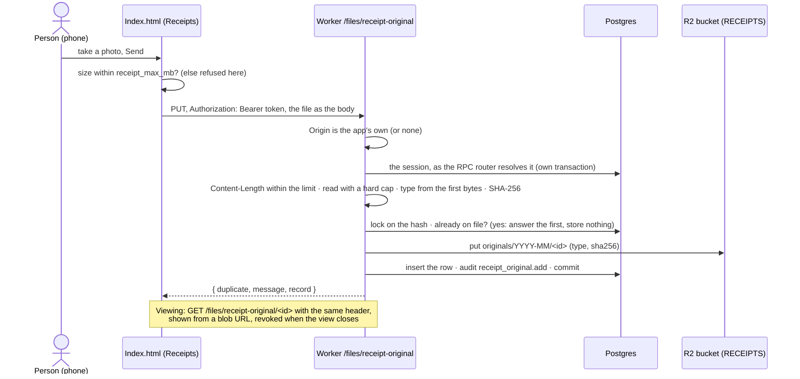

# Receipts and businesses

> Take a photo of a purchase receipt, or pick its PDF, and the app keeps it
> exactly as it was received, for the books and for a tax audit; and the two
> businesses, with what printed on a receipt says which one it belongs to.

<!-- No screenshot: these screens exist only in the Operations app (ADR-0023),
     and the docs runtime (scripts/docs/runtime.js) runs the Apps Script server,
     which has no receipt calls. Nothing in scripts/docs/screens.js can render it. -->

## What it does

Built so far (cards P5-12a and P5-12b), in the Operations app only (inside
Apps Script neither entry exists):

**More → Receipts**, for everyone signed in.

- **Add a receipt**: **Take a photo** (the phone's back camera) or **Choose a
  file** (a JPEG, PNG, WebP or HEIC photo, or a PDF), then which business
  (cstore, vape or *not sure*), an optional note, a preview of what will be
  sent and its size, and **Send**. While sending it says *Sending 2.4 MB…*;
  afterwards *Kept. 2.4 MB, added 2026-11-27 10:05.*, or the server's own
  words: too large, not a photo or a PDF, or *Already on file, added
  2026-11-26 16:40 by Priya Nair.* A photo over the limit is refused on the
  phone before anything is sent, with *Choose a smaller picture size in the
  phone's camera settings and take it again*: the page never shrinks a photo.
- **Admin, manager and payroll admin** see the list: **Waiting**, then **Set
  aside**, newest first, each row with a small preview (images, fetched a few
  at a time as they come into sight) or a PDF mark, who added it and when, its
  size, the business or *business not known*, and the note. Tapping opens the
  original large (a PDF opens in a new tab).
- **Admin and manager**, in that view: **Set aside** (it is not a receipt; a
  reason of 3 to 300 characters; it stays on file under *Set aside*),
  **Put back**, and **Change business** (cstore, vape or not known) on a
  waiting original.
- **An employee** sees *Add a receipt* and what they added in the last 7 days,
  so they can check the photo arrived. Nothing of anyone else's.
- **An original an assistant handed over** (card P5-12b) says *added by Priya
  Nair's assistant (Priya's Muse)*: the key's person and the key's label. One
  from an email also shows its sender and date, as text: *from Fictional
  Corner Supply <billing@…>, sent Nov 26, 09:14 a.m.* Everything else on the
  row is as for a person's upload.

**More → Businesses**, for admin, manager and payroll admin (read only for the
last two). Each business: its display name (the settings
`cstore_business_name`, `vape_business_name`), legal name and HST number
(*not recorded* until an admin types them), notes, and its **signs**: what on
a document says the document is that business's. An admin changes the legal
name, HST number and notes, and adds or removes signs:

| Sign | What it is | Rule |
|---|---|---|
| Name as printed | a trading or billing name as a supplier prints it | 2 to 120 characters, one line |
| HST number | the buyer's number as printed | nine digits, `RT`, four digits; spaces and dashes allowed and dropped (`123456789 RT 0001` is `123456789RT0001`) |
| Supplier account | an account or membership number with one supplier | the number (1 to 60) and the supplier's name (2 to 80) |
| Card ending | a card the business pays with | exactly four digits, never more of the number |

A sign that already belongs to the other business is refused: *The card
ending 4821 already belongs to vape (YV Vape Shop). A sign can belong to one
business only: remove it there first.* A removed sign is kept, marked removed.

**An assistant** (card P5-12b; [assistants](assistants.md)) can list the
originals waiting to be read, be shown one (the stored file itself), hand one
over through a one-time upload address, and ask whether an email has already
been handed over. It reads for the business: any key may list and be shown
every waiting original.

**Not built yet** (later cards): nothing is read from an original (no
supplier, total or tax); no drafts or review screen; no cost history; no
QuickBooks export; no "this email is handled" list beyond the message ids of
originals filed (P5-13). The business on an original is only what a person,
or an assistant from the document, said.

## How it works

**Adding.** `PUT /files/receipt-original`, beside `/rpc/*` and `/mcp` in
`ops/src/index.ts`. Its order: the `Origin` check (a request naming another
origin is refused 403; the page and the API share one origin, so this closes
cross-site uploads with a stolen token); the session from
`Authorization: Bearer <token>` (the page's own token, resolved by the same
`resolveSession` as the RPC router, in its own transaction, so a renewal is
kept as it is for a refused RPC; no token, a bad one, an expired one or a
deactivated person: 401 `NOT_LOGGED_IN`); `Content-Length` required (411) and
within the limit (413) before a byte is read; the body read with a hard cap of
the size claimed (a longer body is refused 413, a shorter one 400); the type
from the first bytes (415 for anything else); the SHA-256; then, in one
transaction: an advisory lock on the hash, the duplicate check, the object put
in R2, the row, and one audit row. New: 201; already on file: 200.

Optional headers, all cleaned on the server: `x-receipt-business` (`cstore` or
`vape`; anything else is "not sure", stored as NULL), `x-receipt-source`
(`photo` or `upload`; anything else is `upload`), `x-receipt-filename` and
`x-receipt-note` (percent-encoded UTF-8). The file name keeps only its last
part after `/` or `\`, loses control and direction characters and leading
dots, and is cut to 120 characters; the note becomes one line of at most 300.
Both are shown to people and never used in a path or a key.

**An assistant's original: `PUT /files/receipt-original/by-ticket/<ticket>`**
(card P5-12b). A file never travels inside a tool call: the tool
`receipt_upload_start` (a `propose` key, counted against its daily cap)
answers a one-time address holding a ticket, 32 random bytes from `crypto` as
base64url, kept in `ops.receipt_upload_tickets` only as its SHA-256. The
ticket is the only credential: no session or assistant key is read on this
route. Its order: `PUT` only (405); **any** `Origin` header refused (403: no
browser has business there); the door on (`assistants_enabled`; off: the same
404 as below, nothing written); `Content-Length` required (411) and within
`receipt_max_mb` (413), before a byte is read and without using the ticket up;
then, in one transaction, the ticket found under a row lock (two PUTs with one
ticket at the same instant take one file). An unknown or malformed ticket, one
used already, one past its 10 minutes, or one whose key has expired or been
withdrawn or whose person is inactive: **the same 404 with one fixed body**,
the reason only in the door's record of calls (flood-limited). A usable ticket
is spent and the PUT recorded, committed **before** the body is read, so the
first PUT that gets that far uses it up whether or not the file is accepted.
Then exactly the page's path: the body read with the same hard cap, the type
from the bytes, the SHA-256, the duplicate rule under the hash lock, the same
storage and audit (`checkLength`, `receiveFile` and `originals.add`, shared
by both routes). The answer is the page's: 201 kept (`id`, `size`, `type`,
*Kept. …*), 200 already on file (`id`, `addedAt`, *Already on file, added …
by …*), or the page's refusal; the ticket is then marked `kept`,
`duplicate` (with the original's id) or `refused` (`not_accepted`, `empty`,
`too_long`, `incomplete`), and one that expires unused is marked `expired`
when it is next seen. Nothing is removed.

**What is recorded for an assistant's or an emailed original.** `added_by` is
the key's person; `assistant_key_id` the key; `source` `assistant`, or `email`
with `email_message_id`, `email_sender` and `email_date` as the assistant gave
them (the message id at most 300 characters and the sender at most 200, with
control characters refused, direction marks removed and the surrounding white
space trimmed; the date a real instant). The file name and the note are
cleaned by the page's own `cleanFileName` and `cleanNote`. The business is
what the assistant declared (`cstore`, `vape`) or NULL. The audit row is the
same `receipt_original.add`, with `assistantKeyId` added. 0010 tied
`assistant_key_id` to source `assistant` only; migration 0012 widens that
check so an emailed original keeps its key (and a later forwarding address can
add an emailed one with none).

**If the row cannot be written after the object was stored** (the database
fails between the two), the answer is an error (500, `SERVER_ERROR` with an
id) and the object stays in the bucket, unreferenced. It is harmless, it is
never removed by the app, and sending the same file again stores it again
with a row.

**Viewing.** `GET /files/receipt-original/<id>` with the same bearer header.
The page cannot put a header on an ``, so it fetches the original and
shows it from a blob URL (an image) or opens a blob URL in a new tab (a PDF).
The answer carries the stored type, `X-Content-Type-Options: nosniff`,
`Content-Disposition: inline; filename="receipt-<id>.<ext>"` (a name the app
makes, never the uploaded one), `Cache-Control: private, no-store` and
`Content-Security-Policy: sandbox; default-src 'none'`, and no cookie or CORS
header. No token in a URL, ever: a token in the query string or a cookie is
ignored (401). An id the session may not see (an employee asking for someone
else's, or their own older than 7 days) answers exactly as an id that does
not exist (404).

**The files accepted**, decided by signature (`ops/src/receipts/sniff.ts`),
never by the name or the type sent:

| Kind | Stored as | Signature |
|---|---|---|
| JPEG | `image/jpeg` | `FF D8 FF` |
| PNG | `image/png` | `89 50 4E 47 0D 0A 1A 0A` |
| WebP | `image/webp` | `RIFF`, four bytes, `WEBP` |
| HEIC / HEIF | `image/heic` | an `ftyp` box first (size 16 or more, within the file), major brand `heic`, `heix`, `hevc`, `hevx`, `heim` or `heis`; or `mif1`/`msf1` with one of those among the compatible brands (AVIF is refused) |
| PDF | `application/pdf` | `%PDF-`, a digit, `.`, a digit |

Anything else (an empty file, a signature cut short, SVG, HTML, a zip, a GIF,
text) is refused with *This file is not a photo or a PDF the app can keep.
Send a JPEG, PNG, WebP or HEIC photo, or a PDF.* A file whose name or header
says one of the five but whose bytes are another of the five is kept as what
its bytes are.

**Storage, locally and hosted.** All storage goes through
`ops/src/receipts/storage.ts`: `put`, `get`, `head`, nothing else. Locally,
`npm --prefix ops run dev` (`wrangler dev`) emulates the bucket on disk under
`ops/.wrangler/` (git-ignored), with no account. Hosted, the bucket
`storeops-receipts` must exist before the Worker is deployed (the hosted setup
creates it; it is never public). **A Worker binding cannot be denied the right
to erase objects**: the code has no way to, and a test keeps it so, but the
binding itself could. So the hosted setup puts a retention lock (an R2 bucket
lock rule) on the bucket, so that nothing, the app included, can remove or
replace an original during the retention period. That is a step of the hosted
setup, not of this code.

**Statuses.** An original is `waiting` (to be read) or `set_aside` (not a
receipt: reason, by whom, when). The column's CHECK is named
(`receipt_originals_status`); a later card adds states (a draft read, a
confirmed receipt) with one migration that drops and re-adds that constraint
with the longer list (a check, not a table rewrite). The set-aside columns are
tied to `set_aside` only, so new states need nothing there. The sources
`assistant` and `email` are allowed already, with their own columns (the
assistant key; the email's message id, sender and date), so those cards need
no migration of this table.

**Sign values** are compared in a normal form (`normalise` in
`ops/src/receipts/businesses.ts`): Unicode NFKC (full-width digits become
digits), lower case, every white space and every dash removed. For a supplier
account the key is the supplier's key, a bar, then the number's key, so the
same number at two suppliers is two signs. The database's partial unique index
on `(kind, value_key)` for live signs holds the rule even past the code, and
every sign change takes one advisory lock, so two admins adding the same card
to the two businesses at once cannot both succeed. The HST number of a
business and an `hst_number` sign are checked against each other across the
two businesses.

## Data

| Table | Reads | Writes |
|---|:-:|:-:|
| `ops.receipt_originals` | ✓ | ✓ (add; status, set-aside, business only) |
| `ops.receipt_upload_tickets` | ✓ | ✓ (add; spend and outcome only) |
| `ops.assistant_calls` | | ✓ (a PUT to the ticket route) |
| `ops.businesses` | ✓ | ✓ (legal name, HST number, notes only; the two rows are seeded) |
| `ops.business_signs` | ✓ | ✓ (add; mark removed only) |
| `ops.audit_log` | | ✓ |
| `ops.config` | `receipt_max_mb`, `cstore_business_name`, `vape_business_name` | |

The first three tables come from `ops/migrations/0010_receipt_inbox.sql`, the
upload tickets from `ops/migrations/0012_receipt_upload_tickets.sql`; all are the
Operations app's own (no Sheet tab feeds them) and are not loaded or compared
by the cutover tools (`LATER_OPS_TABLES` in `ops/src/cutover/compare.ts`). The
legal names and HST numbers start blank: the settings hold display names, not
legal names, and a migration runs before the cutover import has loaded the
settings, so the screen shows the setting's name until one is typed.

## Rules it must not break

- **An original is never erased, overwritten or converted**
  ([ADR-0026](../adr/0026-receipt-originals-are-kept-as-received.md)). No
  `delete` under `ops/src/receipts/`; a `put` never reuses a key; the app's
  database role cannot remove a row or change its hash, size, type, key or
  uploader.
- **The type comes from the bytes**, never from the name or the header.
- **The same bytes are one original**: the SHA-256 is unique, and two uploads
  at once store one object.
- **No original without a session, and none in a URL**: the session comes
  only from the `Authorization` header; the view answer carries the sandbox
  policy and `nosniff`; an id the session may not see answers as a missing one.
  The one exception adds, never shows: an assistant's one-time ticket in the
  upload address, kept as a hash, for one file, for 10 minutes.
- **Every refused ticket is the same 404**, with the same body; the reason is
  only in the record of calls.
- **The business is never guessed**: "not sure" is NULL; one live sign
  belongs to one business.
- **Roles from the session only** (AGENTS.md hard rule 5): a planted `role`,
  `actorId`, `addedBy` or `staffId` changes nothing.
- **Every change is audited**: `receipt_original.add` (id, hash as hex, size,
  type, business, source; never the bytes), `receipt_original.set_aside`,
  `receipt_original.put_back`, `receipt_original.set_business` (before and
  after), `business.update` (before and after), `business_sign.add`,
  `business_sign.remove`.

| Who | Add an original | List and view | Set aside, put back, change business | Read businesses | Change businesses |
|---|:-:|:-:|:-:|:-:|:-:|
| employee | ✓ | own, last 7 days | | | |
| payroll admin | ✓ | ✓ | | ✓ | |
| manager | ✓ | ✓ | ✓ | ✓ | |
| admin | ✓ | ✓ | ✓ | ✓ | ✓ |

## Questions for a real phone test

Read from the code and the platforms' documentation, not yet tried on a phone:

- **iPhone:** the camera saves HEIC by default ("High Efficiency"). Through
  `<input type="file" accept="image/*" capture="environment">`, Safari usually
  hands the page a **JPEG** it converted, not the HEIC; *Choose a file* from
  Files may hand over the HEIC itself. Which one arrives, and whether it is
  still the camera's original, is to be checked.
- **Size:** a 12-megapixel photo is typically 2 to 5 MB as JPEG (1.5 to 3 MB as
  HEIC); a 48- or 50-megapixel "high resolution" mode can pass 10 MB. The
  limit is a setting if 10 MB proves tight.
- **`capture`:** on Android Chrome and iOS Safari it opens the camera
  directly; on a computer it is ignored and the file picker opens. Some
  Android browsers ignore it and offer a chooser.
- **HEIC display:** Safari shows HEIC; Chrome and Firefox on a computer do
  not, so a manager on a laptop sees "this device cannot show this kind of
  photo" for a HEIC original (it is still kept as it was sent).

## Code map

| What | Where |
|---|---|
| Routes | `ops/src/receipts/routes.ts`: `handleUpload`, `handleView`, `handleTicketUpload`, `checkLength`, `receiveFile`, `readCapped`, `NO_TICKET_BODY`, `VIEW_CSP`; wired in `ops/src/index.ts` (`/files/receipt-original`, `/files/receipt-original/by-ticket/`) |
| Upload tickets | `ops/src/receipts/tickets.ts`: `ask`, `lockForPut`, `spend`, `markOutcome`, `proposals`, `byMessageIds`, `cleanEmailText`, `parseEmailDate`, `TICKET_PREFIX` |
| Originals | `ops/src/receipts/originals.ts`: `add`, `inbox`, `forView`, `toRead`, `forAssistant`, `setAside`, `setBusiness`, `maySee`, `maxBytes`, `cleanFileName`, `cleanNote` |
| The type | `ops/src/receipts/sniff.ts`: `sniff`, `CONTENT_TYPES`, `NOT_ACCEPTED` |
| Storage | `ops/src/receipts/storage.ts`: `ReceiptStorage`, `bucketStorage`, `memoryBucket`, `isBucket`; the binding in `ops/wrangler.toml` (`[[r2_buckets]]`, `RECEIPTS`) |
| Businesses | `ops/src/receipts/businesses.ts`: `list`, `update`, `addSign`, `removeSign`, `normalise`, `signKey`, `checkHst` |
| RPCs | `ops/src/rpc/handlers/receipts.ts`: `rpcGetReceiptInbox`, `rpcSetReceiptAside`, `rpcSetReceiptBusiness`, `rpcGetBusinesses`, `rpcUpdateBusiness`, `rpcAddBusinessSign`, `rpcRemoveBusinessSign`; listed in `ops/contracts/rpc-ops.json` |
| Tables | `ops/migrations/0010_receipt_inbox.sql`; `ops/migrations/0012_receipt_upload_tickets.sql` (the tickets) |
| Setting | `receipt_max_mb` in `ops/src/lib/config-keys.ts` (`OPS_ONLY_KEYS`) and `ops/src/modules/settings.ts` (group *Other*) |
| The assistant's view | the `businesses`, `receipts_to_read`, `receipt_original`, `receipt_upload_start` and `receipts_from_email` tools in `ops/src/mcp/tools.ts` ([assistants](assistants.md)) |
| UI | `src/Index.html`: `loadReceiptsTab`, `renderReceiptsTab`, `sendReceiptOriginal_`, `fetchReceiptOriginal_`, `receiptTooLarge_`, `openReceiptSheet_`, `revokeReceiptBlobs_`, `loadBusinessesTab`, `renderBusinessesTab`, `openBusinessSignSheet_`; the `receipts` and `businesses` entries of `MORE_ITEMS` (`opsOnly`) |

## Tests

| Suite | Holds down |
|---|---|
| `ops/test/receipt-inbox.test.ts` | through the Worker's own `fetch` with the in-memory bucket: each of the five types kept with the type its bytes say, whatever was sent; the exact signatures; SVG, HTML, zip, GIF, empty, cut-short refused with nothing stored or written; over the limit refused before the body is read, a lying `Content-Length` stopped at its claim, the limit following the setting; byte for byte and the real SHA-256; the same bytes twice (and twice at once on two connections) one object and one row; no `delete` under `src/receipts/`, no key reused, the database role unable to remove or rewrite; set aside and put back leaving the object and hash; who may add, list, view, set aside and change business; a foreign `Origin`; the view's headers for an image and a PDF, no cookie, no CORS, the same 404 for a forbidden and a missing id, no answer without the header; the audit rows; names and notes cleaned and kept out of the key; a failure after the object was stored; no other table moved |
| `ops/test/mcp-receipts.test.ts` | card P5-12b: an assistant's originals by ticket through the Worker's `fetch` and the tools through the SDK client: the whole flow; byte for byte both ways for the five kinds; the ticket single use, 10 minutes exactly, the same 404 for every refused ticket, one file from two PUTs at once, nowhere stored or answered but once; the page's file rules on this route; who it belongs to and what is recorded; email ids; planted text cleaned; nothing else moved. The refactor of the upload path (`checkLength`, `receiveFile`) is held by `ops/test/receipt-inbox.test.ts`, unchanged |
| `ops/test/businesses.test.ts` | the seven RPCs' roles in the merged contract; the two seeded businesses, blank until typed; every field rule; the HST number normalised and never shared; each kind of sign, normalised; a sign refused at the other business however it is spaced, dashed or cased, also by the database; two admins at once; removal kept and audited; who may; the assistant's `businesses` tool through the SDK client showing the new fields and nothing else |
| `ops/test/mcp-door.test.ts` | the `businesses` tool's exact keys |
| `ops/test/db-migrate.test.ts`, `ops/test/cutover-tool.test.ts` | the three new tables present and skipped by the cutover tools |
| `tests/suites/ui-receipts.js` | an assistant's original says *added by <person>'s assistant (<key label>)*, an emailed one its sender and date, all escaped (card P5-12b); both drawer entries `opsOnly` with their roles; per role, what is rendered (an employee: no list of others, no set-aside or business control); the oversize photo refused before any request; the token only in an `Authorization` header, never in a URL, a toast or storage; blob URLs revoked; the built page carries both screens and Apps Script hides them |

## History

- **Nov 2026 (card P5-12b):** an assistant's way in: the ticket route
  `PUT /files/receipt-original/by-ticket/<ticket>` and its table
  (`ops.receipt_upload_tickets`, migration 0012), the assistant's four inbox
  tools ([assistants](assistants.md)), and on the Receipts screen *added by
  <person>'s assistant (<key label>)* and an emailed original's sender and date
  ([ADR-0026, amended](../adr/0026-receipt-originals-are-kept-as-received.md)).

- **Nov 2026 (card P5-12a):** the two businesses and their signs, the receipt
  inbox (originals kept byte for byte in R2 with a SHA-256 in Postgres), the
  upload and view routes, the Receipts and Businesses screens, and more in the
  assistant's `businesses` tool
  ([ADR-0026](../adr/0026-receipt-originals-are-kept-as-received.md)).
