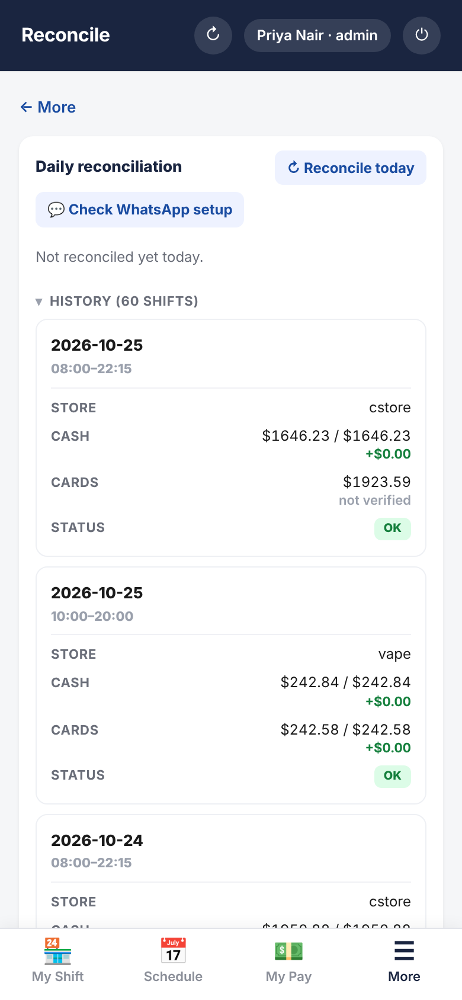
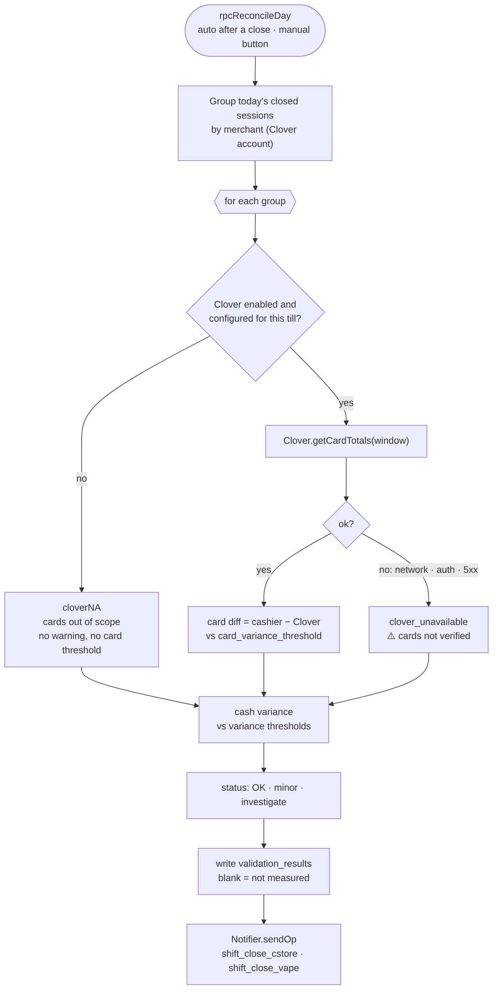

# Reconcile

> After every close, compare what the cashier entered against something that
> measured it independently, and say plainly what was checked and what wasn't.

## What it does

The **Reconcile** tab (managers and above) lists every reconciled shift, newest
first. Each row shows **claimed / measured** and the difference, for cash and
for cards:

- **Cash** is always measured: the cashier's own count against what the drawer
  should hold.
- **Cards** are measured only on a till connected to **Clover** (vape). The
  app asks Clover for the card payments in that shift's time window and
  compares credit, debit and total.
- **A till with no Clover** (cstore on ePOS) shows its card total with **not
  verified**. It doesn't show $0.00 measured, and it doesn't show a red
  shortfall the size of the day's card takings.

**Reconcile today** reruns the check by hand, even if tills are still open.

## How it works

Three outcomes for the cards, and they must stay distinct:

| Situation | Status | Card columns | Message says |
|---|---|---|---|
| Till has no Clover | from cash alone | blank | card figure, no variance |
| Clover answered | from cash **and** cards | filled | claimed / measured (var) |
| Clover failed | `clover_unavailable` | blank | ⚠️ Clover unavailable |

## Running a past day again

*Operations app only* (a new ability, [ADR-0023](../adr/0023-the-operations-app-has-rpcs-and-screens-of-its-own.md);
nothing like it in Apps Script, where the Sheet is edited by hand). When an admin
corrects a closed till ([shifts and close](shifts-and-close.md)), the day's
reconcile was made on the old figures. **Run again for a past day** on the
Reconcile screen (and **Run again** beside each listed day) reconciles that day
again, from the figures as they stand now.

**Who may.** An admin, a manager or a payroll admin: the roles that can open
the screen. The call (`rpcReconcilePastDay`) refuses anyone else. (The ported
`rpcReconcileDay`, for today, still answers any signed-in person, as the old
app's did.) Identity comes from the session; an `actorId` or `role` in the
request is ignored.

**The rules, in the order they are checked.**

1. The day is a real `YYYY-MM-DD`, before today in Toronto (*Use Reconcile
   today for today.*), not in the future, and not more than 370 days back.
2. A reason of 3 to 300 characters, no line breaks.
3. A till of that day still open refuses the run (*Ashin Vale's vape till from
   that day is still open: close it first.*).
4. A day with no closed till at all is refused (*No closed till on 2026-11-20.*).
5. Every till with a closed or validated session that day is reconciled, from
   the figures as they stand now: the same arithmetic as a manual run of today
   (it is the same code, `buildRecords`, with the day passed in).
6. Cards: where a run of today would ask Clover, it asks for that day's window
   (the earliest start to the latest end of the till group's sessions that day),
   inside the same 25-second budget. Clover off, unreachable, out of time or
   refusing the question: the cards are recorded as **not verified** (blank, never
   matching, never $0.00).
7. Earlier results are **kept**. New rows are added; nothing is updated or
   deleted. A new row is `manual` and is marked by being *validated on a later
   day than its business day* (an ordinary run is validated on its own day); the
   reason is in the audit row, which lists the new rows.
8. **No WhatsApp message is sent**, and the answer says `sent: false`. A second
   message about a past day would confuse the group.
9. The sessions' status is not touched (a run of today does not touch it
   either; a `validated` session stays validated).
10. One audit row, `reconcile.past_day`, for the day: the reason, each till
    group's sessions, cash verdict (OK, short, over) and card verdict (matched,
    off, not verified).
11. The answer is what a manual run answers, plus `rerun: true`, `sent: false`
    and `previous` (how many result rows the day already had).
12. Two re-runs of the same day at once take turns: they take the same
    per-day lock as `reconcileDay`, so the second waits, then sees the first's
    rows. The day's till sessions are also locked for share, so a till
    correction in flight is waited for (the re-run reads the corrected figures
    whole) and one that starts during a re-run waits for it.

**How the screen reads a day with several sets of results (Operations app).** A
run is the rows written at one moment. The newest *manual* run is the day's
result (with any automatic run after it, for a till that closed later); runs
before it are *earlier results*, and the day says so: *re-run on 2026-11-27 · 1
earlier result*. Automatic runs of different tills are each current and are not
"earlier results". Apps Script lists every row as it always did.

**What it does not do.** It does not send a message, change a till or any
figure, change a session's status, recalculate commissions, or delete or
overwrite a result. It cannot reconcile today (use *Reconcile today*) or a day
with an open till.

## Data

| Tab | Reads | Writes |
|---|:-:|:-:|
| `till_sessions`, `sales` | ✓ | |
| `validation_results` | ✓ | ✓ |
| `cash_handovers` (cash in hand, for the message) | ✓ | |

## Rules it must not break

- **"Not configured" is not "unavailable."** Warning every day about a till
  that was never meant to have Clover teaches everyone to ignore the warning
  line. Clover switched off (`clover_enabled` false) counts as not configured.
- **Reconcile runs, and the message goes, whether or not Clover is on.** The
  automatic reconcile used to stop when `clover_enabled` was off, which
  silently stopped every close message.
- **Blank is not zero**, on write and on read
  ([ADR-0004](../adr/0004-blank-is-not-zero.md)). `getRecent_` reads the Clover
  columns back as `null`. Reading them as `0` once made both the in-app history
  and the public report show every cstore day as a total loss.
- **The roll-up covers cash too.** A drawer $40 short is never "All matched",
  however the cards came out.
- **Clover never blocks a close.** `Clover.gs` never throws; it returns
  `{ ok:false, error }`.

## Code map

| What | Where |
|---|---|
| Server | `src/Reconcile.gs`: `reconcileDay`, `getRecent_` · `src/Clover.gs`: `getCardTotals`, `merchantFor` |
| RPC | `src/WebApp.gs`: `rpcReconcileDay`, `rpcGetReconciliation` |
| UI | `src/Index.html`: `renderReconPanel`, `reconGroupDetail_`, `pairVar_`; Operations app: `reconDays_`, `reconDayNote_`, `openReconPast_` |
| Past day again (Operations app) | `ops/src/modules/reconcile-past.ts` (`reconcilePastDay`) over `reconcile.ts` (`buildRecords`, `writeRows`, `closedSessions`) · `ops/src/rpc/handlers/reconcile-past.ts` · `rpcReconcilePastDay` in `ops/contracts/rpc-ops.json` |

## Tests

| Suite | Holds down |
|---|---|
| `reconcile` | not-configured vs outage, no fictional variance, a real shortfall still surfaces, blank round-trips as null through the sheet and the public report; with Clover off the automatic reconcile still sends the close message and raises no outage |
| `ui-recon` | the history cell: "not verified" for a till with no Clover, red only for a real difference, a measured zero is a match |
| `parity` | the app and the public page agree on every figure and sign |
| `ops/test/reconcile-past.test.ts` | a past day reconciled again stores what the real run on that day stored (processor on and off, one till and two); after a till correction the new rows carry the corrected verdict and the old rows are untouched; each rule and message; the processor's window (clock-change days too) and its failures recorded as not verified; no message and no notifier call; nothing else moves; the audit row; who may call through the real router; two re-runs at once; a correction in flight; `rpcReconcileDay` unchanged (a golden from before the split) |
| `ui-reconcile-past` | the control only in the Operations app and only for the screen's roles; the Apps Script screen the same HTML as before; a day with several sets shows the newest and says how many it replaced; the form and its answer; the built page carries it |

## History

- **Nov 2026 (P4-12c):** Operations app: **Run again for a past day**
  (`rpcReconcilePastDay`) reconciles every till of a past day again from the
  current figures, keeps the earlier results, asks Clover for that day's window
  and sends no message; the screen shows a day's newest result and says how many
  it replaced. `reconcileDay` was split (`buildRecords`) with no change to what
  it stores, audits or sends.
- **Oct 2026:** the automatic reconcile no longer stops when `clover_enabled` is
  off; Clover switched off is treated as not configured. A **💬 Check WhatsApp
  setup** button sits under the panel header.
- **Oct 2026:** unmeasured card figures read back as `null`, not `$0`. The
  in-app history and the public report had shown cstore's whole card take as a
  shortfall every day.
- **#12 (Batch 13):** cstore has no Clover; "not configured" is separated from
  "unavailable".
- **Batch 9:** Reconcile becomes its own tab; claimed / measured (var) for both
  cash and cards.
- **Batch 5:** reconciliation against Clover per shift window.
