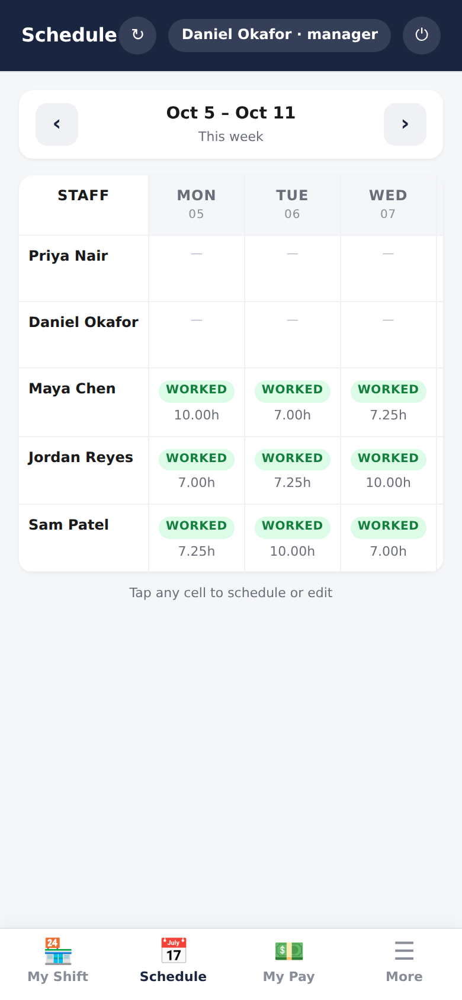
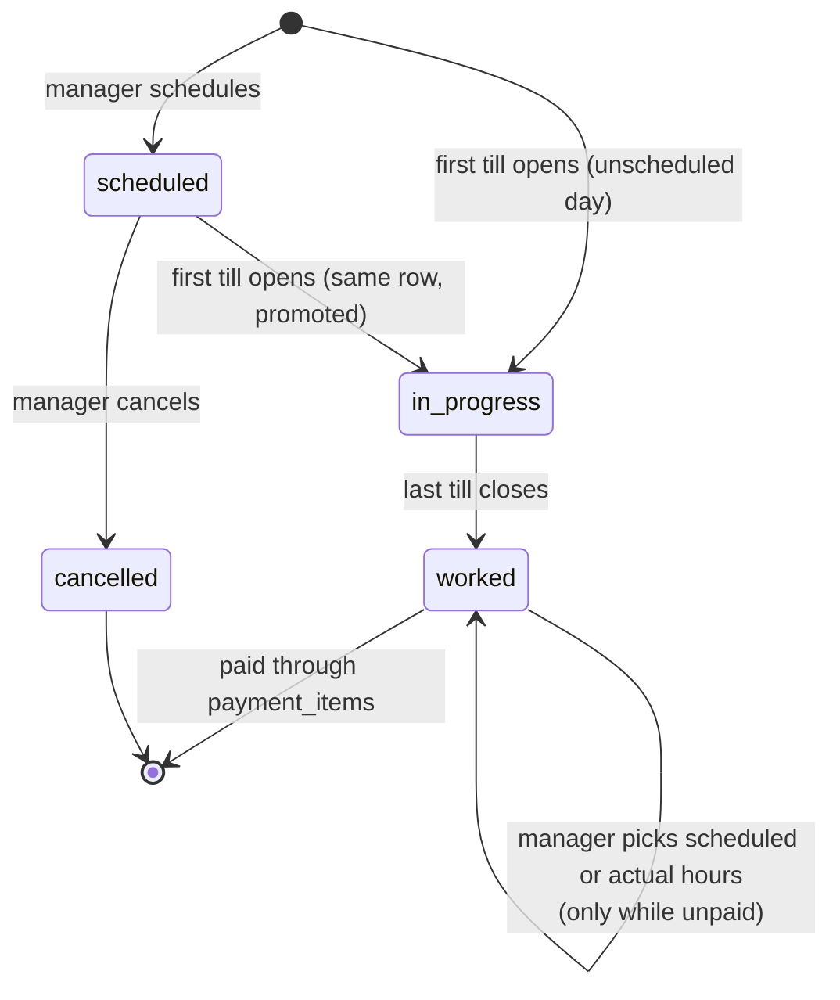

# Schedule and attendance

> Plan the week, then let the tills record who actually worked and for how
> long. That record is what payroll pays against.

## What it does

The **Schedule** tab is one week per screen, a row per person and a column per
day. Everyone can see it. Managers and admins tap a cell to:

- **schedule** a shift ahead of time (start and end time);
- **cancel** a scheduled shift that didn't happen;
- when the scheduled and actual hours differ, **choose which one counts**,
  scheduled or actual;
- (admin only) **correct the clock times** of a worked day;
- (admin, Operations app only) **correct a day after the fact** or **add a
  day worked**: see [Corrections after the fact](#corrections-after-the-fact).

Worked days show **WORKED** with the hours that will be paid.

## How it works

- The attendance ID is **deterministic**: `A_<yyyyMMdd>_<staff>`. A scheduled
  day and the till opening that day land on the **same row**, so a scheduled
  shift can never be paid twice.
- **Hours are wall-clock**, from the first till opening to the last till
  closing. A cashier who runs cstore and vape from 09:00 to 17:00 worked 8
  hours, not 16.
- The **rate is snapshotted** (`rate_at_attendance`) when the day completes.
  A raise next month doesn't re-price this month.
- **`hours_basis`** records whether a manager chose `scheduled` or `actual`.
  Editing the clock times clears it, so the day gets reviewed again.

## Corrections after the fact

Until the move off Sheets, when the schedule did not match what happened an
admin edited the `attendance` tab by hand. The Operations app has no Sheet, so
it has a call of its own for this ([ADR-0023](../adr/0023-the-operations-app-has-rpcs-and-screens-of-its-own.md)):
`rpcGetAttendanceDay` to show a day, `rpcCorrectAttendance` to set it. It does
not exist in the Apps Script app, and the page offers it only when
`isOpsApp_()` is true.

**Who:** an admin only. The contract (`ops/contracts/rpc-ops.json`) says so,
the router enforces it, and the handler checks again. Managers, payroll admins
and employees see the Schedule screen exactly as before.

**Where:** on the Schedule screen, tapping a cell for **today or a past day**
(Toronto) shows **Correct this day** next to what the cell already offers; an
empty cell shows **Add a day worked**. The sheet shows what is recorded, the
till sessions that day (company, start, end), what has been paid, and the hours
the entered times make. After saving it says what the person is owed for that
day, before and after.

A correction sets the day to exactly what the admin entered (it is not a
patch). The rules, checked in this order:

1. The person exists, active or not (someone who has left can still be
   corrected).
2. The day is a real `YYYY-MM-DD`, today or earlier in Toronto, and not more
   than 370 days back. A future day is the schedule's job.
3. A reason of 3 to 300 characters, no control characters. It is the only
   record of why pay changed.
4. Refused while anything is paid against the day (voided payments do not
   count): undo the payment first.
5. Refused while the day is in progress or the person has an open till that
   day: close the till first.
6. The day becomes **worked** or **cancelled** (did not work), nothing else.
7. Scheduled times are blank (not scheduled, stored as blank) or `HH:MM`,
   both or neither, the end after the start.
8. A worked day needs its actual start and end (instants with their zone; the
   page sends Toronto time with Toronto's offset for that date). The end is
   after the start, at most 24 hours later and not in the future; the start is
   on that Toronto day or within 6 hours of it (a shift that began just before
   midnight). Hours are the span, rounded to cents of an hour; the pay basis is
   cleared so the day is reviewed again. The rate snapshot is kept; a day with
   no snapshot (blank, or the 0 a scheduled row is written with) takes the
   person's current rate, and stays **blank** when that is blank (never 0).
9. A day can be cancelled only when the person opened no till that day; its
   actual times and hours are cleared (it is paid nothing); the scheduled times
   stay as entered, so the record shows what was planned.
10. A missing day is created (`A_<yyyyMMdd>_<staff>`); an existing one is
    updated and marked modified. The person's staff row is locked first, the
    same lock a payment takes, so a correction and a payment of one person
    cannot overlap: either the payment sees the corrected hours, or the
    correction sees the payment and is refused.
11. The reason is appended to the notes as `Corrected: <reason>`; notes are
    capped at 2,000 characters, keeping the newest text.
12. One audit row, `attendance.correct`, with the whole record before (blank
    when the day was created) and after, and the reason.
13. Till sessions, sales, payments and bonuses are never touched. Recorded
    hours may then differ from the tills' span: that is the point (a till
    opened late, a person who worked without one).

**Worked example 1 — someone left early and the other person stayed.** Cleo
(cstore, $20/h) and Eli (vape, $18/h) both closed at 17:00 on Monday. Cleo in
fact left at 14:00 and Eli stayed until 19:00. The admin opens Cleo's Monday,
sets the actual end to 14:00, reason "Left at 14:00, Eli covered": 8 h → 5 h,
owed for the day $160.00 → $100.00. Then Eli's Monday, end 19:00: 4 h → 6 h,
$72.00 → $108.00. Payroll shows exactly those amounts.

**Worked example 2 — a no-show and a stand-in.** Dara was scheduled 10:00 to
18:00 on Tuesday and did not come; Eli covered and was never scheduled. The
admin opens Dara's Tuesday, chooses *Did not work*, reason "Did not come; Eli
covered": the day is cancelled and paid nothing, the schedule still shows
10:00 to 18:00. Then Eli's empty Tuesday, **Add a day worked**, 10:00 to 18:00:
the day is created as worked, 8 h at $18/h, owed $144.00.

## Data

| Tab | Reads | Writes |
|---|:-:|:-:|
| `attendance` | ✓ | ✓ |
| `staff` (rate) | ✓ | |
| `payment_items` (is it paid?) | ✓ | |

## Rules it must not break

- **No change to a paid day.** Adjusting hours on a day with any payment
  against it is refused with the amount already paid; undo the payment first.
- **Every change is audited** with before and after (`attendance.adjust_hours`,
  time edits).
- **Cancelled days are ignored by payroll.**
- **A correction never touches a paid day, an open till, or any money record**,
  and a blank rate stays blank.

## Code map

| What | Where |
|---|---|
| Server | `src/Attendance.gs`: `openOrPromote_`, `schedule_`, `complete_`, `cancel_`, `adjustHours_`, `editActualTimes_` |
| RPC | `src/WebApp.gs`: `rpcGetWeekSchedule`, `rpcScheduleShift`, `rpcCancelScheduledShift`, `rpcAdjustAttendanceHours`, `rpcEditAttendanceTimes` |
| UI | `src/Index.html`: `renderScheduleTab`, `editScheduleCell` |
| Corrections (Operations app) | `ops/src/modules/attendance-corrections.ts` (`getDay`, `correct`), `ops/src/rpc/handlers/attendance-corrections.ts`; page: `scheduleCellOffers_`, `torontoInstant_`, `openDayCorrection_` |

## Tests

| Suite | Holds |
|---|---|
| `ops/test/attendance-corrections.test.ts` | corrections: the two owner cases end to end with payroll; admin only through the real router; every rule with an accepting and a refusing case; the audit row; nothing else moves; two corrections at once, and a correction racing a payment |
| `ui-schedule-corrections` | the correction controls only for an admin in the Operations app, today or earlier; Toronto instants across both clock changes; the Apps Script cell sheet and its old calls unchanged |
| `ops/test/attendance.test.ts` | the Operations app's port of the schedule calls |

The Apps Script side has no dedicated suite yet; attendance is exercised
through the close (`wiring`, `lotto-payout`) and payroll. A suite for the
state machine and the paid-day guard is on the
[backlog](../guides/docs-process.md#known-gaps).

## History

- **P4-10 (Operations app):** an admin corrects a past day, or adds a day
  worked, after the fact (`rpcGetAttendanceDay`, `rpcCorrectAttendance`).

- **Batch 4:** schedule grid in the web UI.
- **Batch 2:** attendance as the payroll source of truth; completes on the last
  close.
