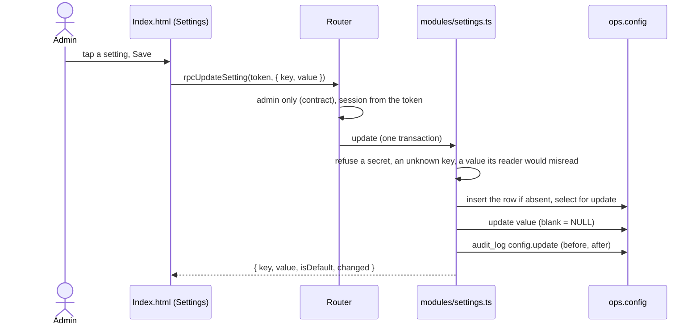

# Settings

> An admin changes the floats, limits, WhatsApp recipients and Clover address
> from a screen, where it used to be a cell of the Sheet's `config` tab.

<!-- No screenshot: this screen exists only in the Operations app (ADR-0023),
     and the docs runtime (scripts/docs/runtime.js) runs the Apps Script server,
     which has no rpcGetSettings. Nothing in scripts/docs/screens.js can render it. -->

## What it does

**More → Settings** (admins only, and only in the Operations app: inside Apps
Script the entry is hidden, because the Sheet is still the place to edit a
cell). The screen lists every setting under a heading: *Tills and cash*,
*Sign-in*, *WhatsApp*, *Clover*, *Till*, *Commissions*, *Public report* and *Other*.
Each row shows the setting's plain-language description, its key, and its
current value, or **default: X** in grey when nothing is set.

Tap a row to change it. The sheet shows the description and the default, an
input that suits the setting (Yes/No buttons, a number box, the staff list for
the cash manager, text otherwise), **Use the default** (sends a blank) and
**Save**. If the server refuses the value, its message is shown under the
input exactly as written; nothing is saved.

Below the settings, **Kept by Cloudflare** lists the four credentials (the
WhatsApp token, the two Clover tokens and the till's key) by name, as *set* or
*not set*. They
are never shown, never stored in the table and cannot be changed here: the
screen says where they are changed (the Worker's secrets in Cloudflare).

Rows in `ops.config` that the app does not know (for example the shopping-list
template name) appear under *Other saved values* and can be edited as plain
text. This screen edits settings; it never invents one.

## How it works

`rpcGetSettings(token)` answers `{ settings, other, secrets }`. Each setting
carries `key`, `value` (the stored text, or `null`), `default`, `read` (how the
code reads it: text, number, boolean, list), `description`, `isDefault` and
`group`. A secret is `{ key, binding, isSet }`: the binding's name and whether
it holds a value, never the value, its length or any part of it.

`rpcUpdateSetting(token, { key, value })` stores `value` after checking it
against the rule of the code that reads the setting (below). A blank value
(empty, missing, or only spaces) stores `NULL`, meaning "use the default"; the
database role cannot delete from `ops.config`, and no row is ever deleted. The
row is locked before it is read, so two edits of one key cannot interleave and
the audit rows chain (the second's `before` is the first's `after`). Setting a
value to what it already is changes nothing and writes no audit row
(`changed: false`).

Both RPCs are listed in `ops/contracts/rpc-ops.json` (not `rpc.json`), with
roles `["admin"]`. The handlers check the role again themselves.

## The settings and what is refused

| Key | Kind | Default | Refused when | Why |
|---|---|---|---|---|
| `cstore_default_opening_float`, `vape_default_opening_float`, `lotto_reserve_default` | number | 250, 100, 500 | negative, or over 1,000,000 | zero is a real figure (the reader keeps it); a slip of a digit is not |
| `variance_ok_threshold`, `variance_minor_threshold`, `card_variance_threshold` | number | 1, 30, 1 | zero or less, or over 1,000,000 | the readers turn zero into the default, so a stored 0 would look set and do something else |
| `cstore_card_split`, `vape_card_split` | boolean | false, true | anything but true/false | see the note on blanks below |
| `cstore_epos_from` | text | blank | not a real date `yyyy-mm-dd` | it marks where the credit/debit split stops in reports |
| `cash_manager_staff_id` | text | blank | not the id of an active person on the staff list | cash handovers go to this person |
| `cash_handover_stale_days` | number | 7 | not a whole number from 1 to 365 | the reader turns zero or less into 7 |
| `session_hours` | number | 24 | not a whole number from 1 to 720 | a zero is read as 24; a month is the longest sign-in |
| `login_max_fails` | number | 5 | not a whole number from 1 to 100 | zero would be read as 5 |
| `login_lockout_mins` | number | 60 | not a whole number from 1 to 10080 | zero would be read as 60; a week is the longest lockout |
| `notifier_enabled`, `clover_enabled` | boolean | false | anything but true/false | the readers take anything else as off |
| `whatsapp_target_number` | list | blank | an entry that is not 8 to 15 digits (spaces, `+`, `-`, brackets are removed first), or more than 20 | stored as comma-separated digits; a repeat is kept once |
| `whatsapp_api_url` | text | blank | not an `https://graph.facebook.com` address | the token is only ever sent there (`isMetaUrl`) |
| `clover_base_url` | text | `https://api.clover.com` | not one of Clover's addresses | the token is only ever sent there (`isCloverUrl`) |
| `till_enabled` | boolean | false | anything but true/false | the switch of the [till link](till-link.md); off until the address and key are set |
| `till_api_url` | text | blank | not one of the till's own addresses (`isTillUrl`: https, no user name, port or query, an exact host of the contract's `servers`, under `/ops/v1`) | the till's key is only ever sent there |
| `till_key_expires_on` | text | blank | not a real date `yyyy-mm-dd` | recorded by the admin when the key is installed; the warning 14 days ahead is a later card |
| `public_report_url` | text | blank | not an `https:` address | the reconcile message links to it |
| `commission_run_day` (0 to 6), `commission_run_hour` (0 to 23) | number | 1, 9 | outside the range | **they do not move the weekly run**: its time is fixed in the app's configuration (card P3-10b); the screen says so |
| business names, template names and language, merchant ids, `timezone` | text | | over 500 characters, or a line break or other control character | a newline in a name would break a WhatsApp template parameter; `timezone` must also be a real zone |

Every number must be written in plain decimal form (`250` or `250.50`): no
`1e3`, `Infinity` or `0x10`.

A blank for `cstore_card_split` is read as *yes* by the code that reads it
(as the old app did), although the registry's default for cstore is *no*. The
screen says so in the description and shows what a blank reads as, rather than
letting "default: No" stand for something the app does not do.

## Rules it must not break

- **A secret is never shown, logged, returned or stored.** The list answers
  with the binding's name and whether it is set. A key shaped like a
  credential (ending `_token`, `_key`, `_secret`, or containing `password`) is
  refused and hidden even when it is not in the registry. See the config
  registry (`ops/src/lib/config-keys.ts`).
- **Only an admin.** Role and identity come from the session; an `actorId` or
  `role` in the input is ignored.
- **Blank is not zero** ([ADR-0004](../adr/0004-blank-is-not-zero.md)). Blank
  stores `NULL`, never `''`, and a real zero stays `0`.
- **Phone numbers are personal data.** The audit row of a recipients change
  holds each number masked to its last four digits and the count, never a full
  number.
- **Never delete.** "Use the default" is a blank; the app's database role has
  no `delete` on `ops.config`.
- **The screen must not let an admin believe another address works.** The WhatsApp
  and Clover addresses are refused unless the code would actually send the token
  there.

## Code map

| What | Where |
|---|---|
| Module | `ops/src/modules/settings.ts`: `list`, `update` |
| RPCs | `ops/src/rpc/handlers/settings.ts`: `rpcGetSettings`, `rpcUpdateSetting`; listed in `ops/contracts/rpc-ops.json` |
| Registry of keys | `ops/src/lib/config-keys.ts` (not changed by this screen) |
| The till's address rule | `ops/src/till/address.ts` (`tillBaseUrl`) |
| UI | `src/Index.html`: `loadSettingsTab`, `renderSettingsTab`, `openSettingSheet`; the `settings` entry of `MORE_ITEMS` (`opsOnly`) |

## Tests

| Suite | Holds down |
|---|---|
| `ops/test/settings.test.ts` | who may call (admin only, through the real router and the merged contract), the list (every registry setting once, unknown rows, secrets by name only and never a value), each validation rule, blank storing `NULL`, a zero staying zero, the app behaving differently after a save, the audit row (masked numbers, none for no change), refusals writing nothing, two edits at once, no `delete` for the app role |
| `tests/suites/ops-ui-build.js` | the entry is `opsOnly` and admin only, hidden in Apps Script and shown in the Operations app, a loader exists, the two calls are named only by the screen's own functions, the screen is escaped, and the built page keeps it |

## History

- **Nov 2026 (card P4-09):** the Settings screen, `rpcGetSettings` and
  `rpcUpdateSetting`: the first screen and calls only the Operations app has
  ([ADR-0023](../adr/0023-the-operations-app-has-rpcs-and-screens-of-its-own.md)).
- **Nov 2026 (card P5-02a):** a *Till* group (`till_enabled`, `till_api_url`,
  `till_key_expires_on`) and a fourth credential, `TILL_API_KEY`, in *Kept by
  Cloudflare* ([till link](till-link.md), [ADR-0024](../adr/0024-the-till-is-read-through-one-client.md)).
