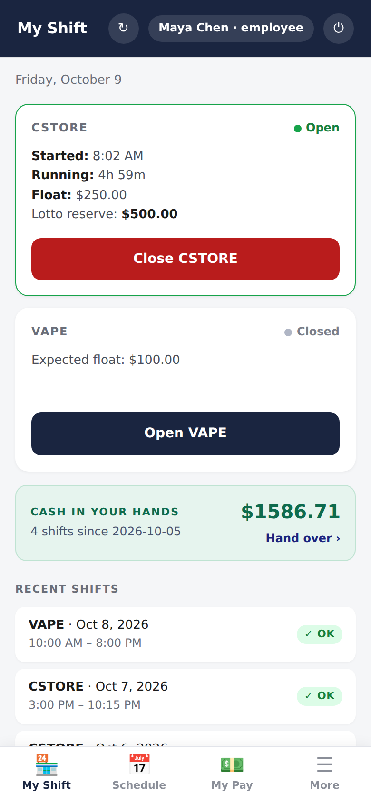
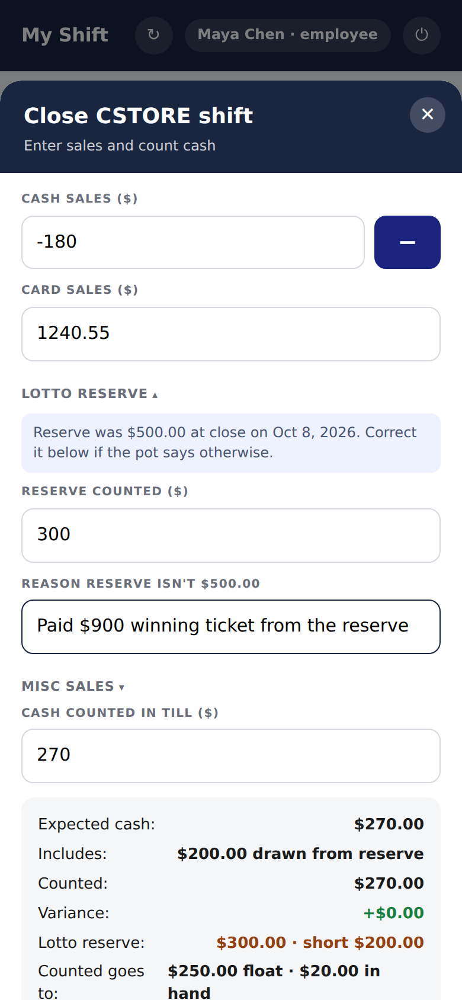
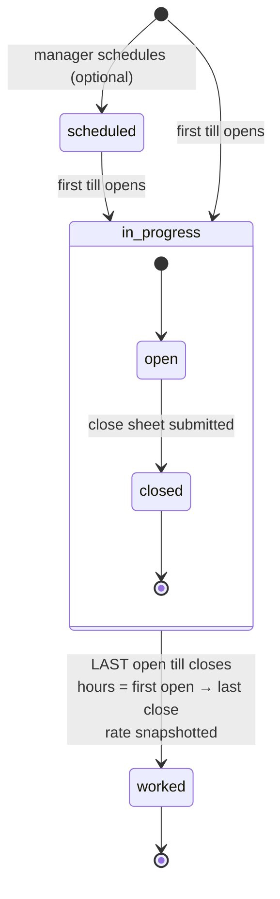

# Shifts and the close

> A cashier opens a till, works the shift, and closes it in one sheet. The app
> works out what the drawer should hold and says at once whether it balances.

| My Shift | The close sheet |
|---|---|
|  |  |

## What it does

**My Shift** shows one card per counter the cashier is allowed to run. Opening
a till confirms the float ($250 cstore, $100 vape by default). At the end of the
shift the cashier fills in the **close sheet**:

- **Cash sales** and **card sales** from the till's end-of-day report. A till
  that splits cards asks for credit and debit; cstore on ePOS asks for one card
  total.
- **Misc sales** (collapsed by default) for anything rung up outside the POS.
- **Lotto reserve** (cstore only): the pot is counted, and a count that differs
  from the last one needs a reason.
- **Cash counted in till.**

The summary at the bottom updates as they type: expected cash, what the pot
contributed, the variance, and where the counted cash goes (float stays, the
rest is **in hand** until it is handed over).

The screenshot shows the hard case. A $900 winning ticket was paid that shift,
so cash sales are **−$180** (the **−** button exists because phone number pads
have no minus key). The pot went from $500 to $300 and fed $200 to the drawer.
$250 + (−$180) + $200 = $270 expected; $270 counted; **+$0.00**.

## How it works



1. `rpcOpenShift` → `TillSessions.open` creates `CST-` or `VAP-<date>-<staff>`
   and creates or promotes today's `attendance` row. The ID is deterministic,
   so a double tap can't open two sessions.
2. `rpcCloseShift` → `TillSessions.close` computes:

   ```
   reserve_fed   = (last count + last top-up) − this count     (cstore only)
   expected_cash = float + cash_sales + misc_cash − cashback + reserve_fed
   variance      = counted − expected     → OK / minor / investigate
   ```

   writes the `sales` row (one card shape per row, see
   [ADR-0005](../adr/0005-card-shapes-are-mutually-exclusive-columns.md)), and,
   if this was the person's last open till, completes the attendance.
3. The client then calls `rpcReconcileDay(auto)`, which reconciles the day and
   sends the close message ([reconcile](reconcile.md),
   [notifications](notifications.md)).

The variance bands come from `variance_ok_threshold` and
`variance_minor_threshold` in config.

## Corrections after the close

Until the move off Sheets, when a cashier mistyped a figure at close (the cash
counted, the cash sales, a card total with a slipped digit) an admin fixed the
`till_sessions` and `sales` tabs by hand, often without recomputing what
depends on them. The Operations app has no Sheet, so it has two calls of its own
for this ([ADR-0023](../adr/0023-the-operations-app-has-rpcs-and-screens-of-its-own.md)):
`rpcGetTillCorrection` shows a closed till, `rpcCorrectTillSession` sets its
figures. Neither exists in the Apps Script app (its `TillSessions.edit` is
called by no screen and recomputes only part of the close), and the page offers
them only when `isOpsApp_()` is true.

**Who:** an admin only. The contract (`ops/contracts/rpc-ops.json`) says so, the
router enforces it, and the handler checks again. Managers, payroll admins and
employees see the Sales screen exactly as before.

**Where:** on the Sales screen, each till of the selected day shows **Correct
this till** (the Sales day is the screen that lists every closed till to an
admin; the History screen lists payments, not tills). The sheet shows who,
which till and the day; what is recorded now (the entered figures, expected
cash, the variance and its status, cash removed, the total); the cash from this
till already handed over; whether the day has been reconciled and which
commission runs cover it. Its inputs are the close sheet's, in the close
sheet's words and order and in the row's card shape, prefilled. As the admin
types it previews the variance and the total; after saving it shows the
server's figures: *Variance $A → $B. Cash removed $C → $D. Day's total $E → $F.*
A blank figure is shown in words (*not counted*, *not entered*), never as $0.00.

A correction sets the session and its sales row to exactly what a close with
those figures would have stored. The arithmetic is the close's own: `close`
and the correction both call `closeFigures` in `ops/src/modules/till-sessions.ts`.
The rules, in this order:

1. The session exists and is closed (or validated). An open till is refused:
   *This till is still open: close it instead.* The session row is locked, then
   its sales row, then the cashier's staff row.
2. A reason of 3 to 300 characters, no control characters.
3. Not more than 370 days ago.
4. Every figure is blank or a number, rounded to cents, and checked as the close
   checks it, with the close's messages: the cash counted is required and 0 or
   more; cash sales may be negative only on cstore (a lotto payout); expected
   cash may not come out below zero; a reserve count away from the expected
   balance needs its reason. The opening float is required, 0 or more. A blank
   figure is stored **blank (NULL), never 0**; it counts as 0 where it is
   summed. A blank reserve count means *not counted*: nothing is fed from the pot.
5. One card shape (ADR-0005): credit and debit, or one card total, never both
   (*Send one card shape.*). A row keeps its shape, or changes to the shape its
   till reports on that business date: for cstore, credit and debit before
   `cstore_epos_from` and one total from that day on; otherwise the till's
   `<company>_card_split`. The other shape's columns are stored blank.
6. Everything the close derives is derived again: expected cash, variance,
   variance status, cash removed, the lotto figures and the total. What the
   close took from settings is taken from that day where the session records
   it: the float left in the drawer is the session's own, and the pot's previous
   count is the count of the cstore close before this one. The variance
   thresholds are today's settings. Who, when, the till, the day and the status
   never change.
7. Cash already handed over from this till (voided handovers excluded) may not
   exceed the corrected cash removed: *Cannot correct: $X from this till has
   already been handed over. Void the handover first.* A handover draws on
   particular sessions (`cash_handover_items`), so the rule is per session; a
   handover locks the cashier's staff row, which the correction locks too, so
   the two cannot overlap.
8. A session with no sales row gets the row a close would have written.
9. One audit row, `till.correct`, with the whole session and sales row before
   and after, and the reason.
10. The reason is appended to the notes as `Corrected: <reason>`, capped at
    2,000 characters, keeping the newest text.
11. Nothing else is written: attendance, payments, bonuses, handovers,
    commission runs and reconcile results are untouched, no message is sent,
    and the sales row keeps its id and place. The answer says what is now
    stale: a reconcile result for that till and day (*run the reconcile for it
    again*), each commission run whose week contains the day when the sales
    figures changed (*not recalculated*), and the next cstore close when the
    reserve count changed (its expected cash was measured against the old count).
12. A correction that changes nothing writes nothing.

**Worked example — a cash count typed as 1,520.00 that was 1,250.00.** Dara
closed the vape till on Saturday: float $100.00, cash sales $1,150.00, credit
$300.00, debit $200.00, and typed the count as $1,520.00. The close stored
expected cash $1,250.00, a variance of +$270.00 (*investigate*) and $1,420.00
cash removed, so Cash Handling showed Dara holding $1,420.00. The admin opens
the till from Sales, sets *Cash counted in till* to 1250.00, reason "Count
typed as 1,520.00; it was 1,250.00". The sheet answers *Variance $270.00 →
$0.00. Cash removed $1420.00 → $1150.00. Day's total $1650.00 → $1650.00.*; the
variance status is *OK*, and Dara now holds $1,150.00: exactly $270.00 less. If
Saturday had been reconciled, the sheet adds *This day was reconciled on the old
figures: run the reconcile for it again.*

## Data

| Tab | Reads | Writes |
|---|:-:|:-:|
| `till_sessions` | ✓ | ✓ |
| `sales` | ✓ | ✓ |
| `attendance` | ✓ | ✓ |
| `config` (floats, thresholds, card split) | ✓ | |

## Rules it must not break

- **A payout is netted into cash sales**, and only cstore's `cash_sales` may go
  negative. Every other money field strips a minus sign, and the server rejects
  a negative on vape.
- **The reserve is derived from two counts, never typed as "fed"**
  ([ADR-0008](../adr/0008-lotto-reserve-is-derived-from-two-counts.md)). The
  last top-up counts as part of the starting balance, or a topped-up pot is
  understated by exactly the top-up.
- **Hours are wall-clock**, from the first open to the last close. Running two
  tills doesn't double the hours.
- **One shift per person per till per day.**
- **The card shape comes from config at write time**, and each row records
  which shape it used, so history before and after a till change stays readable.
- **A correction is a close done again, not a patch** (Operations app): the
  close's own arithmetic, blank stays blank, and cash already handed over is
  never left uncovered.

## Code map

| What | Where |
|---|---|
| Server | `src/TillSessions.gs`: `open_`, `close_`, `getLottoLog_` · `src/Sales.gs`: `write_` · `src/Attendance.gs`: `openOrPromote`, `complete` |
| RPC | `src/WebApp.gs`: `rpcGetMyShiftState`, `rpcOpenShift`, `rpcCloseShift`, `rpcNotifyShiftOpen` |
| UI | `src/Index.html`: `renderShiftTab`, `renderShiftCard`, `openShiftForm` |
| Corrections (Operations app) | `ops/src/modules/till-corrections.ts` (`getCorrection`, `correct`, `shapeForDate`), the shared arithmetic `closeFigures` in `ops/src/modules/till-sessions.ts`, `ops/src/rpc/handlers/till-corrections.ts`; page: `tillRowOffers_`, `tillCorrectionHTML_`, `openTillCorrection_` |

## Tests

| Suite | Holds down |
|---|---|
| `lotto-payout` | netting, reserve fed from two counts, no double-counted top-up, the two guards |
| `sales-cards` | the two card shapes and one continuous total |
| `ui-close-sheet` | the form as shipped: sign button, which inputs strip a minus, the live summary |
| `wiring` | every close-sheet field reaches the server and the sales row |
| `ops/test/till-corrections.test.ts` | corrections: a corrected till stores exactly what a close with the same figures stores (each till, each card shape, with and without a pot movement); the worked example through cash handling, the sales dashboard and the public report; admin only through the real router; every rule with an accepting and a refusing case; the audit row; nothing else moves; what goes stale; two corrections at once, and a correction racing a handover |
| `ui-till-corrections` | "Correct this till" only for an admin in the Operations app, on a closed till; the Apps Script Sales screen unchanged; the close's inputs in the row's card shape; a blank shown in words |

## History

- **P4-12a (Operations app):** an admin corrects a closed till's figures
  (`rpcGetTillCorrection`, `rpcCorrectTillSession`), worked out again with the
  close's own arithmetic.
- **#12, #13 (Batch 13):** cstore moves to ePOS with one card figure. A lotto
  top-up was being counted twice; fixed.
- **#10, #11 (Batch 13):** a lotto payout may exceed the day's takings; sign
  button.
- **Batch 7:** close-sheet input fixes and the daily lotto reserve log.
- **Batch 2:** shift lifecycle; attendance completes on the last close.
