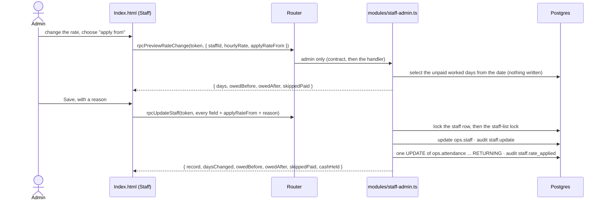

# Staff

> Add a person, change them, deactivate them, set their PIN and give a raise,
> in the Operations app, where it used to be typing into the Sheet's `staff` tab.

<!-- No screenshot: this screen exists only in the Operations app (ADR-0023),
     and the docs runtime (scripts/docs/runtime.js) runs the Apps Script server,
     which has no rpcGetStaffAdmin. Nothing in scripts/docs/screens.js can render it. -->

## What it does

**More → Staff**, in the Operations app only (inside Apps Script the entry is
hidden: the Sheet is still where people are added there). It is offered to an
**admin** and a **manager**, who see different things.

| | Admin | Manager |
|---|---|---|
| The list | everyone, active first then by name, inactive greyed: role, tills, rate ("no rate set" when blank, never $0.00) and badges for *no PIN*, *locked out*, *till open*, *holds $X* | names, role, tills and active only: no rate, email, notes or cash anywhere, on screen or in the answer |
| Add a person | every field: name, role, tills, rate, start date, email, notes, first PIN | name, tills, start date and first PIN; always an **employee**, with no rate |
| Change a person | tap them: every field, **Deactivate** / **Reactivate**, **Set a new PIN**, and a raise that may reach back to unpaid days | nothing opens |

A PIN is typed twice into password boxes and compared on the device before it
is sent. The admin tells the person their PIN; nobody changes their own (the
owner, Nov 27), except an admin setting it the same way as anyone else's.

When an admin changes a rate, **Also apply to unpaid days from** appears.
Choosing a date asks the server what would happen and shows it before Save:
*"4 days: owed for them goes from $160.00 to $418.00. 2 paid days are left as
they are (2026-05-18 $160.00, 2026-05-19 $50.00)."* After saving, the sheet
says what changed in words: days re-rated, the two owed figures, paid days
left alone, and, after a deactivation, the shop cash the person still holds.

Every message from the server is shown as written; nothing is saved when one
appears.

## How it works

Five calls, listed in `ops/contracts/rpc-ops.json` (not `rpc.json`), each
needing a session; the router applies their roles and each handler checks
them again.

| Call | Who | Answers |
|---|---|---|
| `rpcGetStaffAdmin(token)` | admin, manager | admin: `{ viewerRole, cashManagerStaffId, staff: [{ staffId, name, role, companies, active, hourlyRate, startDate, email, notes, hasPin, lockedOut, openTills, cashHeld }] }`; manager: `{ viewerRole, staff: [{ staffId, name, role, companies, active, hasPin }] }` |
| `rpcCreateStaff(token, { name, role, companies, hourlyRate, startDate, email, notes, pin })` | admin, manager | the new person as the caller's list shows them |
| `rpcUpdateStaff(token, { staffId, name, role, companies, hourlyRate, startDate, email, notes, active, applyRateFrom, reason })` | admin | `{ record, changed, daysChanged, owedBefore, owedAfter, skippedPaid, cashHeld }` |
| `rpcPreviewRateChange(token, { staffId, hourlyRate, applyRateFrom })` | admin | `{ days, owedBefore, owedAfter, skippedPaid }`; writes nothing |
| `rpcSetStaffPin(token, { staffId, pin })` | admin | `{ staffId, sessionsEnded, lockoutCleared }` |

The list is read in six queries whatever the number of people (the staff, the
failed sign-ins, the open tills, and the three reads of the cash ledger). The
PIN hash is never returned to anyone.

### Signed-in people feel a change at once

A session is a row keyed by the hash of its token, and on **every** call the
router rebuilds the caller from the staff row (`validateSession`): role,
tills, and whether they are active. So:

- a **role change** applies to the person's very next call, without signing
  them out;
- a **deactivation** deletes all their sessions (signed out everywhere at
  once), and an inactive person's token would be refused anyway.

### The locks

- One advisory lock for the staff list (`ops.staff.admin`), taken by every add
  and every change before it reads names, ids or admins. Two people added at
  the same moment get two different ids (the second waits and reads the
  first's row); the same name cannot be added twice; two admins demoting each
  other at once cannot leave none.
- A change locks the person's staff row **first**. `payShifts` and
  `Payments.undo` lock the same row first, so a payment and a raise of the
  same person never interleave: either the payment reads the new rates, or
  the raise sees the payment and leaves the day alone as paid.
- A deactivation also takes the two till-open locks and the
  `cash_manager_staff_id` setting's row, so an opening or a cash-manager
  change that committed first is seen and refuses it.
- A raise on unpaid days also locks the person's in-progress days, so a till
  closing at that moment either finishes first (and its day is re-rated) or
  waits and reads the new rate.

## Rules it must not break

**Who.** An admin does everything; a manager adds an employee and nothing
else. Identity and role come from the session only: a `role` or `actorId` in
the input changes nothing.

**Adding a person** (every rule also holds for a change):

- **Name:** required, trimmed, 1 to 80 characters, no control characters.
  Refused when it is the name of another **active** person, ignoring case and
  repeated spaces (*"There is already an active person called Ada Quill."*):
  people sign in by picking their name. Someone who has left does not count.
- **Role:** employee, manager, payroll admin or admin. A manager may add only
  an employee (*"A manager can add an employee only."*).
- **Tills:** cstore, vape, both, or none (someone who opens no till), each
  once; stored as the comma list the table uses (`cstore,vape`).
- **Hourly rate:** blank means *no rate yet* and is stored `NULL`, never 0
  ([ADR-0004](../adr/0004-blank-is-not-zero.md)); otherwise a plain number from
  0 to 1000 with at most 4 decimals. From a manager, any rate is refused
  (*"Only an admin sets a pay rate."*), and so are an email and notes.
- **Start date:** blank or a real date. **Email:** blank or one plain address,
  at most 200 characters. **Notes:** at most 500 characters, no control
  characters (not even a line break).
- **PIN:** 4 to 8 digits, stored only as the slow salted hash `hashPin` makes.
  It never appears in the audit log, an error message, an answer or a log.
- **Id:** the next `S_NNN` after the highest id of that shape (`S_010` after
  `S_009`, `S_1000` after `S_999`); ids of another shape are ignored.
- One audit row `staff.create` with the record (no PIN, no hash), naming who
  added them.

**Changing a person** sets them to exactly what the sheet sends:

- **The last active admin** cannot be demoted or deactivated (*"Ada Quill is
  the only active admin."*). **Nobody deactivates themselves** (*"You cannot
  deactivate yourself: ask another admin."*) **or changes their own role**
  (*"You cannot change your own role: ask another admin."*).
- **Deactivating** is refused while the person has a till open (*"Close Eli
  Stone's till first."*) or is the cash manager in Settings (*"Bram Hale is
  the cash manager: name someone else in Settings first."*). Someone who holds
  shop cash can be deactivated: the answer carries the amount, the page says
  it, and the cash stays on the Cash screen under their name. Reactivating is
  allowed (unless the name now belongs to another active person).
- **A reason** (3 to 300 characters) is required when the rate, the role or
  active changes.
- **A new rate** applies to days worked from now on (it is read when a till
  closes). Days already worked keep `rate_at_attendance`.
- **A raise on unpaid days:** with a date (a real day, not in the future, not
  more than 370 days back) and a rate changed to an amount, every **worked**
  day of that person from the date with **nothing paid** against it (a voided
  payment counts for nothing) takes the new rate, in one UPDATE. Days with any
  payment, even part of one, are left untouched and listed. A day whose rate
  was blank or 0 takes the new rate too: that is how someone added with no
  rate gets paid for their first days. A date with an unchanged or blank rate
  is refused.
- One audit row `staff.update` with the whole record before and after (no
  hash) and the reason; when days were re-rated, a second row
  `staff.rate_applied` with the date, the old and new rate, both owed figures,
  and for each day its attendance id, date, hours and rate before.

**Setting a PIN** (admin, for anyone, themselves included, active or not):
the old PIN stops working; every session of that person ends, except, when an
admin sets their own, the session making the call; the person's failed
sign-ins are deleted, which lifts a lockout. The audit row is `staff.pin_set`,
naming the admin. An inactive person's PIN may be set; it does not let them
sign in.

**Never:** a staff row deleted; till sessions, sales, payments, payment items,
bonuses or cash handovers changed.

### A raise, worked through

Cleo Marsh (fictional) is paid $20.00 an hour. On 10 June the admin agrees a
raise to $22.00 from 15 May. Her worked days from 15 May:

| Day | Hours | Rate on the day | Paid | What the raise does |
|---|---:|---:|---|---|
| 18 May | 8 | $20.00 | $160.00 | left alone (paid) |
| 19 May | 6 | $20.00 | $50.00 of $120.00 | left alone (partly paid) |
| 20 May | 5 | $20.00 | $100.00, then the payment was undone | re-rated: $100.00 → $110.00 |
| 21 May | 4 | blank | | re-rated: $0.00 → $88.00 |
| 22 May | 7 | 0 | | re-rated: $0.00 → $154.00 |
| 24 May | 3 | $20.00 | | re-rated: $60.00 → $66.00 |

The preview says *"4 days: owed for them goes from $160.00 to $418.00. 2
paid days are left as they are."* Payroll's owed for Cleo moves from $390.00
to $648.00, exactly $258.00 more. 1 May (before the date), a cancelled day, a
day in progress and a scheduled day are not touched.

## Code map

| What | Where |
|---|---|
| Module | `ops/src/modules/staff-admin.ts`: `list`, `create`, `update`, `previewRateChange`, `setStaffPin` |
| RPCs | `ops/src/rpc/handlers/staff-admin.ts`: `rpcGetStaffAdmin`, `rpcCreateStaff`, `rpcUpdateStaff`, `rpcPreviewRateChange`, `rpcSetStaffPin`; listed in `ops/contracts/rpc-ops.json` |
| PIN hashing | `ops/src/auth/pin.ts` `hashPin`, `setPin` (not changed) |
| UI | `src/Index.html`: `loadStaffAdminTab`, `renderStaffAdminTab`, `staffSheetHTML_`, `openStaffSheet_`, `openStaffPinSheet_`, `ratePreviewText_`, `staffSavedText_`; the `staff` entry of `MORE_ITEMS` (`opsOnly`) |

## Tests

| Suite | Holds down |
|---|---|
| `ops/test/staff-admin.test.ts` | who may call each of the five (admin, manager, payroll admin, employee, no token) through the real router and the merged contract; a manager's add refused for another role, a rate, an email or notes with nothing written; planted `role`/`actorId` ignored; the manager's list keys; every field rule; the id sequence; blank rate `NULL`; sign-in with the new PIN; the PIN and its hash in no audit row, answer or message; every update guard and its message; deactivation signing out; a role change on the next call; the raise end to end with payroll (paid, partly paid, voided, blank and 0 rates, cancelled, scheduled, in progress); preview writing nothing; set PIN (sessions, own session kept, lockout from real failed sign-ins lifted); no money table touched; the races on two connections (two adds, the same name twice, two admins demoting each other, a payment against a raise both ways) |
| `tests/suites/ui-staff-admin.js` | the entry is `opsOnly`, for admin and manager only; a manager's sheet has no rate, role, email or notes; PIN boxes are password boxes; a blank rate is "no rate set"; the PIN goes to `call` only (not the cache, a toast or storage); the preview and after-save words; the built page keeps the screen |

## History

- **Nov 2026 (card P4-11):** the Staff screen and its five calls, in the
  Operations app only
  ([ADR-0023](../adr/0023-the-operations-app-has-rpcs-and-screens-of-its-own.md)).
