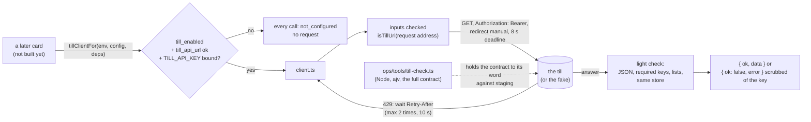

# Till link

> The one place the Operations app calls the vape till's API, and a fake till
> to test every later card against. Built, tested and **switched off**: nothing
> calls it yet.

<!-- No screenshot: nothing on screen uses the link yet. The only screen it
     touches is Settings (ops-only, see settings.md), which the docs runtime
     cannot render. -->

## What it does

The vape till is a separate system with its own Office. It has agreed a
read-only API with Operations
([contract 1.1.0](../../ops/contracts/till-api.v1.yaml), what was agreed:
[the agreed note](../plans/2026-11-till-api-agreed.md),
[ADR-0021](../adr/0021-till-figures-come-through-an-api.md)). This page is the
*client* for it: `ops/src/till/client.ts`. Cards after this one use it to
match people and stores, show sales by channel, prefill the vape close and
(later) send a proposal.

**What is built (card P5-02a):**

- the client: `listStores`, `listStaff`, `listShifts`, `dailySales`,
  `listProducts`, `listSuppliers`, `listOrders`, all GET;
- the fake till and a fake clock, for tests;
- three settings and one secret, off by default;
- `tillClientFor(env, config, deps)`, which gives a client that answers
  `not_configured` unless everything is set.

**What is not built:** anything that uses it (no RPC, no screen, no cron), the
matching of people and stores and the key-expiry warning (card P5-02b), any
write to the till (a proposal is a later card, and the client has no code path
that can write), and `GET /proposals/{id}` (it comes with proposals).

### Settings and the secret

| Name | Where | Default | Refused when |
|---|---|---|---|
| `till_enabled` | setting (boolean) | `false` | not `true` or `false` |
| `till_api_url` | setting (text) | blank | not one of the till's own addresses (`isTillUrl`, no query) |
| `till_key_expires_on` | setting (text) | blank | not a real date `yyyy-mm-dd`. The admin types in the day the key in use expires when installing it; the 14-day warning is a later card |
| `TILL_API_KEY` | Worker secret (`till_api_key` in the registry) | not bound | cannot be set on the Settings screen: it is listed under *Kept by Cloudflare* as set or not set |

The client answers `not_configured` to everything, and makes no request, unless
`till_enabled` is true **and** `till_api_url` is set and passes `isTillUrl`
**and** `TILL_API_KEY` is bound.

### Using it, and the errors

```ts
const client = tillClientFor(ctx.env, await ctx.config(), { fetch: ctx.fetch, sleep, now: () => new Date() });
const r = await client.listShifts({ storeId, day: "2026-11-25" });
if (!r.ok) return showHandEntry(r.error.kind);   // never throws: an answer, always
const shifts = r.data.shifts;
```

| Call | Takes | Answers (`data`) |
|---|---|---|
| `listStores()` | | `{ stores }` |
| `listStaff(storeId)` | a uuid | `{ store_id, staff }` |
| `listShifts({ storeId, day })` | a real `YYYY-MM-DD`, not after today (Toronto) | `{ store_id, business_day, shifts }` (shifts **opened** that day) |
| `dailySales({ storeId, from, to })` | real days, `from <= to`, `to` not after today, `to` at most 91 days after `from` | `{ store_id, from, to, days }` (one row per day and channel; none for a day with no sales) |
| `listProducts(storeId)` | | `{ store_id, products }` |
| `listSuppliers(storeId)` | | `{ store_id, suppliers }` |
| `listOrders(storeId, status?)` | `status` only `"open"` | `{ store_id, orders }` |

The contract has no `from`/`to` on shifts: ask a day at a time. Nothing is
paged in 1.1.0, so every list is the whole list and no answer says `truncated`.

Every call answers `{ ok: true, data }` or
`{ ok: false, error: { kind, status?, code?, message, retryAfterSeconds? } }`:

| `kind` | Meaning |
|---|---|
| `not_configured` | no address, no key, or the switch is off. No request was made |
| `bad_address` | the address is not one of the till's own. No request was made |
| `bad_input` | a store id that is not a uuid, a day that is not real, a range that is backwards, too long or in the future, a status other than `open`. No request was made |
| `timeout` | no answer in 8 seconds (not retried) |
| `network` | the till could not be reached |
| `rate_limited` | 429 after waiting twice, or the wait asked for would pass 10 seconds in all. `retryAfterSeconds` says how long the till asked for |
| `unauthorized` | 401: no key, an unknown, expired or revoked key |
| `forbidden` | 403 (`code: forbidden_store`): a store the key may not see |
| `not_found` | 404 |
| `server` | 5xx (not retried). `code` may be `server_error` or `unavailable` |
| `bad_answer` | not JSON, a top-level key or list the endpoint needs is missing, the answer is for another store, or a redirect (never followed) |
| `rejected` | any other 4xx; `code` is the till's (`bad_request`, `conflict`, `rejected`) |

**Money, ids and times as the contract sends them.** Money is a JSON number
rounded to the cent (`63.35`, refunds negative), not a string; the client hands
it on unchanged. A later card turns it into whole cents at the edge
(`Math.round(x * 100)`) and adds cents, never the numbers. Ids are uuids
(strings); the nil uuid `00000000-0000-0000-0000-000000000000` ("Not known")
means the till recorded no one. Days are `YYYY-MM-DD` in Toronto; moments are
UTC ISO 8601 (`2026-11-25T23:04:11Z`). A `null` `counted` (also on an
`auto_closed` shift) means *not counted*, never 0 ([ADR-0004](../adr/0004-blank-is-not-zero.md)).

### Testing a card against the fake

```ts
import { createFakeTill, FAKE_DAYS, FAKE_STORE_ID } from "../src/till/fake";
import { createTillClient } from "../src/till/client";

const till = createFakeTill();            // a fictional store, people, shifts, sales, products
const client = createTillClient({ baseUrl: till.baseUrl, key: till.key, fetch: till.fetch,
                                  sleep: till.clock.sleep, now: till.clock.now });
till.rateLimit(1, 3);                     // the next request answers 429, Retry-After: 3
await client.listStores();                // waits 3 virtual seconds (till.clock.waits is [3000]), no real time
```

The fake's data is in `till.state.data` (change it freely: each answer is a
copy). Its days are named in `FAKE_DAYS`; "today" is 2026-11-27.

| Case | Where |
|---|---|
| a closed shift; `staff_takings` with the nil uuid ("Not known") | `FAKE_DAYS.closedWithNotKnown` |
| a closed shift with door cash (inside `expected`); an `auto_closed` shift with `counted` null, `door_cash` 2 orders | `FAKE_DAYS.allChannels` |
| a shift still open | `FAKE_DAYS.open` |
| till, online and delivery rows on one day | `FAKE_DAYS.allChannels` (sales) |
| takings 4.00 short of the total: the till's "To check" | `FAKE_DAYS.toCheck` (sales) |
| no shifts, no sales | `FAKE_DAYS.empty` |
| a staff list with three people who match Operations' fictional staff by name (Priya Nair, Daniel Okafor, Maya Chen) and one who does not (Casey Lindqvist) | `listStaff` |
| a store the key may not see | `FAKE_HIDDEN_STORE_ID` |

| Switch | Effect |
|---|---|
| a wrong or missing key | 401 `unauthorized` (always on) |
| `down()` | every request fails like a network error |
| `slow(ms)` | every answer takes `ms` of the fake clock |
| `rateLimit(n, retryAfter)` | the next `n` requests answer 429 (`retryAfter`: seconds, an HTTP date as text, or none) |
| `serverError()` | every request answers 500 |
| `garbage()` | every request answers 200 with text that is not JSON |
| `redirect(to)` | every request answers 302 (a caller that follows makes a second, recorded request) |
| `echoKey()` | every request answers 500 with a message quoting the Authorization header it got |
| `reset()` | switches off, data restored |

`till.requests` records method, URL, whether an Authorization header was sent
and the `redirect` mode: never the header's value. The fake clock (`till.clock`)
runs virtual time: a `sleep` costs no real time, `clock.waits` lists what the
client waited for and `clock.deadlines` its request timeouts, and
`clock.auto = false` with `clock.advance(ms)` moves time by hand.

## How it works



The client runs in the Worker: it imports nothing from `node:`, does not load
the contract, and has no `ajv`. The full schema check and the arithmetic rules
are the Node tool's job (`npm --prefix ops run till:check`), which validates
real answers; the fake's answers are validated against the same contract by
the tests, which is also what keeps the hand-written `types.ts` honest.

## Rules it must not break

- **The key goes only to the till's own addresses**, only in the
  `Authorization: Bearer` header, never in a URL. `isTillUrl` is the one test of
  an address, used by the client and by the Settings screen
  ([ADR-0024](../adr/0024-the-till-is-read-through-one-client.md)).
- **The key is in no answer, no error, no thrown value, no log line.** Every
  text that leaves the client is scrubbed, including what the till echoes. The
  client logs nothing.
- **Never throws.** A caller reads `ok`.
- **GET only.** There is no code path that sends a body or any other method.
  A proposal is a later card with its own tests.
- **A redirect is never followed** (`redirect: "manual"`), so the key cannot
  follow one.
- **No retry but the 429, and that one bounded:** two retries, 10 seconds in
  all, by the injected `sleep`. A 5xx or a timeout is the caller's to decide.
- **Time, waiting, the network and the key come from outside.** No
  `new Date()`, timer, `process`, `fetch` or randomness in the client.
- **Switched off:** nothing outside `ops/src/till` and the tests imports the
  client or the fake (a test searches for it). When a card first calls
  `tillClientFor`, that card changes this rule on purpose.
- **Never the real till in a test.** Every test uses the fake; a test that
  reaches the global `fetch` fails.
- **Blank is not zero:** a null `counted`, `expected` or `variance` is *not
  counted*; the client never turns one into 0.

## Code map

| What | Where |
|---|---|
| The client | `ops/src/till/client.ts`: `createTillClient`, `retryAfterSeconds`, `SHAPES` |
| The switch | `ops/src/till/index.ts`: `tillClientFor` |
| The address rule | `ops/src/till/address.ts`: `isTillUrl`, `tillBaseUrl`, `TILL_SERVERS` (copied from the contract's `servers`; a test compares) |
| Answer types (by hand, from the contract) | `ops/src/till/types.ts` |
| The fake till and its clock | `ops/src/till/fake.ts`: `createFakeTill`, `createFakeClock`, `FAKE_DAYS`, `FAKE_PEOPLE` |
| Day arithmetic | `ops/src/till/days.ts` |
| The contract loader and rules (Node only, for the tool) | `ops/src/till/contract.ts`, `ops/src/till/rules.ts` |
| The registry entries | `ops/src/lib/config-keys.ts`: `till_enabled`, `till_api_url`, `till_key_expires_on`, `till_api_key` |
| The Settings rules for them | `ops/src/modules/settings.ts` (group *Till*) |
| The secret's name | `ops/wrangler.toml` (comment), `ops/.dev.vars.example` |

## Tests

| Suite | Holds down |
|---|---|
| `ops/test/till-client.test.ts` | every `kind` of error through the fake's switches; the address table (look-alike hosts, sub-domains, user info, ports, IPs, trailing dots, look-alike letters, paths); the servers equal the contract's; the key only in the header and in no result, request record or log, including what the till echoes (raw, URL-encoded, escaped, base64) and a redirect that is not followed; 429 waits (seconds, HTTP date, unreadable), the retry cap and the total-wait cap; the timeout by the injected clock; inputs refused before any request; the typed results equal the fake's data; the light checks; no way to send anything but a GET and no ambient time or randomness; the shapes and parameters equal the contract's; `tillClientFor` for each missing piece; nothing outside `ops/src/till` imports the client |
| `ops/test/till-fake.test.ts` | every normal answer validates against the contract with no error and no warning; the arithmetic rules hold apart from the "To check" day; the cases later cards need are present; each switch; the request record never holds the key; the fake clock |
| `ops/test/settings.test.ts`, `ops/test/config.test.ts` | the three settings and the secret: accepted and refused values, the secret listed as set or not set and never shown, the registry marks the four as Operations-only |
| `ops/test/till-contract.test.ts`, `till-rules.test.ts`, `till-check.test.ts` | the Node tool's contract loader, rules and checking run (unchanged) |

## History

- **Nov 2026 (card P5-02a):** the client, the fake till and its clock, the
  settings `till_enabled`, `till_api_url`, `till_key_expires_on` and the secret
  `TILL_API_KEY`, all off and called by nothing
  ([ADR-0024](../adr/0024-the-till-is-read-through-one-client.md)).
