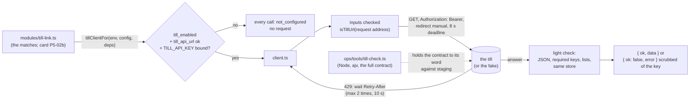

# Till link

> The one place the Operations app calls the vape till's API, a fake till to
> test every card against, and what is built on it: an admin matches
> each person here to their till login and the till's store to this store, and
> is warned before the till's key expires; and the Sales screen shows the vape
> till's sales by channel beside what was entered. The till is only read. **Switched
> off** until the setting, the address and the key are all set.

<!-- No screenshot: the Till logins section, the warning and the Sales screen's
     From the till section are in the
     Operations app only (ADR-0023), and the docs runtime
     (scripts/docs/runtime.js) runs the Apps Script server, which has no
     rpcGetTillLink. Nothing in scripts/docs/screens.js can render them. -->

> **Contents:** [What it does](#what-it-does) · [What an admin does](#what-an-admin-does-card-p5-02b)
> (states, rules, what is stored) · [Settings and the secret](#settings-and-the-secret)
> · [Using the client](#using-it-and-the-errors) · [How it works](#how-it-works)
> · [Rules it must not break](#rules-it-must-not-break) · [Tests](#tests)

## What it does

The vape till is a separate system with its own Office. It has agreed a
read-only API with Operations
([contract 1.1.0](../../ops/contracts/till-api.v1.yaml), what was agreed:
[the agreed note](../plans/2026-11-till-api-agreed.md),
[ADR-0021](../adr/0021-till-figures-come-through-an-api.md)). This page is the
*client* for it: `ops/src/till/client.ts`. Cards after this one use it to
match people and stores, show sales by channel, prefill the vape close and
(later) send a proposal.

**What is built (card P5-02a):**

- the client: `listStores`, `listStaff`, `listShifts`, `dailySales`,
  `listProducts`, `listSuppliers`, `listOrders`, all GET;
- the fake till and a fake clock, for tests;
- three settings and one secret, off by default;
- `tillClientFor(env, config, deps)`, which gives a client that answers
  `not_configured` unless everything is set.

**What is built (card P5-02b):** the first caller of the client: the matches
between Operations' people and stores and the till's, four admin-only calls, the
Staff screen's *Till logins* section, and the key-expiry warning on the Staff
and Settings screens (below).

**What is built (card P5-03b):** the first read of figures: the Sales screen's
*From the till* section, the vape till's sales by channel (in store, online,
delivery) beside what cashiers entered, from one new read-only call
(`rpcGetSalesByChannel`; [below](#sales-by-channel-card-p5-03b)).

**What is not built:** anything else that *uses* the matches (the vape close from
the till's figures: a later card), any cron or message about the
key, any write to the till (a proposal is a later card, and the client has no
code path that can write), and `GET /proposals/{id}` (it comes with proposals).

### What an admin does (card P5-02b)

**More → Staff → Till logins**, for an **admin** in the Operations app. A manager's
Staff screen is unchanged: it makes no till call and has no section. Inside
Apps Script nothing changes.

1. **The store.** One line, *Main store ↔ Fictional Corner Store*, with a sheet to
   choose from the till's stores (only a store the till lists *now*). Changing it
   is two steps: end the match, then match again; and a match cannot be ended
   while people are matched through it (*"1 person is matched through it: end
   their match first."*).
2. **People.** Each person on the Staff list shows *Matched to Maya Chen (till) ·
   cashier · last seen 2026-11-26* or *not matched*. Nothing is ever matched by
   the app, even on an exact name: where the till's name equals theirs (ignoring
   case and repeated spaces, and only if exactly one till person has that name
   and is not already matched) it offers a **Match to Maya Chen?** button, which
   opens a confirm sheet; only that sheet's *Match* calls the server. Tapping *not
   matched* offers the till's unmatched people instead. An inactive person may be
   matched (their history is still theirs).
3. **In the till, not matched here.** The till's people with no match are listed
   from the live answer, with a note that they are **not created here** and stay
   the till's business. Nothing about them is stored. The nil uuid ("Not known")
   is never listed, offered or accepted.
4. **End a match.** Tap a matched person, give a reason (3 to 300 characters). It
   works with the till down. The row is kept with who, when and why. A match the
   till no longer lists is flagged *no longer in the till's list* and kept; it is
   never deleted or ended by itself.
5. **The key's expiry.** The day typed into the setting `till_key_expires_on` when
   the key was installed. From **14 days before** that day (Toronto calendar days,
   so a clock-change day is one day), on it and after it, a warning sits at the
   top of the section and above the *Till* group on Settings: *"The till's key
   expires on 2026-12-07 (in 10 days). Make a new key in the till's Office and
   install it, then change the date in Settings."* At 15 days there is none. A
   blank date while the link is switched on says *"The key's expiry date is not
   recorded"*. No message is sent anywhere.

Sign-in stays Operations' own (name and PIN): the till has no part in it, and
nothing here can change it.

#### The states, and what the screen says

`rpcGetTillLink` always answers. `state` is one of six; the words are the
server's, shown as written (the till's own text is never shown):

| `state` | When (client error kinds) | Message |
|---|---|---|
| `off` | `till_enabled` is not true. No request, no client | *The link to the till is switched off (Settings, Till). Sign-in and everything else work as usual.* |
| `not_configured` | enabled but no address, an address that is not the till's, or no key (`not_configured`, `bad_address`). No request | *The link to the till is switched on but not set up: it needs the till's address in Settings and the key installed.* |
| `ok` | answered | *The till answered.* |
| `unreachable` | `network`, `server` | *The till could not be reached just now (it may be down). What is saved is shown; try again later.* |
| | `timeout`, or the 8-second budget ran out | *The till did not answer in time.* / *…in time (8 seconds)…* |
| | `rate_limited` | *The till asked us to slow down (try again in N seconds). …* |
| `refused` | `unauthorized` | *The till did not accept the key. It may have expired or been withdrawn: install a new one.* |
| | `forbidden` (a store the key may not see) | *The till's key may not see the till store matched here. Check which store the key was made for.* |
| | `not_found`, `rejected` | *The till refused the request. Nothing was changed.* |
| `bad_answer` | `bad_answer` (not JSON, a redirect, the wrong store), `bad_input` | *The till answered with something this app does not understand. Nothing was changed; tell whoever looks after the till link.* |

In every state but `ok` the screen shows that one line, the stored store match and
the stored person matches **read-only**, and no matching control; the Staff
screen's own list, sign-in and every other call are unaffected. The writes that
need the till *now* (match a store, match a person) refuse with the same words
plus *"Nothing was changed."* Ending a person's match needs no till.

#### The calls

All in `ops/contracts/rpc-ops.json`, `"roles": ["admin"]`, needing a session
([ADR-0023](../adr/0023-the-operations-app-has-rpcs-and-screens-of-its-own.md)).

| Call | Does |
|---|---|
| `rpcGetTillLink(token)` | `{ state, message, keyExpiry: { day, daysLeft, warn, recorded, message }, stores: [{ storeId, name, tillStore }], tillStores, people: [{ staffId, name, active, link, suggestion }], unmatchedTillPeople }`. No pay rate, PIN, hash, email or notes of anyone. One `GET /stores` and one `GET /staff` together, inside one 8-second budget. Notes `last_seen_at` for matched people the till's list holds (the one write of a read) |
| `rpcSetTillStore(token, { storeId, tillStoreId \| null })` | match, or end the match (`null`). Needs the till to list that store now: *"The till does not list that store."* |
| `rpcLinkTillStaff(token, { staffId, tillStaffId })` | match one person to one till login |
| `rpcUnlinkTillStaff(token, { staffId, reason })` | end a match, with who, when and why |

The rules of `rpcLinkTillStaff`, as built (messages as the screen shows them):

| Refused when | Message |
|---|---|
| the person does not exist | *There is no such person.* |
| the till id is not a uuid | *Choose the person in the till to match.* |
| it is the nil uuid | *"Not known" is the till's name for no one: it cannot be matched to a person.* |
| no store is matched | *Match the till's store to this store first.* |
| the till cannot be read | the state's words, then *Nothing was changed.* |
| the till does not list them now, for the matched store | *That person is not in the till's list for this store now.* |
| the person already has a match | *Ada Quill is already matched to Ada Q.: end that match first.* |
| the till login belongs to someone | *Maya Chen is already matched to Ada Quill.* |

It locks the person's staff row first, then one advisory lock for the whole link
(two admins matching the same till login to two people hold different staff rows,
so the second must read the first's committed row), and the tables' partial unique
indexes are the last guard. Identity and role come from the session only; time
from `ctx.now`; every change writes an audit row (`till_link.store_matched`,
`till_link.store_ended`, `till_link.staff_linked`, `till_link.staff_unlinked`).

#### What is stored, and what is not

In Operations' own database (migration `0011_till_links.sql`), never in the till:

- `ops.till_stores`: Operations store ↔ the till's store uuid and its name as
  given, who matched it and when, who ended it and when. One live row per store
  and per till store.
- `ops.till_staff_links`: Operations person ↔ the till's `staff_id` (uuid, never
  the nil uuid) for one till store, the till's **name and role as given when
  matched** (so the screen can say *matched to Maya Chen (till)* with the till
  down), when matched and by whom, when the till's list last held them, and who
  ended it, when and why. One live login per person per till store, and one
  person per till login.
- The app role may add rows and read them; it may update only `last_seen_at` and
  the *ended* columns, and cannot delete. Nothing else about a till person is kept,
  and unmatched till people are **not stored at all**. Neither table is read by the
  cutover tools (`LATER_OPS_TABLES`).

#### The time budget, `sleep`, and what to cache later

The whole RPC has **8 seconds** (`BUDGET_MS`). The handler supplies what a Worker
needs and the client must not own (ADR-0024): `sleep` is a `setTimeout` that also
resolves, clearing its timer, when its signal aborts; `elapsedMs` is
`performance.now()` since the call began (because `ctx.now` is the instant it
*started*). The client is given `timeoutMs` 7.5 s (so its own timeout answers
first) and `maxWaitMs` 3 s for a 429, and the module races the calls against the
budget on the same `sleep`; if the budget wins the answer is `unreachable` and a
late reply is ignored. The client's own rules are untouched. The connection and
the transaction stay open while the till is read (at most the budget), and no
lock is taken until the till has answered.

A later card should cache the till's **stores list** (it changes about never: an
hour) and **staff list** (a few minutes, dropped by any match or end), so opening
the screen does not call the till each time; this card calls it once per screen
load.

#### What the till's staff list gives, and what is uncertain

`GET /staff?store_id=` answers `{ store_id, staff: [{ staff_id, display_name, role
(owner, area_manager, store_manager, cashier), active, all_stores, store_ids,
has_pin }] }`. A person appears **once** in the answer, whatever their stores
(`all_stores` true with empty `store_ids`, or listed ids). Questions for the till
side are in the card's report: whether the list is filtered to the stores asked
about (the fake returns everyone), whether an inactive person is ever removed,
and whether `display_name` can repeat or change.

#### Who may call the client

A test names them (`ops/test/till-client.test.ts`): exactly four files import the
client, its index, the types or the days: `ops/src/modules/till-link.ts` and
`ops/src/rpc/handlers/till-link.ts` (the matching), and
`ops/src/modules/sales-channels.ts` and `ops/src/rpc/handlers/sales-channels.ts`
(sales by channel, card P5-03b). In each pair the module makes the reads and the
handler gives it a timer and a clock (and reads the input's days). A fifth caller
is a decision: it is a change to that list and to [ADR-0024](../adr/0024-the-till-is-read-through-one-client.md).
`ops/src/modules/settings.ts` imports `keyExpiryWarning` from the module (a pure
function) and `till/address` (the address rule), neither of which calls the till.

### Sales by channel (card P5-03b)

On the **Sales** screen (Operations app only), when the **All** or **Vape** view is
selected, a section *From the till* sits under the totals, loaded after the screen
has drawn (the screen never waits for the till; a quiet "Loading the till's
figures..." shows meanwhile). It is the vape till's own figures for the screen's
date range, by channel, **beside** what the cashiers entered and never mixed into
the totals, the trend or the bars above them (those still come from what was
typed at close). The cstore view, and Apps Script in every role, have no section
and make no call. Nothing from the till is stored: the call is one live GET of
`/sales/daily`, and no row of the database changes.

**What a daily row holds** (contract 1.1.0, `DailyRow`). One row per business day
and channel; a day and channel with no sales has *no row*. `till`: counter sales
and refunds, by the day rung (the Office's "In store"). `online`: website pickup
orders, by the day collected, wherever they were paid. `delivery`: website
delivery orders, by the day delivered; its extra `delivery` object holds `orders`
and `fees` (before HST, and **inside** that row's subtotal, net and total). A
delivery cancelled after a failed drop (fee kept) is not in these figures. The
`sales_summary` (sales less refunds, after voids): `count` (sales),
`refund_count`, `subtotal` (before discounts and HST), `discount`, `net` (after
discounts, before HST: subtotal - discount), `surcharge` (card), `rounding`
(cash, to the nickel), `hst`, `total` (what customers paid less refunds, **with**
HST: net + surcharge + hst + rounding). The `takings`, per method (cash, credit,
debit, etransfer, other): `sales_total` (positive), `refunds_total` (negative),
`net_total`. Their `net_total`s add up to `total`, except for a till sale whose
payments did not cover its total (the Office's "To check").

**What is shown, per channel (In store, Online, Delivery) and for All channels.**
Chosen so a manager can read the day and check it against the till's own
Office; nothing is derived beyond adding:

| Shown | From | Why |
|---|---|---|
| **Total** | `sales_summary.total` | what customers paid, less refunds: the headline |
| **Before tax** | `sales_summary.net` | after discounts, before HST (it is also before the card surcharge and the cash rounding, which are in the total) |
| **Tax** | `sales_summary.hst` | the HST inside the total |
| **Refunds** | the takings' `refunds_total` over the five methods | the money refunded, negative (the total is already net of it) |
| **Sales, refunds** | `count`, `refund_count` | the volume behind the money |
| **Days** | how many days reported the channel | so a channel that traded on 2 of 7 days is not read as a week |
| Delivery: **orders**, **delivery fees** | `delivery.orders`, `delivery.fees` | the fees are inside the channel's figures, and the screen says so |

Not shown: the discount, surcharge and rounding on their own, the subtotal, and
the takings by method (they are in the till's Office; a later card reconciles).

**Money is added in whole cents.** The till sends dollars as JSON numbers rounded
to the cent; the module converts each with `cents()` (the rules' helper) and adds
integers, and writes the answer as `cents / 100` with two decimals. A sum of
floats anywhere fails a test. The screen's difference line is worked in cents too.

**Blank is not zero.** A channel the till did not report in the range is
`null` and the screen says **no figures**; a channel it reported as 0 is
**$0.00**. A range the till reported nothing for answers `state: "ok"` with every
channel `null`. Refunds and a negative day are negative and shown as such.

**The range.** The screen's own range is asked of the till, with `to` not after
today. The contract allows at most 92 days (`to` at most 91 days after `from`): a
longer range is **cut at the start**, keeping the newest 92 days, and the answer
says so (`range.clamped`) and the screen says it in words ("showing the newest 92
days, Aug 28 to Nov 27"). A start after the end, a day that is not real, an end
in the future, or a selected day outside the range are refused with a readable
message **before any request** (the till is not asked); a selected day the cut
removed has no figures. The app's own *Entered at close* is read for the same
(cut) days, so the two sides cover the same days.

**The states** (the same words as the Staff section, one more state, and no
figures in any of them). The call still answers; only a request that makes no
sense is refused:

| `state` | When | Message |
|---|---|---|
| `ok` | the till answered | The till answered. |
| `off` | `till_enabled` is false | The link to the till is switched off (Settings, Till)... Shown only to an admin, who can open Settings; a manager or a payroll admin sees nothing at all |
| `not_configured` | switched on, no address or no key | ...switched on but not set up... |
| `no_store` | set up, but no till store is matched to this store | The till's store is not matched to this store yet (Staff, Till logins). |
| `unreachable` | down, slow past the 8 seconds, failing, throttled | the P5-02b words |
| `refused` | the key not accepted, or a store it may not see | the P5-02b words |
| `bad_answer` | not what the contract says | the P5-02b words |

`off` is checked first, then `not_configured`, then `no_store`. The messages are
`explain()` and `MESSAGES` from `ops/src/modules/till-link.ts` (`MESSAGES` is now
exported; nothing else about it changed). The store asked of the till is the one
matched in `ops.till_stores`, **never** one from the input. The whole call keeps
P5-02b's 8-second budget and `sleep` wiring.

**The "To check" case.** A day whose takings do not add up to its total (the
rules' `checkDailyRow` warning) is counted exactly as the till reports it and
listed in `toCheck`; the range's note says "2 days to check in the till: Nov 22,
Nov 25" and the selected day says "To check in the till". Never dropped,
never corrected.

**A row the client accepted but the rules reject** (`checkDailyRow`'s errors:
`net` or `total` not adding up, a method's `net_total`, a refund with the wrong
sign, a `delivery` object on another channel; `checkDailyRows`: two rows for one
day and channel, a day outside the range asked for) is **counted as sent** and
`brokenRows` is true: the section says "the till's figures did not all add up.
They are shown as the till sent them", and one line (`sales_channels.rows_rejected`
with the places, never a value) goes through the handler's log. No audit row:
nothing was done. A figure that is not a number (which the client's checks should
have stopped) is left out of the sum, not made 0, and flags the same way.

**Entered at close beside Rung at the till.** For the range the screen shows
*Entered at close* (the app's own vape sales, what cashiers typed, read by the
Sales screen's own reader and added in cents; "no closes" when there were none,
not $0.00), *Rung at the till (In store)* and the difference (rung minus
entered), side by side with no colour and no verdict: they are different
measurements. The vape close from the till's snapshot (a later card) is where
they are reconciled.

**What a later card should cache.** Nothing is cached here: each draw of the
Sales screen calls the till once (a tap on another day calls it again for that
day's lines). A later card would cache the daily rows of **finished days** (a day
before today changes only by a till correction) for a few minutes per range, and
today's rows for no more than a minute, dropped by a refresh.

### Settings and the secret

| Name | Where | Default | Refused when |
|---|---|---|---|
| `till_enabled` | setting (boolean) | `false` | not `true` or `false` |
| `till_api_url` | setting (text) | blank | not one of the till's own addresses (`isTillUrl`, no query) |
| `till_key_expires_on` | setting (text) | blank | not a real date `yyyy-mm-dd`. The admin types in the day the key in use expires when installing it; the warning from 14 days before is shown on the Staff and Settings screens (below) |
| `TILL_API_KEY` | Worker secret (`till_api_key` in the registry) | not bound | cannot be set on the Settings screen: it is listed under *Kept by Cloudflare* as set or not set |

The client answers `not_configured` to everything, and makes no request, unless
`till_enabled` is true **and** `till_api_url` is set and passes `isTillUrl`
**and** `TILL_API_KEY` is bound.

### Using it, and the errors

```ts
const client = tillClientFor(ctx.env, await ctx.config(), { fetch: ctx.fetch, sleep, now: () => new Date() });
const r = await client.listShifts({ storeId, day: "2026-11-25" });
if (!r.ok) return showHandEntry(r.error.kind);   // never throws: an answer, always
const shifts = r.data.shifts;
```

| Call | Takes | Answers (`data`) |
|---|---|---|
| `listStores()` | | `{ stores }` |
| `listStaff(storeId)` | a uuid | `{ store_id, staff }` |
| `listShifts({ storeId, day })` | a real `YYYY-MM-DD`, not after today (Toronto) | `{ store_id, business_day, shifts }` (shifts **opened** that day) |
| `dailySales({ storeId, from, to })` | real days, `from <= to`, `to` not after today, `to` at most 91 days after `from` | `{ store_id, from, to, days }` (one row per day and channel; none for a day with no sales) |
| `listProducts(storeId)` | | `{ store_id, products }` |
| `listSuppliers(storeId)` | | `{ store_id, suppliers }` |
| `listOrders(storeId, status?)` | `status` only `"open"` | `{ store_id, orders }` |

The contract has no `from`/`to` on shifts: ask a day at a time. Nothing is
paged in 1.1.0, so every list is the whole list and no answer says `truncated`.

Every call answers `{ ok: true, data }` or
`{ ok: false, error: { kind, status?, code?, message, retryAfterSeconds? } }`:

| `kind` | Meaning |
|---|---|
| `not_configured` | no address, no key, or the switch is off. No request was made |
| `bad_address` | the address is not one of the till's own. No request was made |
| `bad_input` | a store id that is not a uuid, a day that is not real, a range that is backwards, too long or in the future, a status other than `open`. No request was made |
| `timeout` | no answer in 8 seconds (not retried) |
| `network` | the till could not be reached |
| `rate_limited` | 429 after waiting twice, or the wait asked for would pass 10 seconds in all. `retryAfterSeconds` says how long the till asked for |
| `unauthorized` | 401: no key, an unknown, expired or revoked key |
| `forbidden` | 403 (`code: forbidden_store`): a store the key may not see |
| `not_found` | 404 |
| `server` | 5xx (not retried). `code` may be `server_error` or `unavailable` |
| `bad_answer` | not JSON, a top-level key or list the endpoint needs is missing, the answer is for another store, or a redirect (never followed) |
| `rejected` | any other 4xx; `code` is the till's (`bad_request`, `conflict`, `rejected`) |

**Money, ids and times as the contract sends them.** Money is a JSON number
rounded to the cent (`63.35`, refunds negative), not a string; the client hands
it on unchanged. A later card turns it into whole cents at the edge
(`Math.round(x * 100)`) and adds cents, never the numbers. Ids are uuids
(strings); the nil uuid `00000000-0000-0000-0000-000000000000` ("Not known")
means the till recorded no one. Days are `YYYY-MM-DD` in Toronto; moments are
UTC ISO 8601 (`2026-11-25T23:04:11Z`). A `null` `counted` (also on an
`auto_closed` shift) means *not counted*, never 0 ([ADR-0004](../adr/0004-blank-is-not-zero.md)).

### Testing a card against the fake

```ts
import { createFakeTill, FAKE_DAYS, FAKE_STORE_ID } from "../src/till/fake";
import { createTillClient } from "../src/till/client";

const till = createFakeTill();            // a fictional store, people, shifts, sales, products
const client = createTillClient({ baseUrl: till.baseUrl, key: till.key, fetch: till.fetch,
                                  sleep: till.clock.sleep, now: till.clock.now });
till.rateLimit(1, 3);                     // the next request answers 429, Retry-After: 3
await client.listStores();                // waits 3 virtual seconds (till.clock.waits is [3000]), no real time
```

The fake's data is in `till.state.data` (change it freely: each answer is a
copy). Its days are named in `FAKE_DAYS`; "today" is 2026-11-27.

| Case | Where |
|---|---|
| a closed shift; `staff_takings` with the nil uuid ("Not known") | `FAKE_DAYS.closedWithNotKnown` |
| a closed shift with door cash (inside `expected`); an `auto_closed` shift with `counted` null, `door_cash` 2 orders | `FAKE_DAYS.allChannels` |
| a shift still open | `FAKE_DAYS.open` |
| till, online and delivery rows on one day | `FAKE_DAYS.allChannels` (sales) |
| takings 4.00 short of the total: the till's "To check" | `FAKE_DAYS.toCheck` (sales) |
| no shifts, no sales | `FAKE_DAYS.empty` |
| a staff list with three people who match Operations' fictional staff by name (Priya Nair, Daniel Okafor, Maya Chen) and one who does not (Casey Lindqvist) | `listStaff` |
| a store the key may not see | `FAKE_HIDDEN_STORE_ID` |

| Switch | Effect |
|---|---|
| a wrong or missing key | 401 `unauthorized` (always on) |
| `down()` | every request fails like a network error |
| `slow(ms)` | every answer takes `ms` of the fake clock |
| `rateLimit(n, retryAfter)` | the next `n` requests answer 429 (`retryAfter`: seconds, an HTTP date as text, or none) |
| `serverError()` | every request answers 500 |
| `garbage()` | every request answers 200 with text that is not JSON |
| `redirect(to)` | every request answers 302 (a caller that follows makes a second, recorded request) |
| `echoKey()` | every request answers 500 with a message quoting the Authorization header it got |
| `reset()` | switches off, data restored |

`till.requests` records method, URL, whether an Authorization header was sent
and the `redirect` mode: never the header's value. The fake clock (`till.clock`)
runs virtual time: a `sleep` costs no real time, `clock.waits` lists what the
client waited for and `clock.deadlines` its request timeouts, and
`clock.auto = false` with `clock.advance(ms)` moves time by hand.

## How it works



The client runs in the Worker: it imports nothing from `node:`, does not load
the contract, and has no `ajv`. The full schema check and the arithmetic rules
are the Node tool's job (`npm --prefix ops run till:check`), which validates
real answers; the fake's answers are validated against the same contract by
the tests, which is also what keeps the hand-written `types.ts` honest.

## Rules it must not break

- **The key goes only to the till's own addresses**, only in the
  `Authorization: Bearer` header, never in a URL. `isTillUrl` is the one test of
  an address, used by the client and by the Settings screen
  ([ADR-0024](../adr/0024-the-till-is-read-through-one-client.md)).
- **The key is in no answer, no error, no thrown value, no log line.** Every
  text that leaves the client is scrubbed, including what the till echoes. The
  client logs nothing.
- **Never throws.** A caller reads `ok`.
- **GET only.** There is no code path that sends a body or any other method.
  A proposal is a later card with its own tests.
- **A redirect is never followed** (`redirect: "manual"`), so the key cannot
  follow one.
- **No retry but the 429, and that one bounded:** two retries, 10 seconds in
  all, by the injected `sleep`. A 5xx or a timeout is the caller's to decide.
- **Time, waiting, the network and the key come from outside.** No
  `new Date()`, timer, `process`, `fetch` or randomness in the client.
- **Four callers, named:** only `ops/src/modules/till-link.ts`,
  `ops/src/rpc/handlers/till-link.ts`, `ops/src/modules/sales-channels.ts` and
  `ops/src/rpc/handlers/sales-channels.ts` import the client; the fake is for tests
  (`ops/test/till-client.test.ts` lists them and fails for any other). A new
  caller changes that list on purpose, and ADR-0024.
- **The matches, not the till, are Operations' record.** A person is matched only
  by a person at the screen, never by the app, never from the nil uuid, and
  never created from the till's side; a match is ended, never deleted.
- **When the till cannot be read, nothing else is affected.** `rpcGetTillLink`
  answers a state and its words, the stored matches stay, sign-in and every other
  call are untouched, and the whole RPC stays inside 8 seconds.
- **The warning is pure and shared:** `keyExpiryWarning(config, now)` serves the
  Staff section and the Settings answer: 14 days before, warn; 15, not.
- **The till's figures are the till's, beside the app's and never mixed:** the
  Sales screen's totals, trend and bars stay what cashiers entered; the *From the
  till* section is separate and labelled, and nothing from the till is stored.
- **Money from the till is added in cents,** a channel it did not report is *no
  figures* (not $0.00), a "To check" day is counted as reported and marked, and a
  row that breaks a rule is shown as sent and flagged: never dropped or corrected.
- **Never the real till in a test.** Every test uses the fake; a test that
  reaches the global `fetch` fails.
- **Blank is not zero:** a null `counted`, `expected` or `variance` is *not
  counted*; the client never turns one into 0.

## Code map

| What | Where |
|---|---|
| The client | `ops/src/till/client.ts`: `createTillClient`, `retryAfterSeconds`, `SHAPES` |
| The switch | `ops/src/till/index.ts`: `tillClientFor` |
| The address rule | `ops/src/till/address.ts`: `isTillUrl`, `tillBaseUrl`, `TILL_SERVERS` (copied from the contract's `servers`; a test compares) |
| Answer types (by hand, from the contract) | `ops/src/till/types.ts` |
| The fake till and its clock | `ops/src/till/fake.ts`: `createFakeTill`, `createFakeClock`, `FAKE_DAYS`, `FAKE_PEOPLE` |
| Day arithmetic | `ops/src/till/days.ts` |
| The contract loader and rules (Node only, for the tool) | `ops/src/till/contract.ts`, `ops/src/till/rules.ts` |
| The matches, the states, the budget, the expiry warning | `ops/src/modules/till-link.ts`: `get`, `setStore`, `linkStaff`, `unlinkStaff`, `keyExpiryWarning`, `explain`, `BUDGET_MS` |
| The four calls, `sleep` and the clock for a Worker | `ops/src/rpc/handlers/till-link.ts`; entries in `ops/contracts/rpc-ops.json`; lines in `ops/src/rpc/registry.ts` |
| Sales by channel: the figures (pure), the range, the read | `ops/src/modules/sales-channels.ts`: `summarise`, `parseRange`, `get`, `fromCents` |
| Its call | `ops/src/rpc/handlers/sales-channels.ts` (`rpcGetSalesByChannel`, roles as the Sales screen's `rpcGetSalesDashboard`); entry in `ops/contracts/rpc-ops.json`; line in `ops/src/rpc/registry.ts` |
| The two tables | `ops/migrations/0011_till_links.sql` (`ops.till_stores`, `ops.till_staff_links`); named in `LATER_OPS_TABLES` (`ops/src/cutover/compare.ts`) |
| The screen | `src/Index.html`: *Till logins* (`loadTillSection_`, `renderTillSection_`, `tillSectionHTML_`, the three sheets) on the Staff screen, and `tillWarnHTML_` above the *Till* group of Settings; the Sales screen's *From the till* (`salesTillWanted_`, `loadSalesTill_`, `salesTillHTML_`, `salesTillDayHTML_`, `tillChannelHTML_`) |
| The registry entries | `ops/src/lib/config-keys.ts`: `till_enabled`, `till_api_url`, `till_key_expires_on`, `till_api_key` |
| The Settings rules for them | `ops/src/modules/settings.ts` (group *Till*) |
| The secret's name | `ops/wrangler.toml` (comment), `ops/.dev.vars.example` |

## Tests

| Suite | Holds down |
|---|---|
| `ops/test/till-client.test.ts` | every `kind` of error through the fake's switches; the address table (look-alike hosts, sub-domains, user info, ports, IPs, trailing dots, look-alike letters, paths); the servers equal the contract's; the key only in the header and in no result, request record or log, including what the till echoes (raw, URL-encoded, escaped, base64) and a redirect that is not followed; 429 waits (seconds, HTTP date, unreadable), the retry cap and the total-wait cap; the timeout by the injected clock; inputs refused before any request; the typed results equal the fake's data; the light checks; no way to send anything but a GET and no ambient time or randomness; the shapes and parameters equal the contract's; `tillClientFor` for each missing piece; exactly the four named callers import the client |
| `ops/test/till-fake.test.ts` | every normal answer validates against the contract with no error and no warning; the arithmetic rules hold apart from the "To check" day; the cases later cards need are present; each switch; the request record never holds the key; the fake clock |
| `ops/test/till-link.test.ts` | against a real database and the fake till: linking a person; a till person not in Operations is listed and never created (`staff` unchanged); the till down with sign-in still working; the warning at 14 days and not 15, on the day, after, blank, and across both clock changes; every state (off, not configured by setting, key or address, ok, unreachable by down, slow, failing and throttled, refused by a wrong key and a store the key may not see, bad answer by garbage and a redirect) answering inside the budget with the stored matches listed; a till so slow that the 8 seconds run out; suggestions on equal names only and never automatic; the nil uuid never offered and refused; a till person not listed now; both already-matched messages; an inactive person; ending a match with the till down; a match the till dropped flagged and kept; two admins at once on two connections; the store map; who may call (the router and each handler alone); planted `role` and `actorId`; no pay, PIN, hash, email or notes in the answer; the key in no answer, audit row or message in every state (with `echoKey`); only GETs, once per endpoint; nothing else moves; the tables' own constraints and grants; one real-time run of the Worker's timers |
| `tests/suites/ui-till-link.js` | the section only for an admin in the Operations app (a manager makes no till call; Apps Script unchanged); each state's message and no matching control when not ok, stored matches read-only; the suggestion sends nothing until the confirm; choosing, ending, the store sheet; the warning at the top of the section and above the Till group on Settings; everything escaped; the built page carries it |
| `ops/test/sales-channels.test.ts` | the pure part on hand-built rows: three channels summed per channel and together in cents (amounts where a float sum is wrong: 0.1 + 0.2, a hundred days of 0.35, thirty of 1.15), negatives, a channel missing on some days, a channel at 0 against one not reported, a range with nothing reported, delivery orders and fees, the "To check" day counted and listed, a broken row kept and flagged; the fake's days (`allChannels`, `empty`, `toCheck`) and the selected day; the range (clamped to 92 days and said so; from after to, a bad date, the future, a day outside: refused before any request); every state (off, not configured, no store matched, down, slow, failing, throttled, wrong key, hidden store, garbage, redirect, the 8 seconds running out) answering with no figures and the app's own total; who may call, read from both contracts and equal to the Sales screen's; a planted role, actor or store changes nothing; the key in no answer or message in any state; one GET of `/sales/daily` and no row of any table changing; *Entered at close* equal to the Sales screen's own reader for vape |
| `tests/suites/ui-sales-channels.js` | the section only in the Operations app and only for the All and Vape views; drawn after the screen, with a placeholder, and a late answer dropped; each state's message and no figures (off said only to an admin); "no figures" against $0.00; a negative shown as negative; the "to check" and "did not all add up" notes; the side-by-side with no verdict; everything escaped; the Sales screen in Apps Script byte-identical to a frozen copy for every role; the built page carries it |
| `ops/test/settings.test.ts`, `ops/test/config.test.ts` | the three settings and the secret: accepted and refused values, the secret listed as set or not set and never shown, the registry marks the four as Operations-only |
| `ops/test/till-contract.test.ts`, `till-rules.test.ts`, `till-check.test.ts` | the Node tool's contract loader, rules and checking run (unchanged) |

## History

- **Nov 2026 (card P5-02a):** the client, the fake till and its clock, the
  settings `till_enabled`, `till_api_url`, `till_key_expires_on` and the secret
  `TILL_API_KEY`, all off and called by nothing
  ([ADR-0024](../adr/0024-the-till-is-read-through-one-client.md)).
- **Nov 2026 (card P5-03b):** sales by channel. The Sales screen's *From the till*
  section (Operations app, All and Vape views): the vape till's in-store, online
  and delivery figures for the screen's range and the selected day, beside what
  was entered at close, read live and stored nowhere; one new call
  (`rpcGetSalesByChannel`, the Sales screen's roles). The allowlist of callers is
  now four files.
- **Nov 2026 (card P5-02b):** the first caller. People and stores matched (two
  tables, four admin-only calls, the Staff screen's *Till logins* section), every
  state of the link answered in words, and the key-expiry warning from 14 days
  before on the Staff and Settings screens. The allowlist of callers replaces
  "nobody". Still nothing sent to the till, and still off until configured.
