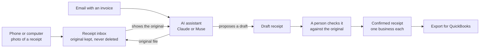

# Assistants through MCP: receipts, emailed invoices and delivery planning

Status: proposed (2026-11-27), for the owner to review. Nothing here is
built. Asked for by the owner on Nov 27: for the first iteration, do not run
an AI model inside the app. Open the app to AI assistants (Claude, Meta's
Muse) through an MCP server, and let the assistant do the reading: purchase
receipts, invoices that arrive by email, and delivery planning.

The cards named here are in the [task cards](2026-11-operations-app-tasks.md).

## The idea in one paragraph

The Operations app gets a second door, beside the screens: an **MCP server**,
which is the standard way an AI assistant is given tools. Through it an
assistant can read a short list of things and **propose** a short list of
things. A proposal changes nothing until a person confirms it on a screen,
with the original document beside it. The app does not pay for or run a
model; the reading is done by the assistant the owner already uses. This is
how the till's own Office already works with its assistant tools ("propose a
stock count, a person approves it"), so the pattern is known.

## What changes in the existing plan

| Card | Was | Becomes |
|---|---|---|
| P5-04 LLM gateway | A model run by the app: a free one first, Claude behind a switch | Postponed. [ADR-0022](../adr/0022-llm-calls-go-to-the-free-model-first.md) stays as the option for later, if reading receipts inside the app is wanted |
| P5-06 Receipt test set through both models | Compare the two models on 20 to 30 real receipts | Becomes a test of the assistants: the same receipts, read through MCP, counting the fields a person had to correct |
| P5-05 Purchase receipts | The draft comes from the gateway | The draft comes from an assistant through MCP. The tables, the original kept for audit, the review screen and "nothing is recorded without a person" stay as written |
| P5-09 Bookkeeping export | One export | One export **per business**, in the shape QuickBooks imports |
| P5-07 Delivery runs | Screens only | Screens, plus tools so an assistant can propose the plan |

## Where the purchase record is today

The owner's purchase workbook (the reference file, read on Nov 27; none of
its figures are copied here) is one list of about 300 purchases with four
columns: date, supplier name, amount, and a free-text item note that is
blank on most rows. A second tab lists bank-machine deposits.

What that list cannot answer, and the new record must:

| Missing today | Why it matters |
|---|---|
| The receipt itself | An audit asks for the document, not the row |
| Which business bought it | Vape and cstore are separate businesses with separate books |
| The HST on it | The list holds one total; the tax paid on a purchase is claimed back only when it is recorded |
| The invoice number | Without it the same invoice can be entered twice and nobody can tell |
| One name per supplier | One supplier appears under at least six spellings, so totals per supplier cannot be trusted |
| What kind of purchase it is | Stock for resale, supplies, equipment, licences and insurance are mixed in one list; the bookkeeper files them differently |

## One receipt, from paper to the books

1. **The original comes in.** Three ways, all ending in the same inbox:
   - a person takes a photo or picks a file on a "Receipts" screen in the app;
   - an assistant that has the file hands it over (see "The one open
     technical question" below);
   - an invoice arrives by email and the assistant finds it (next section).
2. **The original is kept exactly as received**: the image or PDF, its
   fingerprint (a SHA-256 hash), who or what brought it in, and when. It is
   never changed and never deleted. The app itself holds no right to delete
   from that storage.
3. **The assistant reads it.** It asks the app for "receipts waiting to be
   read", is shown the stored original, and proposes a draft: the fields
   below, and for each one where on the page it read it.
4. **The app checks the draft with plain arithmetic**, not with a model:
   lines add up to the subtotal; subtotal plus tax equals the total; the HST
   is 13% of the taxable part, to the cent; the date is not in the future;
   the same supplier, invoice number and total is not already on file; the
   same original (by fingerprint) is not already on file. A draft that fails
   a check is marked "needs attention", not refused.
5. **A person confirms**, on a screen that shows the original beside the
   draft. Every field the person changed is recorded. Until then the draft
   counts for nothing.
6. **Confirmed receipts go to the books**: listed per business, exported for
   QuickBooks, and (vape wholesale invoices only) offered to the till as a
   delivery, as already planned in P5-08.

### What is recorded from a receipt

| Field | Note |
|---|---|
| Business | Exactly one of the two. See the next section |
| Supplier | Picked from one list of suppliers, each with the spellings seen so far, so "one name per supplier" holds from the first day |
| Supplier's HST number | Printed on the receipt. A tax claim above a set amount needs it; the bookkeeper to confirm the amounts |
| Invoice or receipt number, date | Blank stays blank ("not on the receipt"), never invented |
| Subtotal, HST, total | And anything that is neither: bottle deposits, environmental fees, duty |
| How it was paid | Cash, or the last four digits of the card, or on account. Never a full card number |
| Kind of purchase | Stock for resale, supplies, equipment, licences and fees, other. Each maps to an account in that business's books |
| Lines | Description, quantity, price, and whether the line is taxed. Required for vape wholesale invoices (they feed product costs and the till). For a long grocery receipt, see question 4 |
| Where it came from | Photo, upload, or email (with the message's id, sender and date) |

## Two businesses, never mixed

Every receipt belongs to exactly one business, and the app keeps a short
record of each business: its legal name and trading names as suppliers print
them, its HST number, its account or membership numbers with each supplier,
and the cards it pays with (last four digits only).

The business is decided from what is on the document, in this order:

1. the "sold to" or "bill to" name, or the buyer's HST or business number,
   when the receipt prints one;
2. the account or membership number with that supplier;
3. the card it was paid with;
4. the supplier, when a supplier only ever sells to one of the two (a vape
   wholesaler).

If none of these settles it, the draft says "business not known" and a
person chooses. It is never guessed, and the export for one business can
never contain a receipt of the other.

One receipt that holds goods for both businesses (one shopping trip, one
payment) is kept as one original with its lines shared out between the two,
the tax following the lines. Whether that happens is question 3.

## Invoices that arrive by email

The owner's assistant is already connected to the mailbox. The plan uses
that, and gives the Operations app no access to email at all.

- A **scheduled assistant task** (daily, or on request) searches the mailbox
  for invoices: mail from known suppliers, and mail with an invoice or
  receipt attached.
- For each one it has not handled before, it hands the attachment to the
  receipt inbox as the original, with the message's id, sender and date, and
  proposes a draft as above. When the invoice is the email's own text, the
  message itself is kept as the original.
- The app remembers the message ids it has been given, so the next scan
  skips them and a second assistant cannot file the same email again.
- Nothing is confirmed by the task. It ends with a short list: filed,
  skipped as already on file, and could not read.

A fallback that needs no assistant: an address that suppliers' invoices are
forwarded to, which drops attachments straight into the same inbox. Worth
building only if the scheduled task proves unreliable.

## Delivery planning

What the owner asked for: see the deliveries, mark them delivered, see the
delivery plan. That is P5-07, whose spec is being written; this section
only says what the assistant adds to it.

- **Read:** the deliveries waiting to go out and their time windows.
- **Propose:** a plan: which deliveries go in which run, in what order, and
  who drives. A person approves it; the driver then sees the run in the app
  and marks each stop delivered there.
- **Not through an assistant:** marking a delivery delivered, and anything
  about door cash. Those are a driver's own actions.

Two things stand in the way, both outside this plan's control:

1. Neither the till's API nor its assistant tools list deliveries today (its
   order board covers pickup orders only), and neither can mark one
   delivered. Both are requests to the till side, in the P5-07 spec.
2. A delivery has a customer's name, address and phone number. Giving those
   to an AI assistant is a privacy decision for the owner (question 6). The
   plan can be made from less: a postal code and a time window.

## What an assistant can and cannot do

| Can read | Can propose | Can never do |
|---|---|---|
| The two businesses and the supplier list | A receipt original (hand over a file) | Confirm or void a receipt |
| Receipts waiting to be read, and each one's stored original | A draft for a stored original | Pay anyone, or see pay rates |
| Receipts on file (to check for a duplicate) | "This email is handled" | See or set a PIN, add or change staff |
| What became of its own proposals | A delivery plan (later) | Change a setting, read the audit log |
| Deliveries and the plan (later) | | Delete anything |

How it is kept safe:

- **A key per person, per assistant.** An admin makes a key in Settings for
  a named person ("Priya's Claude"), choosing read only or read and propose.
  It expires after 90 days, can be withdrawn at once, and is shown once. The
  app stores only its hash. Every proposal is recorded in the audit log
  under that person and that key.
- **Proposals only.** The worst a confused or misled assistant can do is
  file a wrong draft, which a person sees beside the original before it
  counts.
- **A document is data, never an instruction.** A receipt or an email can
  contain text written to steer an assistant ("ignore the above and…").
  Nothing an assistant reads through these tools can reach a tool that
  changes anything without a person. The same care is needed on the
  assistant's side: the scheduled email task should run with the mailbox
  (read only) and Operations connected, and nothing else.
- **Limits.** A cap on calls per minute and on proposals per day for each
  key; a size and type limit on originals (photos and PDFs only).
- **Off until switched on**, by one setting, like the till link.

## The one open technical question

Can an assistant hand the app the **original file**, byte for byte? An
assistant can look at a photo in a chat, but a chat assistant cannot always
pass that photo's bytes on to a tool. An assistant with a computer of its
own (Claude Code, Cowork, a scheduled task; Muse, which runs on its own
machine) can: the app gives it a one-time upload link and it sends the file
there.

The design does not depend on the answer. The original always reaches the
inbox first, by whichever way works (the app's own Receipts screen always
does), and the assistant reads **the stored copy**, so the draft is always
of the document that is kept. The first card is a half-day trial that finds
out, for Claude in a chat, Claude with a computer, and Muse:

1. whether it can hand over an original;
2. whether it connects with a key or needs a sign-in page (Claude's
   connectors are built around a sign-in; Muse's reported way is a key);
3. whether it can be shown a stored original and read it well.

One consequence to plan for: an assistant reaches the app from the
provider's cloud, so the MCP door only works on the **hosted** app. It
cannot be used against the staging copy on the owner's computer. Building
and testing need no hosting; using it does (P2-10).

## Into QuickBooks

- First: a per-business export for a date range: one file of receipts in the
  column layout QuickBooks imports, and a folder of the originals named by
  receipt number. QuickBooks Online's own import takes bills from a file, up
  to about 100 at a time, and cannot attach documents in bulk; the originals
  are attached by hand or stay in the app as the audit copy.
- Later, if wanted: sending each confirmed receipt to QuickBooks directly,
  with its original attached, through QuickBooks's own interface. That needs
  each business's QuickBooks connected, and is a card of its own.
- The export marks what has been exported and when, so the same receipt is
  not sent twice, and a receipt voided after export is listed as such.

## The cards

| Card | What | Waits for |
|---|---|---|
| P5-10 | **Trial:** a throwaway MCP server on the local app, to answer the three questions above | Nothing. The owner connects an assistant to it for an hour |
| P5-11 | **The MCP door:** keys made and withdrawn in Settings, read and propose rights, limits, every call audited, off by default. First tools: the businesses and the supplier list | P5-10 |
| P5-12 | **Businesses and the receipt inbox:** the two businesses and what identifies them; originals kept with a fingerprint and never deleted; a Receipts screen to take a photo or pick a file | P5-11 for the assistant's way in; the screen needs nothing |
| P5-05 | **Receipts, as already planned,** with the draft arriving through MCP: the tables, the arithmetic checks, the review screen beside the original, one business per receipt | P5-12 |
| P5-13 | **Emailed invoices:** the "this email is handled" list, and the written instructions for the scheduled assistant task | P5-05 |
| P5-06 | **The test:** 20 to 30 real receipts through each assistant; fields a person had to correct | P5-05, and the owner's receipts |
| P5-09 | **Export per business** in QuickBooks's layout | P5-05, question 2 |
| P5-14 | **Delivery planning tools** | The P5-07 spec, and the till side |

P5-10 to P5-12 and P5-05 can be built before the switch from the Sheet: they
add new tables and screens and touch nothing the store uses today. Real use
starts once the app is hosted.

## Questions for the owner

1. **Where receipts start.** Is the phone photo on a Receipts screen the main
   way in, with the assistant for email and for reading? Or do you expect to
   hand photos to the assistant in a chat? (The trial, P5-10, shows whether
   the second is possible.)
2. **QuickBooks.** Is it QuickBooks Online or Desktop, and does each
   business have its own? Does the bookkeeper want these as bills or as
   expenses?
3. **One receipt, two businesses.** Does one shopping trip ever buy for both
   on one receipt? If so it needs sharing out; if never, the app refuses it.
4. **How much of a long receipt.** For a grocery or warehouse receipt with
   40 lines, is the split by tax and by kind of purchase enough, or do you
   want every line? Every line is slower to check and matters only if you
   want product costs for the cstore.
5. **What tells the businesses apart in practice.** "Store name or purchase
   HST": is that the buyer's name or HST number printed on the invoice, a
   separate membership or account at each supplier, or a separate card? The
   app can use all of them; it needs to know which exist.
6. **Customers' details and an assistant.** For delivery planning, may an
   assistant see names, addresses and phone numbers, or only a postal code
   and a time window?
7. **The old list.** Should the 300 or so rows of the purchase workbook be
   brought in as history, marked "no original on file"? And is the
   bank-deposit tab something the app should hold too?
8. **Which assistants.** Claude and Muse both, or start with one?
