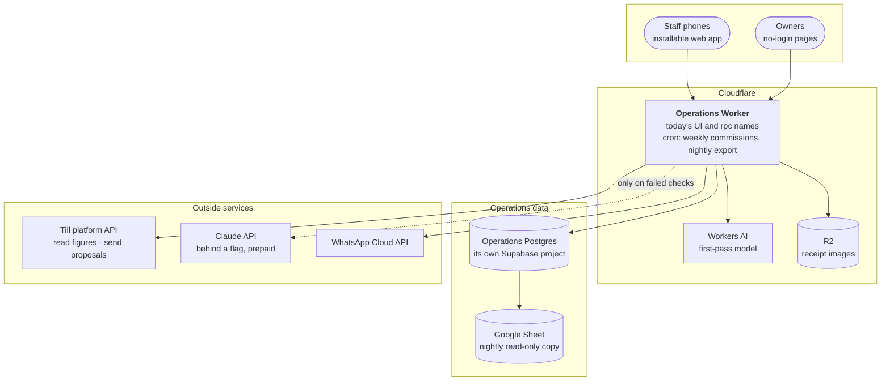
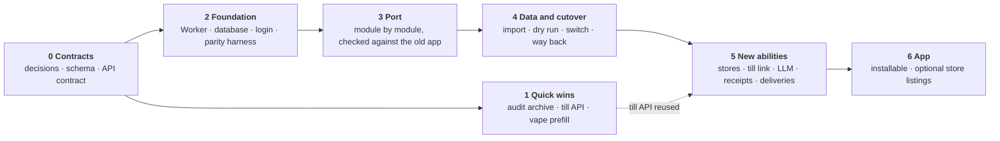
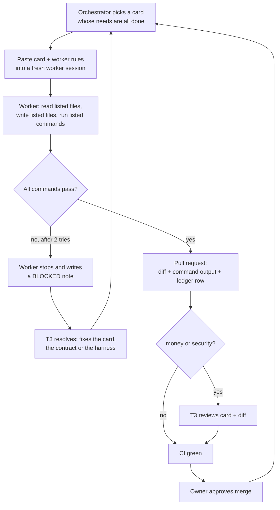

# Plan — StoreOps becomes the Operations app, off Sheets

> **Status: draft for owner review.** Nothing here is built. The decisions in
> section 3 carry a proposed default each; change any of them and the task
> cards that depend on it are listed beside it. The work itself is split into
> small cards in [the task file](2026-11-operations-app-tasks.md), written so
> that a small, cheap model can do most of them and a stronger model only
> plans, reviews the money paths and unblocks.

## 1. Why

- **Sheets is the bottleneck.** Every request re-reads whole tabs, the audit
  log grows by about 1,200 rows a month, and Apps Script adds a cold start and
  a 6-minute limit. It gets slower with every month of trading.
- **Staff type what the till already knows.** The vape till platform records
  each shift's float, cash sales, counted cash, variance and card split. The
  vape close in StoreOps asks the cashier for the same figures again.
- **New work needs things Apps Script can't do well:** an installable phone
  app, photo upload for purchase receipts, delivery runs, and LLM calls with
  a spending cap.
- **Operations must stay separate from the till.** The till carries audit and
  tax duties. Payroll, attendance, cash handovers and internal planning are
  internal, and must not live in or write to the till's database.

## 2. Target



What stays the same on purpose:

- **The names, parameters and role rules of the 41 `rpc*` that migrate**
  (of 62; the rest belong to the deprecated areas below). The UI keeps calling
  them; only the transport and the storage underneath change. This is what
  makes the port checkable: old and new must return the same answer.
- **Every rule in the ADRs.** Blank is not zero becomes `NULL` is not zero.
  Append-only audit, void-never-delete, proposed-then-approved, public pages
  with inlined data, and the WhatsApp template shapes all carry over.
- **The UI.** `Index.html` moves as it is. It already talks to the server only
  through `call()` and `cachedCall()`.

What changes:

| Today | After |
|---|---|
| Google Sheet tabs | Postgres tables, one per tab, same column names |
| `Setup.gs` and menu migrations | Numbered SQL migration files |
| Sessions in script properties | `sessions` and `login_failures` tables |
| Secrets in the `config` tab | Worker secrets; `config` keeps only non-secret settings |
| No locking on payments and handovers | One database transaction with a row lock per allocation |
| Monday trigger installed by hand | Cloudflare cron trigger |
| Vape close typed by the cashier | Figures fetched from the till API, confirmed by the cashier |
| `cstore` / `vape` per person | Person assigned to stores; every record carries a store |

### Not migrated: deprecated areas

The owner marked these as deprecated (Nov 21). They are not ported, not
imported, and have no tables in the new schema. Their data stays readable in
the archived Sheet. No module that does migrate depends on them; only
`WebApp.gs` and `Setup.gs` refer to them.

| Area | Tabs | Modules | RPCs | Suites not ported |
|---|---|---|---:|---|
| Product master, with every per-type detail (beer, cigarettes, vapes, other) | `product_master`, `product_beer_detail`, `product_cigarettes_detail`, `product_vape_detail`, the four `_pm_*_staging` tabs | `ProductMaster.gs`, `ProductTypes.gs` | 11 | `import-perf`, `ui-products` |
| Suppliers | `suppliers` | `Suppliers.gs` | 1 | |
| Order catalogue | `order_catalog` | `OrderCatalog.gs` | 2 | |
| Shopping list | `shopping_list` | `ShoppingList.gs` | 7 | `shopping-gate`, `ui-picker` |
| Never implemented | `pos_extracted`, `clover_batches` | | 0 | |

Also left behind: the `shopping_list` WhatsApp message and its config key
`whatsapp_template_shopping_list`, and the Shopping List, Suppliers and
Product Master entries in the drawer.

Product costs and suppliers don't go away; they get a new design instead of
a port (owner, Nov 21). Purchase receipts (P5-05) create them in the `ops`
schema, which is where product costs live for both stores. The vape till can
take supplier costs, so a person sends them there with a button (P5-08);
nothing is pushed automatically. The cstore till can't, so its costs stay in
Operations only. Receipts are also the bookkeeping record: the photo and its
figures are kept together for tax filing, and exported later (P5-09).

## 3. Decisions to confirm

Each has a proposed default. Cards that change if you choose differently are
named in the last column.

| # | Decision | Proposed default | Affects |
|---|---|---|---|
| D1 | Where the new code lives | An `ops/` folder in this repo. Docs, ADRs, history and the old source stay beside it for porting. | P2-01 |
| D2 | Database | **Answered (Nov 21):** Postgres in **its own Supabase project**: the one the till's staging uses today, freed when the owner moves the till's staging to a local database. Building happens on a local Postgres; the Supabase project is Operations' staging until the switch and its production from then on. Tables sit in schema `ops`, reached through an `ops_app` role, and the schema isn't exposed through Supabase's public API. See "Answers" below. | P0-03, P2-02, P2-10, P4-05, P4-06 |
| D3 | How the Worker reaches it | Plain SQL through Supabase's connection pooler, via Cloudflare Hyperdrive. Locally, a Postgres container from Docker Compose with the same version, roles and migrations, and the same image as a service container in CI; see [the local database spec](2026-11-ops-local-database.md). | P2-01, P2-02, P2-03, P2-10 |
| D4 | Company and store | `cstore` and `vape` stay as companies. A store is a location; there is one today. A till belongs to a company in a store. | P0-03, P5-01 |
| D5 | Login | Name and 4-digit PIN with lockout, as today, at launch. A stronger second step for admin and payroll roles in phase 5. | P2-06, P5-02 |
| D6 | Where PINs are checked | **Answered (Nov 21):** always by Operations, with its own PINs. The till offers no PIN check: its PINs are checked on the till PC so it works offline, and an internet-facing check of a short PIN could be guessed through. | P2-06, P5-02 |
| D7 | cstore ePOS | **Answered:** no integration; the cstore close stays manual. One-off exports are possible, so P4-03 may use one to cross-check past cstore card totals during the dry run. | P3-05, P4-03 |
| D8 | Which Claude model handles escalations | The smallest current model, with the model name as a setting. Changing it is a config edit. | P5-04 |
| D9 | Quick wins on the current app | Do the audit-log archive now. Do the vape prefill on the current app only if the till API is ready before phase 3 ends. | P1-01, P1-03 |
| D10 | Owner's view of the data | A nightly read-only export to a Google Sheet. | P4-06 |
| D11 | Cutover | One switch on a quiet morning, after a full dry run, with the Sheet app kept read-only for 30 days as the way back. | P4-04, P4-05 |
| D12 | Who orchestrates | A strong-model session hands out cards and reviews. The owner approves every merge to `main` and every production step. | section 5 |

### Answers (Nov 21)

1. **Hosting moves from Netlify to Cloudflare; the database stays on
   Supabase.** The till's database needs no migration: Workers reach
   Supabase through its connection pooler, via Hyperdrive or Supabase's own
   client library. What does need care in that move: secrets and environment
   variables, Netlify functions rewritten for the Workers runtime, and using
   the pooler rather than direct connections.
2. **cstore ePOS:** no daily export, and its API is paid, so no integration.
   One-off exports can be done (see D7).
3. **The owner builds the till-side API**, from
   [the till API request](2026-11-till-api-for-operations.md), and shares the
   resulting contract back.
4. **Where Operations' database runs.** The owner moves the till's staging
   database to a local one, which frees a Supabase project on the free plan.
   Operations gets that project. Building starts on a local Postgres and is
   flipped to the Supabase project once built. With the till's staging local,
   Operations' tests and local runs use a fake till built from the contract,
   never a till database. Retrieval checks call the till's staging API,
   on Netlify for now and the till team's Docker setup later; only the
   `TILL_API_BASE_URL` setting changes (P1-04).
5. **The till API contract is agreed** and saved as
   `ops/contracts/till-api.v1.yaml`. What changed from the request (no PIN
   check, one `receipt` proposal kind, a `delivery` channel, door cash in
   the drawer) and the review are in
   [what was agreed](2026-11-till-api-agreed.md).

**How D2 got here.** The plan first proposed Operations' own database. The
free plan allows two active projects, both used by the till, so the next
proposal was an `ops` schema inside the till's projects. Cloudflare D1 was
weighed and set aside: it can't run a transaction that reads and then
writes, which handovers and payments rely on. The owner then freed a project
by moving the till's staging to a local database, so Operations gets real
separation: its own capacity and maintenance, and no route to the till's
tables at all.

**What the free plan doesn't give**, and what covers it:

| Gap | Cover |
|---|---|
| No automatic backups | The nightly job also writes every table to R2, kept 90 days (P4-06), beside the read-only Sheet |
| A project idle for about a week is paused | Production is used daily. Before the switch, a weekly cron request keeps the staging project awake |
| 500 MB database | The Sheet's whole history is a small fraction of that; the audit-log archive (P1-01) keeps it so |
| One project for Operations | Until the switch it is staging. After it, staging is a second schema, `ops_staging`, with its own role and fictional data only (P4-05) |

## 4. Phases



| Phase | Ends when | Ships to staff? | Cards |
|---|---|---|---:|
| 0 Contracts | The schema, the till API contract and the RPC list are files in the repo, and the remaining decisions are answered | No | 4 |
| 1 Quick wins | The audit log is archived; the till API answers for one real shift | Yes, on the current app | 4 |
| 2 Foundation | An empty Operations app runs on a staging URL: login works, one RPC answers, the parity harness runs | No | 10 |
| 3 Port | Every migrated RPC returns the same answer as the old app over the same data, and the UI suites pass | No | 9 |
| 4 Data and cutover | Production data is imported, totals match the Sheet, staff use the new URL | **Yes: the switch** | 7 |
| 5 New abilities | Store assignment, the till link, the LLM gateway, receipts and deliveries each ship on their own | Yes, one at a time | 9 |
| 6 App | The app installs to a home screen | Yes | 2 |

Phase 1 is independent of phases 2–4 and can run alongside them. Inside
phase 3, cards that don't share files can run in parallel.

I haven't put dates on this. Phase 3 is the bulk: about 9,500 lines of
server code to port, in 9 cards. A fair first measure is how long the first
three cards of phase 3 take; the rest are the same shape.

## 5. How the work is run

The aim is that a card can be done correctly by a small model that has read
nothing but the card. That only works if the hard thinking is done before the
card is handed out, and if "correct" is something a command decides.

### Three roles

| Role | Who | Does | Reads |
|---|---|---|---|
| **Orchestrator** | A strong model, with the owner approving | Picks the next card, pastes it to a worker, reviews the result, updates the ledger, resolves anything blocked | This plan, the task file, the diff |
| **Worker** | A small or mid model, one fresh session per card | Exactly one card, on one branch, as one pull request | Only the card, the worker rules, and the files the card lists |
| **Checker** | CI, not a model | Runs the tests, the parity comparison and the docs guard | Nothing: it runs commands |

### Three tiers of card

| Tier | Kind of work | Model |
|---|---|---|
| **T1** | Mechanical, with one right answer: SQL tables from the schema reference, simple read and write functions, porting pure functions, moving tests | Small |
| **T2** | A module with rules in it, where the old code and its tests say what right means | Mid |
| **T3** | Contracts, anything with no oracle yet, the cutover, security review, and any card a worker marked blocked | Large |

A card marked **money** or **security** gets a T3 review of its diff whatever
tier wrote it. Review reads the card and the diff, not the whole codebase.

### Why this keeps token use low

- **The worker never reads the plan.** The orchestrator pastes one card and
  the worker rules, about 60 lines together.
- **Each card names the exact files to read.** For `Index.html` it names the
  functions, and the worker searches for them. Nobody reads 6,000 lines.
- **Lookups go to generated references**, which are exact and short:
  [code-map.md](../reference/code-map.md) for modules and RPCs,
  [schema.md](../reference/schema.md) for columns.
- **Correctness is a command, not a conversation.** A card is done when its
  commands pass, so there is no long review loop.
- **Pull requests stay small**, about 400 changed lines at most. A card that
  would exceed that gets split by the orchestrator before it is handed out.
- **Strong-model time goes only where judgment is needed:** phase 0, the
  parity harness, reviews of flagged cards, and the cutover.

### The oracle: old and new must agree

The repo can already run the whole current server in Node over an in-memory
spreadsheet, with 120 days of fictional data (`scripts/docs/runtime.js` and
`scripts/docs/fixtures.js`). Card P2-09 turns that into a comparison:

1. Freeze the clock. Seed the old runtime with the fixture.
2. Copy the same rows into the new database.
3. Call the same RPC with the same arguments on both.
4. The answers must be equal, apart from generated IDs and timestamps.

Every phase 3 card ends with "parity passes for these RPCs". That is what
lets a small model port a module and know it is right.

Parity is not enough alone for writes, so write RPCs are also checked by the
ported unit tests, and by comparing the rows each side wrote.

### The card loop



### Worker rules

These are pasted with every card. They are the whole contract.

```text
1. Do exactly one card. Read only the files it lists. If you need another
   file, read it, and name it in your report.
2. Write only the files under "Make". Never edit src/ (the live app),
   ops/contracts/, or another card's files unless the card says so.
3. Do not change a contract: RPC names, parameters, return shapes, table or
   column names, roles. If the card can't be done without changing one,
   stop and report BLOCKED.
4. Port behaviour, don't improve it. If the old code looks wrong, keep the
   behaviour and note it in your report. Parity decides.
5. Money is numeric with 2 decimals, rounded at every write. An absent
   figure is NULL, never 0. Dates are stored as real dates; the business
   day is America/Toronto.
6. Write the test first and see it fail. Then make it pass.
7. Run every command under "Done when" and paste the last lines of output.
8. If a command still fails after two honest attempts, stop. Report
   BLOCKED with: the command, the output, what you tried, your best guess.
   Do not weaken a test, skip a check, or guess a contract.
9. Use fictional people only in tests and fixtures. No real names, pay,
   takings or phone numbers.
10. Finish with: files changed, commands and results, anything surprising,
    and the ledger row set to "review".
```

### The ledger

The table at the top of the [task file](2026-11-operations-app-tasks.md) is
the single record of state: `todo`, `doing`, `review`, `done` or `blocked`.
A card's pull request updates its own row. Two cards may run at the same time
when all their needs are `done` and their "Make" lists don't overlap.

### Stop rules for the orchestrator

- No card starts while a card it needs is not `done`.
- No merge to `main` without the owner. Merging to `main` deploys the current
  production app, so card P2-01 first limits that deploy to changes under
  `src/`.
- Nothing touches production data before phase 4, and phase 4 runs on a copy
  first.
- Three blocked cards in a row means the contract or the harness is wrong.
  Stop handing out cards and fix that.

## 6. Data migration and the switch

1. **Export** every tab of the production Sheet to files (card P4-01),
   deprecated ones included, so the archive is complete.
2. **Import** into an empty staging database, skipping the deprecated tabs.
   Blank cells become `NULL`.
   Every row that can't be imported goes to a rejects file with its reason;
   nothing is dropped silently (P4-02).
3. **Reconcile**: per table and per month, compare row counts and money
   totals between the Sheet and the database (P4-03). The switch does not
   happen until every line matches or has a written explanation.
4. **Dry run** the whole thing on a copy, then have two people use the
   staging app for a normal day beside the real one (P4-04).
5. **Switch** on a quiet morning: put the old app in read-only, run the
   import, run the reconcile, point staff at the new URL (P4-05).
6. **Way back** for 30 days: the Sheet app stays, read-only. Going back means
   re-entering the days since the switch, so the decision to go back is made
   within the first two trading days or not at all.
7. **After**: a nightly export keeps a Sheet the owner can open (P4-06). The
   Apps Script deploy is retired (P4-07).

## 7. Risks

| Risk | What limits it |
|---|---|
| A ported rule behaves differently | Parity against the old runtime on every migrated RPC; ported unit tests; T3 review of money cards |
| The fixture doesn't cover a real-world case | The dry run reconciles real production data, month by month |
| A small model guesses instead of stopping | Worker rule 8; contracts are files it may not edit; CI is the judge |
| Two people pay the same shift at once | Fixed by design in the new app: one transaction with a row lock (P3-09, P3-06) |
| The till API isn't ready | Phases 2–4 don't need it. The vape close stays manual until phase 5 |
| A leaked LLM key runs up a bill | Starts in free-model-only mode with no key installed; prepaid balance with auto-reload off; daily escalation cap (P5-04) |
| Operations is down at close time | The close keeps a manual-entry path; a failed message or till lookup never blocks a close |
| Cost creeps on the new hosting | Each phase 2 and 5 card that adds a paid service names it in its report |

## 8. What this plan does not cover

- The till platform's own move to Cloudflare.
- The work inside the till's repository for its API, beyond the contract.
- A delivery feature design. Card P5-07 starts with writing that spec.
- Store listings for a native app. Card P6-02 is a decision, not a build.

## 9. Related decisions

Proposed, pending this review:

- [ADR-0020](../adr/0020-operations-moves-off-sheets.md): Operations moves to
  its own app and database. Would supersede ADR-0001.
- [ADR-0021](../adr/0021-till-figures-come-through-an-api.md): till figures
  come through an API, and Operations keeps its own snapshot.
- [ADR-0022](../adr/0022-llm-calls-go-to-the-free-model-first.md): LLM calls
  go to the free model first, with Claude behind a flag.
